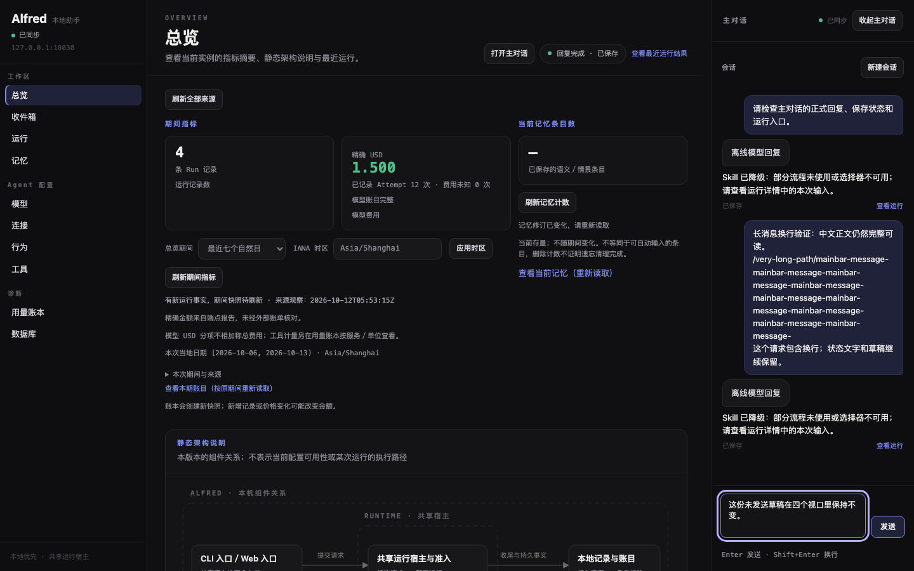
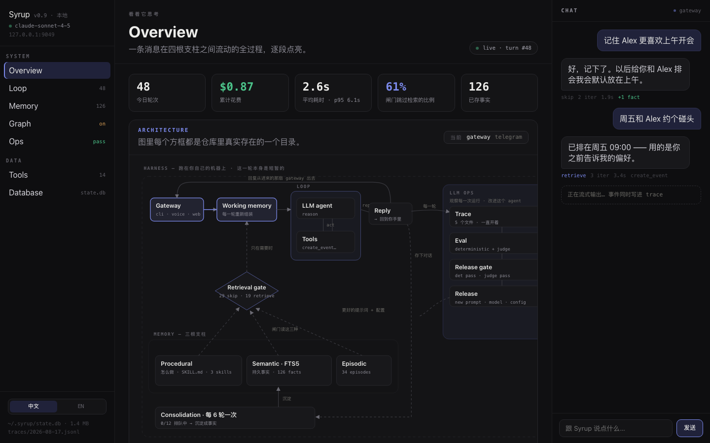
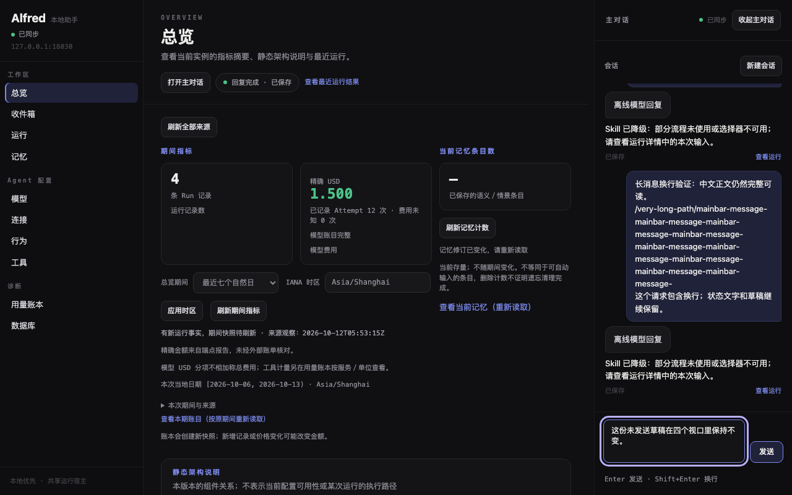
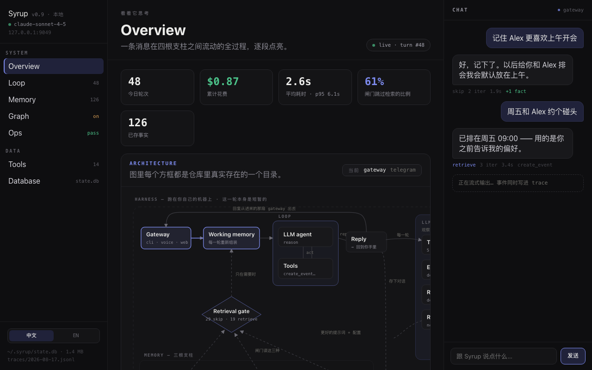
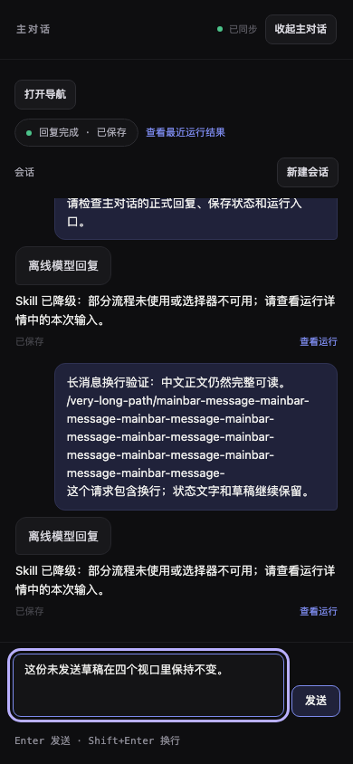
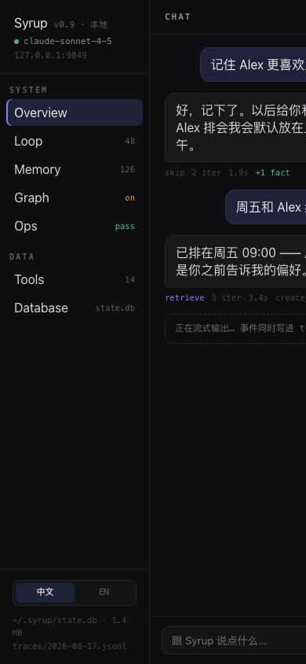
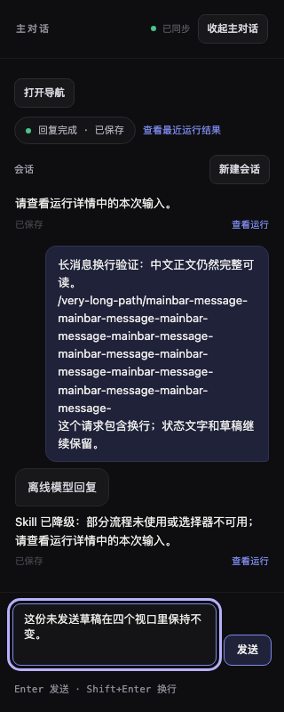
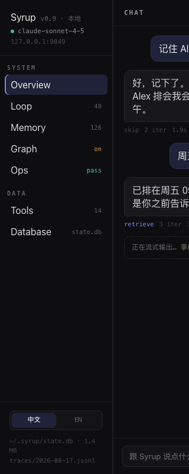

# V03 MainBar 气泡与输入区视觉验收

**2026-10-23 更新**：已在 `e982bfa` 基线上完成九项本地门禁和本地 code-review；本轮结果见[复验与评审](#2026-10-23-复验与评审)。下文保留初次实现和首次范围核对的历史记录。远端 CI 以 PR #147 最新 head 的检查为准。

对应 [#125](https://github.com/nineofoursyrup/Agent-Alfred/issues/125)，父规格为 [#122](https://github.com/nineofoursyrup/Agent-Alfred/issues/122)，复用 [RECIPES.md](../../design/issue-122/RECIPES.md) 的 `DASHBOARD-CLAUDE-DESIGN-RECIPES-v1`。工作区 `/Users/nineofour/Agent-Alfred-v03`，分支 `dashboard-visual/v03-mainbar`，初始基线 `449e77fd0ff814fb63f97a009c2435139a68686d`，产品候选 `dc7ff2d969c0d75973cab6ac2841f7d2428b896f`，最终实现／测试候选 `c4226390b9f40b78eac46264db01818490232df5`。证据归档后的交付包含相同产品／测试字节；身份核对见 [source-audit.json](evidence/V03/source-audit.json)。

MainBar 顶栏现在是等宽「主对话」、当前观测状态点与文字。用户请求靠右、88% 上限、选中底和用户气泡边、12/12/4/12 圆角；助手回复靠左、92% 上限、抬升底和卡片边、12/12/12/4 圆角。正文为 13px，用户行高 1.55、助手 1.6，保留换行和长路径。现有保存／结局状态以等宽元数据呈现，绑定实际 Run 身份的入口放在同一行；暂态过程输出用虚线框。输入区加上边线，仍使用支持多行的原有 textarea。

## 文件与契约

| 文件 | 本票范围 |
| --- | --- |
| `src/agent_alfred/ops/static/index.html` | 只在 `#mainbar` 子树增加状态点／阶段文字，并给原有「消息」标签加 `sr-only`。 |
| `src/agent_alfred/ops/static/app.js` | MainBar 气泡类名、流式类名、元数据旁 Run 链接，以及复用 V02 `dotClass` 更新 MainBar 状态点；HTTP/SSE、会话、草稿、定位、阅读和恢复逻辑不改。 |
| `src/agent_alfred/ops/static/app.css` | 只改 MainBar 区域的局部规则和既有窄屏 MainBar padding 的 token 表达。所有新增选择器以 `#mainbar` 开头；颜色和尺寸由现有 token 推导，不定义 `:root` 或公共 `sy-` 类。 |
| `tests/browser/shell.spec.js` | 只在 V02 状态点用例增加 MainBar 的连接、当前 Run、断连、恢复、无当前 Run 和 reducedMotion 断言。其他用例及既有断言逐字保留。 |
| `tests/browser/routing.spec.js` | 仅将原段落／状态的读取定位为 `#messages p, #messages small` 的完整原文，仍用原 `toBe` 精确比较；不把新增 Run 导航文字或 CSS 换行计入旧版业务文字基线。 |
| `tests/browser/skills.spec.js` | 仅把原 Run href 前缀定位器加上 `#page`，明确选择中央运行列表，避免与新 MainBar 入口重复匹配。原选择器其余部分和全部后续断言不变。 |

所有现有 id、role、landmark／region 可访问名称、h2 层级、按钮名称与 `#messages > article > p/small` 层级保留。Run 身份仍由外层 `article[data-run-id]` 承载，没有拆成重复记录；正式回复、精确定位 `.located`、未完整正文和重试、预览提示、聚合资料、Skill 提示、结局及保存状态仍分别呈现。新增「查看运行」链接只使用已经持有的字符串 Run ID 和现有 `/runs/<encoded-id>` 路由，不读取新数据；没有 Run ID 的历史消息不补造身份或入口。`dashboard` 导出及其现有方法，以及被其他模块使用的接口名称、签名和行为不变。

连接、当前运行、会话、存储警告、阅读状态、重新定位、回到最新、更早消息、错误和发送不可用原因均保留。`:root` token、公共 `sy-` 配方、`RECIPES.md`、`.gitattributes`、`shell.js`、其他页面、静态资源清单没有差异；`app.css` 的延迟回执滚动保护逐字相同。主 checkout 初始有 `docs/dashboard.md`、`README.md`、`tmp/` 未提交内容，没有修改或暂存这些内容。新 worktree 初始干净，详见 source audit。

本地使用 `code-review` 进行 Standards／Spec 聚焦核对：Standards 0 项、Spec 0 项；这是本地评审，不声称完成独立评审。`mainbar*.spec.js`、send-flow、streaming、busy、session-create-race、accessibility 均没有改动。完整套件发现的两处必要定位器变化在上表逐条列出；没有删除或放宽任何断言，没有增加重试或延长超时。第一次本地核对未发现这两处适配缺口，完整套件与原样复测保留后才修正，详见首次失败。初次相关批次为 **64 passed / 0 failed，50.7s**；[原始日志](evidence/V03/gates/01-mainbar-browser.json) 包括 `mainbar*.spec.js`、send-flow、streaming、busy、session-create-race、accessibility 和 shell。

## 四视口与原稿并列

原稿身份为 version `1786950414092924`，HTML SHA-256 `54807adb38541fa2966e5b0c334b9d0e8d71c60b814245601bc4f35b8ec54b84`，support.js SHA-256 `8fe7df74405f3c55f49b7249c74ea1397e65d07dea2b1bd3b4a489bec2e28cbe`。实施前按 [原稿 README](../../design/issue-122/reference/README.md) 核对；两份文件未修改。Playwright 实际打开归档 HTML，先读取可访问快照，再以 `/^Overview/` 匹配选择 Overview；实际链接名为 `Overview`。React／ReactDOM 18.3.1 均从 unpkg 加载，HTTP 200。环境、请求、尺寸、计算样式和源码 SHA 见 [capture.json](evidence/V03/capture.json)。

产品截图使用真实 `tests/browser/server.py`、HTTP、SQLite 和临时状态目录，以及现有离线 BrowserModel；请求经真实 MainBar 发送并保存。没有导入原稿演示数据。Chromium、DPR 1、reducedMotion=reduce；390/320 截图均在 MainBar 面板打开后拍摄，输入保留同一份未发送草稿。完整浏览器测试使用 `ALFRED_BROWSER_TEST_PORT=18030`，辅助服务限于分配的 18030～18038；截图服务结束后才启动完整套件。

| 视口 | Alfred MainBar | 原稿 Overview 的 CHAT 侧栏 |
| --- | --- | --- |
| 1440×900 |  |  |
| 1280×800 |  |  |
| 390×844 |  |  |
| 320×800 |  |  |

| 视口 | 差异与原因 |
| --- | --- |
| 1440×900 | Alfred MainBar 为 320px；原稿外框实测 321px，来自其 content-box 加左边线。气泡颜色、边框、四角、padding 10×13px 及 88%／92% 上限一致；Alfred 还保留收起按钮、会话入口、真实 Skill 提示、保存文字与 Run 链接，所以消息区从更低的位置开始，元数据不复制原稿 iter／耗时／工具演示数字。 |
| 1280×800 | Alfred MainBar 仍为 320px，原稿仍为 321px；中央区分别为 728／726px，公共壳层的 border-box 差异不在本票改变。高度缩短时对话区局部滚动，输入框和发送原因仍在底部；长无空格路径完整换行，正文不会横向溢出。 |
| 390×844 | Alfred 打开既有互斥 MainBar 面板，宽 390px，导航及中央区隐藏；所有消息／元数据／操作仍在同一个 MainBar，草稿不变。原稿 nav 实测 191px，中央区宽度 0，CHAT 外框 293px 且右侧被裁切。保留产品既有窄屏交互是明确的可操作性取舍。 |
| 320×800 | Alfred 面板宽 320px，正文、路径、Skill 提示和元数据换行，整页、MainBar 与每个气泡的横向溢出均为 0。截图跟随最新，第一条记录的前部可滚动查看；没有删除历史。原稿中央区仍为 0px，CHAT 从 x=191 开始，右侧继续被裁切；不伪装原稿有窄屏适配。 |

### 刻意偏离

1. 原稿 CHAT 使用「阶段 + 点」且没有收起／会话／阅读等控件。Alfred 保留全部现有名称与事实；新增顶栏阶段文字只来自 V02 已有 `connected`、`unavailable`、`busySummary.stage`，不新增读取、计时器或推断。
2. 状态点复用公共 6px、1.4s `sy-pulse`，原稿 CHAT 为 5px、1.2s。复用 V02 的同一个 `dotClass`：已连接时可脉冲；断连或尚无有效观测时静止，即使保留旧 Run 摘要也不伪装活跃；无当前 Run 且已连接仍显示连接脉冲。永久测试覆盖上述情况及 reducedMotion 的 `animationName=none`。
3. 原稿气泡的 `font:400 13px/1.55 inherit`／`font:400 13px/1.6 inherit` 是无效简写，预览实测回退为 16px、normal 行高。Alfred 使用 #122 明确批准的有效系统字体 CSS：13px／1.55–1.6；没有复刻预览运行时的字体错误。
4. 输入仍为原有三行 textarea，保留 Enter／Shift+Enter、输入法合成事件、草稿、发送禁用原因和键盘焦点。原稿是单行 input；这里只复制输入底／边／9px 圆角和按钮配方。原「消息」label 视觉隐藏，`for=message` 关联与可访问名称保持，原占位符不代替标签。
5. 状态 `small` 和 Run 入口保留为 `article` 的直接子元素，用 CSS 栅格排到助手正文后；既有 Skill 提示和聚合事实继续位于原位置。精确定位边框仍包围整条 Run 记录，便于表达请求／回复属于同一身份。没有改变既有正文恢复、阅读确认或定位行为。
6. 四视口截图关闭动画以便稳定对照；脉冲是否绑定真实观测由永久状态点测试验证，截图不能单独证明动画行为。原生焦点外轮廓保持 3px，是保留的可操作性要求。

### 建议的公共配方

可由 #135 汇总「用户／助手非对称气泡 + 同一 Run 元数据行 + 暂态虚线框」配方，以及保留可访问 label 的多行输入区。现有 12／4px 气泡圆角、10×13px padding、上边线与间距均从已冻结 token 推导；本票没有增设公共 token 或重定义 `sy-` 类。

## 定位、流式和状态证据

[精确定位](evidence/V03/mainbar-located-1440x900.png) 通过真实 `/api/mainbar/locate` 返回 `applied`，`.located` 边框计算值为 `rgb(124, 138, 236)`；「已定位历史回复；相邻历史尚未读取。」保持可见。[流式提示](evidence/V03/mainbar-streaming-1440x900.png) 使用现有受控传输边界注入普通 Attempt／block 事件，计算 `borderStyle=dashed`，阶段文字为运行中；这是离线状态测试，不是实际 provider 验收。四视口默认截图使用真实已保存回复；每条请求／回复只保留一个 `article[data-run-id]`，见 capture JSON。

## 八项门禁与首次失败

所有运行先输出到 `.scratch/v03/`，全部门禁退出后才归档。JSON 保存命令、开始时间、退出码、耗时、前后 HEAD／差异及六个产品／测试文件 SHA、完整 stdout/stderr 字符串和原始输出 SHA-256；可从字符串还原原始日志。没有改 `.gitattributes`、断言、重试或 timeout。

| 门禁 | 最终实现候选结果 | 原始日志 |
| --- | --- | --- |
| `uv run ruff check` | PASS；0.213s | [07-ruff.json](evidence/V03/gates/07-ruff.json) |
| `uv run python scripts/check_skills.py` | PASS；0.337s | [07-skills.json](evidence/V03/gates/07-skills.json) |
| `uv run python scripts/check_env_example.py` | PASS；6.403s | [07-env.json](evidence/V03/gates/07-env.json) |
| `uv run --extra mcp pytest` | PASS：6445 passed / 0 failed / 1 deselected；2607.861s | [09-pytest.json](evidence/V03/gates/09-pytest.json) |
| `npm run typecheck` | PASS；1.771s | [07-typecheck.json](evidence/V03/gates/07-typecheck.json) |
| `ALFRED_BROWSER_TEST_PORT=18030 npm run test:browser`（完整套件） | PASS：545 passed / 0 failed；1316.868s | [07-browser.json](evidence/V03/gates/07-browser.json) |
| `git diff --check` 与 `git diff --check origin/main...HEAD` | PASS；0.104s | [07-diff.json](evidence/V03/gates/07-diff.json) |
| `uv build && uv run python scripts/check_mcp_installations.py --output .scratch/v03/mcp-artifacts.json` | PASS：4 安装组合 / 0 failed；59.324s | [07-install.json](evidence/V03/gates/07-install.json) |

完整浏览器首轮为 **536 passed / 9 failed，1344.399s**，原始完整输出见 [04-browser.json](evidence/V03/gates/04-browser.json)。首次失败的 9 个用例目录保存在 `evidence/V03/first-browser-failure/`，只含该用例的失败 PNG、trace.zip、error-context 阅读副本及原始上下文 JSON；没有提交整个结果目录或 artifact 压缩包。完整性见 [browser-failure-manifest.json](evidence/V03/browser-failure-manifest.json)。

| 首次失败 | 实际失败与处理 |
| --- | --- |
| integrations:147，rotated secrets redaction | 15s timeout／主对话尚未出现脱敏正式回复。原样复测通过；没有改该文件或产品数据逻辑。 |
| routing-statistics:57，restart／late range | 未及时出现 24h 范围文字。原样复测通过；没有改该文件或页面。 |
| routing-statistics:263，legacy／bad-data | 15s timeout。补充原用例单独复测 **1 passed，13.2s**，见 [05-legacy-counts-original.json](evidence/V03/gates/05-legacy-counts-original.json)。 |
| routing:88，failed recording／no reply | 未及时出现「已结束 · 按要求未回复」。原样复测通过，全部原断言保留。 |
| routing:185，pre-routing baseline | 新气泡保留换行、新 Run 入口加「查看运行」，使整段 `innerText` 与旧版不同；原样复测再次失败。仅将读取限定为原请求／回复 `p` 和状态 `small` 的完整原文，原 `expect(texts[1]).toBe(texts[0])` 精确相等断言保留。 |
| run-path:444，SIGKILL complete | 15s timeout。原样复测通过；没有改该文件或 Run 页面。 |
| run-path:475，trace too_large | 15s timeout／路径节点尚为 0，预期 9。原样复测通过；没有改断言或该文件。 |
| skills:67，late evidence／next Run | 全局 Run href 定位器同时匹配中央列表和新增 MainBar 入口，首次 trace 确认 2 个匹配。原样复测未重现，但保留首次证据；仅加 `#page` 明确原用例意图，全部后续断言保留。 |
| topology:240，keyboard at 1280px | 15s timeout，发生于第 16 个 edge 的 scrollIntoViewIfNeeded。原样复测通过；没有改该文件、页面或超时。 |

首轮失败先保留，再以原源码复测：[05-first-failures-original.json](evidence/V03/gates/05-first-failures-original.json) 为 **12 passed / 1 failed，94.279s**，含被参数化行号选中的额外原用例；其中漏选的 legacy 用例随后单独执行并通过。两处定位器修正后为 **2 passed，15.8s**，见 [06-locators.json](evidence/V03/gates/06-locators.json)。七个其他首轮失败均已通过原样复测；这些孤立 PASS 不替代最终完整套件。MainBar 相关初次 64 用例全部通过；#125 指明的 `A未提交草稿`／locate 409 两种偶发值没有重现。

首轮 Python 全量在已发现浏览器候选需修正后主动中断，**917 passed / 1 deselected，exit 2（KeyboardInterrupt）**，见 [04-pytest.json](evidence/V03/gates/04-pytest.json)。它是未完成的检查，不记为 PASS。修正候选上重新执行完整 Python 门禁；期间不改 HEAD、源码或 tracked diff，也不把日志／图片写入交付目录。

随后首次完整 Python 结果为 **6444 passed / 1 failed / 1 deselected，3324.519s**，见 [07-pytest.json](evidence/V03/gates/07-pytest.json)。失败为未改动的 `test_database_lifecycle.py::test_real_forgetting_waits_for_worker_cleanup[protect]`，原 `thread.join(2)` 后线程仍活着（第 191 行）。在同一候选上原用例原样复测 **1 passed，8.67s**，见 [08-pytest-original.json](evidence/V03/gates/08-pytest-original.json)；没有更改该测试、数据库实现、断言或超时。单例通过不替代完整门禁，随后以完全相同的命令与候选重新执行全量，最终结果见门禁表的 [09-pytest.json](evidence/V03/gates/09-pytest.json)。首次全量失败记录没有覆盖，不据此断言唯一根因是资源竞争。

视觉辅助捕获另有两次初始失败，原始输出保存在 [01-capture.json](evidence/V03/gates/01-capture.json)、[02-capture.json](evidence/V03/gates/02-capture.json)，首次测量及当时脚本在 [capture-helper-failures.json](evidence/V03/capture-helper-failures.json)。第一次把截图后留下的空 `style=""` 计成 CSS 声明，得到 Expected 0 / Received 2；最小复现确认来自截图的 caret restoration，最终记录空属性、检查实际声明。第二次独立 BrowserContext 缺 `baseURL`，复用 `controlledTransport` 的 `goto('/')` 报 invalid URL；补上分配端口的 baseURL 后捕获通过。没有为辅助脚本失败修改产品；原失败没有覆盖。正常 Session/SSE 切换的 `net::ERR_ABORTED` 单独记录；最终 pageerror／其他 requestfailed 为 0。

失败上下文原本有行尾空白。原始 `.scratch` 文件保留，原始 UTF-8 字节与 SHA-256 另保存在每个失败目录的 `error-context.raw.json`；可完整还原。`error-context.md` 只是去除行尾空白的阅读副本，PNG 和 trace.zip 按原字节归档；没有修改 `.gitattributes` 或放宽 diff-check。

最终八项门禁的候选／源码身份见各 gate JSON。所有证据按用户要求在门禁全部结束后才归档；之后仅增加文档和证据，已测产品／测试字节相同，复用完成的确定性结果，并另执行最终 diff-check。

门禁结束后的 `git fetch origin` 执行于 `2026-10-12T08:32:08.301779+00:00`，退出 0、2.100s；`origin/main` 仍为初始基线 `449e77fd0ff814fb63f97a009c2435139a68686d`，没有前进，因此不需要 rebase 或触发其附加复验。两次远端刷新和最终原始输出见 [origin-refresh.json](evidence/V03/origin-refresh.json)、[10-fetch.json](evidence/V03/gates/10-fetch.json)。证据归档后的新增文件已执行 staged diff-check：退出 0、0.025s，见 [11-evidence-diff.json](evidence/V03/gates/11-evidence-diff.json)。证据提交之后另执行最终工作区／分支 diff-check。

## 没有执行的验收项

| 验收 | 状态与继续条件 |
| --- | --- |
| 原生桌面真实 200% 缩放 | NOT RUN；需要原生浏览器实际缩放操作与观察。viewport 变更不代替它。 |
| 原生中文输入法／组合输入 | NOT RUN；浏览器合成事件测试原样通过，但没有进行人工 IME 观察。 |
| iPhone／iOS Safari／真实软键盘 | NOT RUN；沿用 #122 范围外约定。窄视口是 Chromium 模拟。 |
| 真实 provider 流式输出和日用验收 | NOT RUN；本票证据使用离线模型／受控传输，不据此宣称真实 provider 结果。 |
| #135 十页与 MainBar 整体视觉验收 | NOT RUN；由同批集成和用户验收推进。 |

本票只推送分支并创建 PR；没有合并、开启自动合并或手动关闭 #125。

## 2026-10-23 rebase 与首次范围核对（当时 BLOCKED）

以下为首次核对时的状态。用户随后明确批准保留三个测试文件的既有差异，范围阻塞已解除；完整复验见下一节。

本节保留首次核对时的交付状态；上文 2026-10-12 的全量门禁与截图仍是历史候选证据，不能当作本次 rebase 后的门禁通过。

- 已在指定 worktree 执行 `git fetch origin && git rebase origin/main`，无冲突。基线为 `e982bfa83e72938b3e5cbaeb4f469290cc3538ad`（已合入 V11 / PR #146）；本地 rebase 后 HEAD 为 `a8bebff38c3a99e0c2bc5662a8b4b0ee66535bb8`。
- 首次核对时远端 PR #147 为 OPEN，head 为 `b6bfc71ceed00ac0da7db1559ba9e33136464436`，该旧 head 的 CI 为 SUCCESS。当时尚未推送本次 rebase，没有合并或关闭 #125。
- `git diff --check` 与 `git diff --check origin/main...HEAD` 均通过。`git range-diff` 确认本票三个提交的补丁均相同（`=`），范围差异不是本轮新加。三个产品文件及 routing／skills 测试的 SHA-256 相同；shell 测试随 rebase 引入了 main 已有的 V11 Inbox 定位器更新（`#page .card` → `#page .inbox-rows article`），不能将六份文件笼统记为字节相同。
- **当时的范围阻塞**：执行说明要求 `origin/main...HEAD` 仅含三个 MainBar 产品文件及 V03 证据，但现有 PR 还包含下表三个测试文件。它们符合 #125 的原始测试要求，却不在本次执行说明的白名单中。没有擅自删除、还原或继续修改这些既有差异。

| 既有范围外文件 | 具体用途 |
| --- | --- |
| `tests/browser/shell.spec.js` | 在原 V02 状态点用例加入 MainBar 连接、当前 Run、断连与 reducedMotion 覆盖。 |
| `tests/browser/routing.spec.js` | 精确原文比较限定为请求、回复和状态，排除新增 Run 导航文本。 |
| `tests/browser/skills.spec.js` | Run 链接定位增加 `#page`，避免匹配 MainBar 的新增入口。 |

按照执行说明的“若修复必须动冻结层或归属外文件，停下汇报”和步骤 4 的文件白名单，当时后续全量门禁、完整验收评审、提交、推送和新 CI 均为 **NOT_RUN / BLOCKED**，尚未进行新的 flaky 判定。当时需要用户裁决是否将这三个文件的**既有差异**纳入范围例外，并建议仅允许保留这些既有差异，继续维持其他文件冻结，且不放宽断言、超时或重试。

原始 diff、前后源码 SHA-256、range-diff、diff-check 结果和远端状态回读见 [scope-audit.json](evidence/V03/rebase-2026-10-23/scope-audit.json)。首次记录时，本节及该审计只写入允许的 V03 证据路径，尚未提交。

## 2026-10-23 复验与评审

用户明确允许保留 `tests/browser/routing.spec.js`、`tests/browser/shell.spec.js`、`tests/browser/skills.spec.js` 的**既有差异**作为范围例外；其他冻结约定不变，不放宽断言、超时或重试。该授权只解除上节的范围阻塞，没有扩大三个测试文件的改动。

基线为 `e982bfa83e72938b3e5cbaeb4f469290cc3538ad`，门禁与评审候选为 `a8bebff38c3a99e0c2bc5662a8b4b0ee66535bb8`。rebase 无冲突，三份原提交的 range-diff 均为 `=`；测试例外的稳定 patch-id 仍为 `1471ea13a58853477cc110593fe5527b9cc95a2d`。全部门禁结束后再次 fetch，`origin/main` 未前进。

本轮没有新增产品或测试修改。九项本地门禁均在上述候选上首次通过，日志先保存于 `.scratch/v03/pr147-20261023/`，结束后才归档。运行前后 719 个源码、测试、脚本、依赖和配置文件 SHA-256 一致；本轮提交只追加本页和 V03 证据。原始源码身份见 [candidate.json](evidence/V03/rebase-2026-10-23/candidate.json)，结果汇总见 [validation-summary.json](evidence/V03/rebase-2026-10-23/validation-summary.json)。

| 门禁 | 结果 | 耗时 | 原始输出 |
| --- | --- | --- | --- |
| `.venv/bin/ruff check --no-cache .` | PASS | 0.163s | [01-ruff.json](evidence/V03/rebase-2026-10-23/gates/01-ruff.json) |
| `.venv/bin/python -B scripts/check_skills.py` | PASS | 0.058s | [02-skills.json](evidence/V03/rebase-2026-10-23/gates/02-skills.json) |
| `.venv/bin/python -B scripts/check_env_example.py` | PASS | 2.456s | [03-env.json](evidence/V03/rebase-2026-10-23/gates/03-env.json) |
| `.venv/bin/python -B -m pytest -q` | PASS；6445 passed / 0 failed / 1 deselected / 14 warnings | 2747.337s | [05-pytest.json](evidence/V03/rebase-2026-10-23/gates/05-pytest.json) |
| `npm run typecheck` | PASS | 0.639s | [04-typecheck.json](evidence/V03/rebase-2026-10-23/gates/04-typecheck.json) |
| `ALFRED_BROWSER_TEST_PORT=18030 npm run test:browser` | PASS；545 passed / 0 failed；retries=0 | 764.761s | [07-browser.json](evidence/V03/rebase-2026-10-23/gates/07-browser.json) |
| `git diff --check` 与分支 diff-check | PASS | 0.284s | [09-diff.json](evidence/V03/rebase-2026-10-23/gates/09-diff.json)、[09-branch-diff.json](evidence/V03/rebase-2026-10-23/gates/09-branch-diff.json) |
| `uv build` | PASS；wheel + sdist | 15.314s | [06-build.json](evidence/V03/rebase-2026-10-23/gates/06-build.json) |
| `uv run python scripts/check_mcp_installations.py --output <临时目录>/mcp-artifacts.json` | PASS；wheel／sdist × base／mcp，4 组合 | 12.395s | [08-install.json](evidence/V03/rebase-2026-10-23/gates/08-install.json) |

门禁 JSON 包含命令、环境覆盖、候选、起止时间、退出码、耗时、原始输出及 SHA-256；`log_file` 为本地原始日志名，归档 JSON 的 `output` 可还原该日志。归档时已逐份核对输出字节与哈希。浏览器保持单 worker、retries=0、原超时；实际监听端口回读为 18030／18034，见 [browser-port-proof.json](evidence/V03/rebase-2026-10-23/browser-port-proof.json)，全部辅助服务仍限于 18030～18038。安装核验的四种结果见 [mcp-artifacts.json](evidence/V03/rebase-2026-10-23/mcp-artifacts.json)。

**本轮 flaky：无。** 完整 Python 和浏览器均为一次通过，没有失败后重跑；`A未提交草稿` 未复现。上文 2026-10-12 的首次失败、原样复测和辅助脚本失败记录原样保留，不能把它们算成本轮失败或抹去。浏览器套件自行生成的四张 Behaviour／Aggregation 截图已保存在忽略的运行目录，不加入本票证据或静态资源；没有提交整包 Playwright artifact。

**本地 code-review：通过。** [review.md](evidence/V03/rebase-2026-10-23/review.md) 分别记录 Standards 与 Spec：各 0 项发现，无剩余阻塞。评审不是独立多代理评审。#125 对应的 MainBar 定位、阅读、聚合、空身份和跨会话草稿用例，以及 V02/MainBar 状态点、reducedMotion、CE-01 精确原文比较和 CE-23 迟到证据隔离均包含在本次 545 项全量通过中。

[冻结范围审计](evidence/V03/rebase-2026-10-23/frozen-scope.json) 确认：HTML 非 MainBar 部分、JS 非 MainBar 渲染／绑定部分、CSS 非 MainBar 部分均与基线相同；`:root`、公共 `sy-` 类、`RECIPES.md`、`shell.js` 和其他页面不变，没有增删静态资源。三个测试例外只保留既有补丁；没有需要用户进一步裁决的越界或冲突。

四视口视觉、定位和流式截图继续使用上文已归档证据，MainBar 三份产品文件与原截图候选字节相同。本轮没有重新拍摄截图，也没有将原生 200%／中文 IME／真实 provider／#135 整体验收升级为 PASS。

远端 CI 必须在 force-with-lease 推送后按最终 PR head 独立回读；旧 head `b6bfc71` 的绿灯不作为本轮 CI 结果。最新结果见 [PR #147 checks](https://github.com/nineofoursyrup/Agent-Alfred/pull/147/checks)。本轮授权止于提交、推送和 CI 验证，不合并、不关闭 #125。
