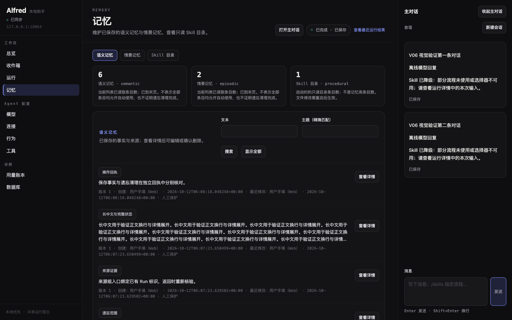
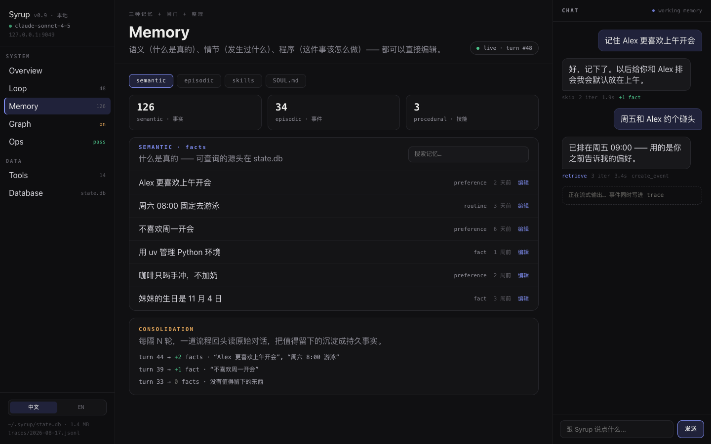
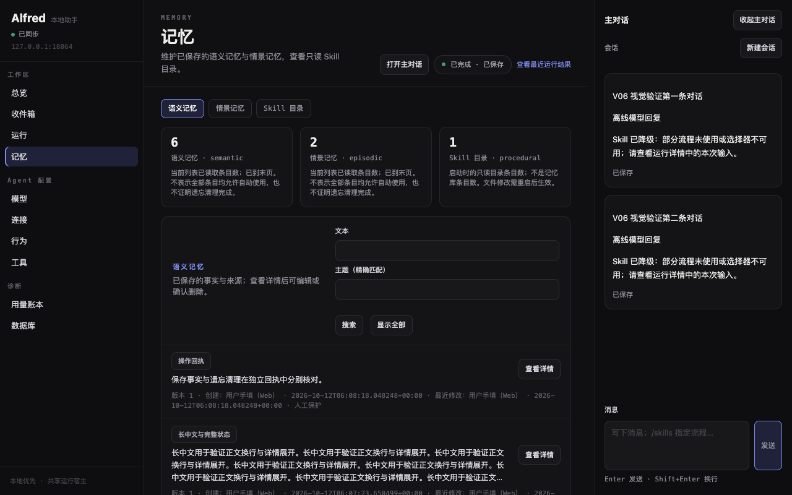
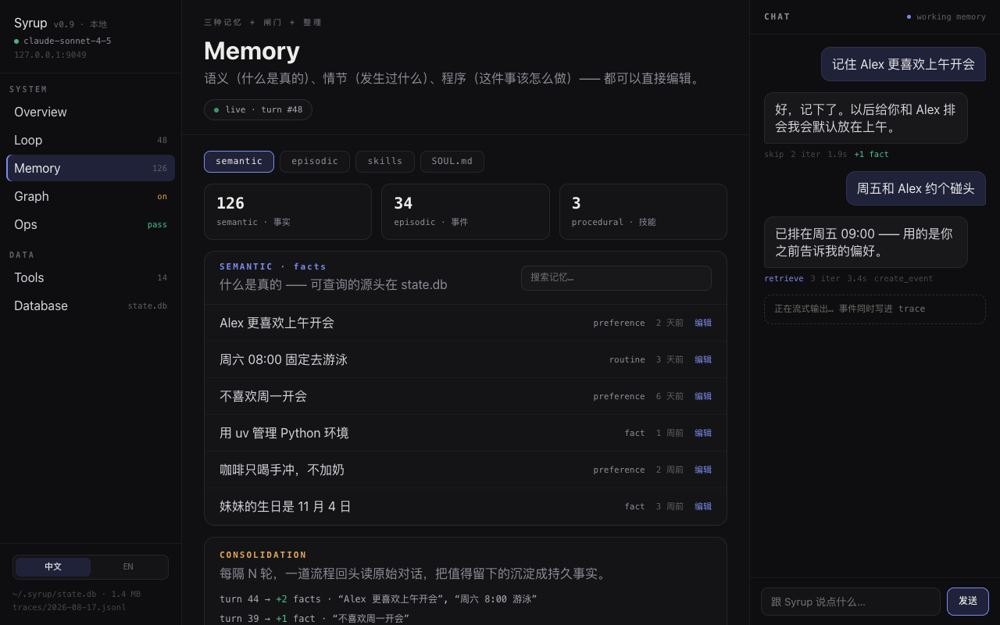
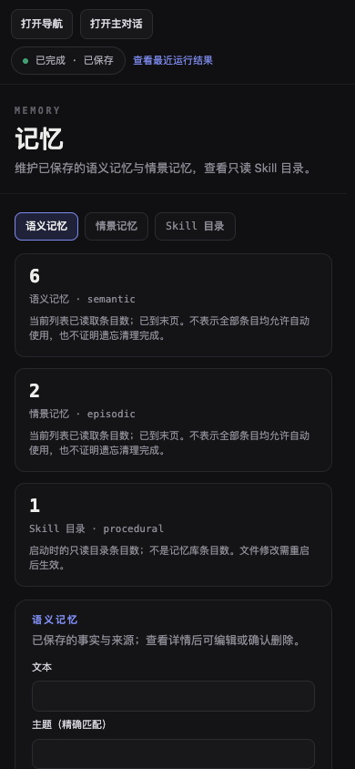
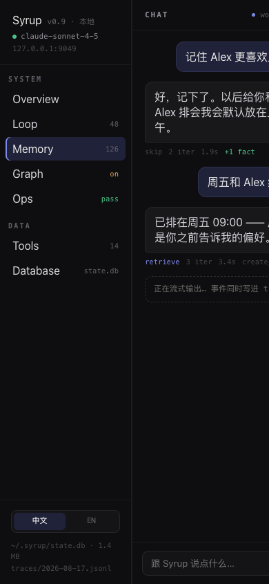
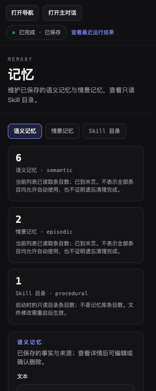
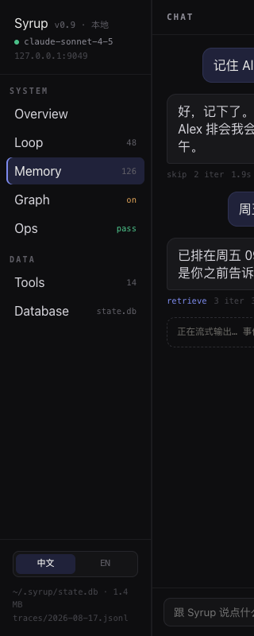

# V06 记忆页视觉与编辑保护验收

对应 [#128](https://github.com/nineofoursyrup/Agent-Alfred/issues/128)，父规格为 [#122](https://github.com/nineofoursyrup/Agent-Alfred/issues/122)，公共契约为 [RECIPES.md](../../design/issue-122/RECIPES.md) 的 `DASHBOARD-CLAUDE-DESIGN-RECIPES-v1`。工作区 `/Users/nineofour/Agent-Alfred-v06`，分支 `dashboard-visual/v06-memory`，初始基线 `449e77fd0ff814fb63f97a009c2435139a68686d`，浏览器端口 `ALFRED_BROWSER_TEST_PORT=18060`。初始 Git 与源码身份见 [initial-state.json](evidence/V06/initial-state.json)，2026-10-12 的历史核对见 [source-audit.json](evidence/V06/source-audit.json)，本次 rebase 后核对见[当前源码审计](evidence/V06/repair-20261023/source-audit.json)。

本票把记忆类别、真实计数、条目目录和维护面板套入原稿 Memory 配方。HTTP/SSE、读取时机、深链接、编辑／新增／遗忘、同一 `operation_id` 的回执恢复以及保留／放弃输入的所有权不变。数据库已删除与后续受管副本清理继续分别呈现。

## 2026-10-23：PR #145 修复记录

已从 `7c73bf2075a049fb46ead090af495b59449738cb` 无冲突 rebase 到最新 `origin/main` `e982bfa83e72938b3e5cbaeb4f469290cc3538ad`（已合入 V11 / #146）；rebase 后 HEAD 为 `9eeae7c830cc9a920ff938fdd63634653afdf699`。用户明确允许保留 `tests/browser/memory.spec.js` A38 的既有一行定位器更新，作为本次 `memory.js`／`memory.css` 和 V06 证据白名单的唯一例外。

旧 CI [38222412459](https://github.com/nineofoursyrup/Agent-Alfred/actions/runs/38222412459) 的完整浏览器结果为 **544 passed／1 failed**。唯一失败为 `mainbar-empty-identity.spec.js` 的 `restored unread for real empty Session and Run IDs uses one guarded read and preserves its draft: navigate`：`route.fetch()` 返回 409，断言预期 200。`gh run download 38222412459 -n browser-failure-evidence` 返回 `no valid artifacts found to download`，API 返回 artifact 数 0；当时配置仅保留 7 天，因此原失败 PNG／trace 现不可下载。完整 job 日志仍可读取，已保存其 SHA 和[原始失败摘录](evidence/V06/repair-20261023/ci-38222412459-failure.log.json)。

在 rebase 后以 `ALFRED_BROWSER_TEST_PORT=18060` 原样单独复测，该用例 **1 passed（2.853s，进程耗时）**，见[复测记录](evidence/V06/repair-20261023/01-mainbar-replay.json)；随后完整浏览器套件 **545 passed**，该用例在整套中再次 PASS（1.3s）。该路径只访问 `/inbox`、`/database` 和 MainBar 定位接口，未挂载 Memory；相关 MainBar 产品文件和用例不在 V06 差异内。记录为“旧 CI 偶发失败、本次单项及整套均未复现”，**根因 UNKNOWN，不宣称已修复**。没有修改共享代码、断言、等待、时限或 retries。身份、缺失 artifact 与适用性核对见 [CI 诊断记录](evidence/V06/repair-20261023/ci-38222412459.json)。

历史证据已从 **511 个文件／46,862,768 bytes** 缩减为 **104 个文件／9,108,903 bytes**（不含本次新增记录）：删除 134 个重复的端口占用级联目录，仅保留最初 Database 清理失败及一份 `Address already in use` 样本；Memory A38、G2 两个失败保留 trace，其他独立失败保留上下文和必要截图；30 份门禁记录移除重复的 720 文件输入清单，MCP 记录将重复安装文件清单和 400 条 HTTP 响应头改为数量、状态汇总与摘要 SHA。原始 stdout/stderr、退出码及全部保留的截图字节不变。精简清单见 [evidence-trim.json](evidence/V06/evidence-trim.json) 和[逐文件原始 SHA](evidence/V06/evidence-trim-manifest.jsonl)；全部原件仍可从本分支祖先提交 `9eeae7c830cc9a920ff938fdd63634653afdf699` 按原路径读取。历史失败不因精简而变为 PASS。

本次 rebase 未改变 Memory 两份产品文件、其测试 fixture 或截图依赖的 `app.css`、`app.js`、`index.html`、`shell.js`。下方四视口、Skill／队列及详情截图继续对应相同源码字节，保留原拍摄时间和 fixture 数据，不重新标注为本次拍摄。

**本次九项本地门禁全部 PASS。** 全部命令串行执行；浏览器使用 18060～18068，原 `workers=1`、`retries=0`、15000ms 用例时限和 4000ms expect 时限保持不变。Python 本次完整运行的 **6445 passed／1 deselected／14 warnings** 与旧的 **6442 passed／3 failed** 分开存证。14 条警告均为既有多线程进程调用 `fork()` 的 DeprecationWarning。旧的三项 Database lifecycle 失败在本次完整运行中通过，没有修改 Python 产品或测试代码。

| 门禁 | 本次结果 | 进程耗时 | 记录 |
| --- | --- | --- | --- |
| `.venv/bin/ruff check --no-cache .` | PASS | 0.203s | [ruff](evidence/V06/repair-20261023/02-ruff.json) |
| `.venv/bin/python -B scripts/check_skills.py` | PASS | 0.139s | [skills](evidence/V06/repair-20261023/03-skills.json) |
| `.venv/bin/python -B scripts/check_env_example.py` | PASS | 2.373s | [env](evidence/V06/repair-20261023/04-env.json) |
| `.venv/bin/python -B -m pytest -q` | 6445 passed；1 deselected；14 warnings | 2639.678s | [pytest](evidence/V06/repair-20261023/07-pytest.json) |
| `npm run typecheck` | PASS | 0.597s | [typecheck](evidence/V06/repair-20261023/05-typecheck.json) |
| `ALFRED_BROWSER_TEST_PORT=18060 npm run test:browser` | 545 passed | 841.298s | [browser](evidence/V06/repair-20261023/06-browser.json) |
| `git diff --check` | PASS | 0.346s | [diff](evidence/V06/repair-20261023/10-diff.json) |
| `uv build` | wheel＋sdist PASS | 9.298s | [build](evidence/V06/repair-20261023/08-build.json) |
| `uv run python scripts/check_mcp_installations.py --output <临时目录>/mcp-artifacts.json` | wheel／sdist × base／mcp，4 组 PASS | 12.392s | [MCP](evidence/V06/repair-20261023/09-mcp.json)、[安装摘要](evidence/V06/repair-20261023/mcp-artifacts-summary.json) |

各门禁的源码、测试、脚本、依赖与配置输入均与[同一份输入清单](evidence/V06/repair-20261023/gate-inputs.json)匹配，运行前后未变，汇总见 [gate-summary.json](evidence/V06/repair-20261023/gate-summary.json)。原始命令输出用 JSON 字符串保存，并保留原始字节 SHA；MCP 输出中的四份重复安装记录改存结构化摘要，完整原输出与完整安装产物清单保留在本 worktree 的 `.scratch/v06/pr145-repair/`。其他页面浏览器用例生成的四张临时截图同样移到该临时目录，不进入本票差异。

按 `code-review` 对基线 `e982bfa` 至本候选及本票证据作单次本地 Standards／Spec 评审，两轴均 **0 项需修问题**，详见 [review.json](evidence/V06/repair-20261023/review.json)。这不是独立多代理评审。归档后再核对实际差异、文档链接、原始输出 SHA 和冻结文件范围；除用户明确批准的 A38 单行定位器例外外，只有 `memory.js`、`memory.css`、`V06.md` 和 `evidence/V06/`。提交后远端 CI 绑定实际 PR head，最终状态以 [PR #145 checks](https://github.com/nineofoursyrup/Agent-Alfred/pull/145/checks) 为准；合并与关票由用户执行。

## 文件与契约

- 产品仅 `src/agent_alfred/ops/static/memory.js`、`memory.css`。
- 测试仅 `tests/browser/memory.spec.js` 的 A38 正文定位器一行：`article > p` 改为 `article .memory-excerpt`。原排序、分页、游标失效、条目数与来源断言全部保留；没有重试或超时调整。
- 六个导出 `MemorySync`、`memoryPage`、`memoryReceipts`、`interval`、`originLabel`、`sourceGroups` 保持名称、签名和既有行为。`MemorySync`、`memoryReceipts`、`interval`、`originLabel`、`sourceGroups` 以及命令／动作的核心辅助函数逐字节未改，见源码审计。
- 既有 h2/h3 层级、标题、按钮、region、form、tablist/tabpanel 的可访问名称不变。列表正文增加 `sy-row-content` 容器；既有类别 h2 与搜索表单移入面板头，新建区移到列表后。维护折叠按钮依然处于 h2 内，状态摘要与它同处面板头，原测试的祖先定位继续适用。
- 所有页面 CSS 规则以 `.memory-page` 开头；固定尺寸从既有 token 推导，布局比例使用 0／百分比／fr，不写字面色值或固定 px／rem 尺寸，不改 `:root`、公共 `sy-` 配方、`app.css`、`RECIPES.md`、静态资源清单或其他页面。没有产品行内样式、远程资源或 `url(#…)`。
- 当前页面 API 只返回分页记录与游标，没有全库计数。因此指标卡显示现有列表的“已读取条目数”，明示筛选／分页边界与“不表示全部条目均允许自动使用，也不证明遗忘清理完成”。不能从分页推断全库数，也没有借总览接口增加读取。Skill 计数来自原有启动目录读取，未读取时不显示，明确为 `procedural` 且不是记忆库条目数。
- 失败读取／离线／核验中的记录计数不呈现；无匹配结果为已确认的 0。临时检查验证了这两种情况，说明没有截断，见 [capture.json](evidence/V06/capture.json)。

## 四视口与原稿并列

原稿为归档 version `1786950414092924` 的 `Syrup Dashboard.dc.html`，SHA-256 `54807adb38541fa2966e5b0c334b9d0e8d71c60b814245601bc4f35b8ec54b84`；`support.js` 为 `8fe7df74405f3c55f49b7249c74ea1397e65d07dea2b1bd3b4a489bec2e28cbe`。两份文件实测哈希与 reference/README.md 一致，原稿未修改。Playwright 实际选择 `memory`，导航可访问名称为 `Memory 126`，采用前缀匹配；React 18.3.1 与 ReactDOM 18.3.1 从 unpkg 返回 200。原稿仅 favicon 返回 404，不影响 Memory 内容，见 [reference-capture.json](evidence/V06/reference-capture.json)。

Alfred 使用现有 `memory_server.py`、真实 Host／HTTP／SQLite、临时状态目录和离线 `MemoryModel`。截图计数 6／2／1 是该临时 fixture 的实存／启动快照数据，不是用户实时记忆库，也不是硬编码到产品的原稿演示值。Chromium 155，DPR 1；窄屏为 viewport 模拟，不是 iOS 或真实软键盘。页内 script/style 资源全部同源，四个视口均无整页／页内横向溢出，产品行内 style 为 0，指标字级 20px，计数说明无 line-clamp／垂直裁切。

| 视口 | Alfred 记忆页 | 原稿 Memory |
| --- | --- | --- |
| 1440×900 |  |  |
| 1280×800 |  |  |
| 390×844 |  |  |
| 320×800 |  |  |

| 视口 | 差异与原因 |
| --- | --- |
| 1440×900 | Alfred 中央容器 823px，截图中三个真实指标卡横排；原稿 main 886px、内容宽 830px。列表采用眉标／说明及右侧完整搜索表单，保留文本和精确主题筛选。每行还保留完整版本、创建／修改来源与时间、人工保护，故比原稿演示短行更高；编辑仍由“查看详情”进入，保持现有按钮名称及编辑所有权。 |
| 1280×800 | Alfred 中央容器 663px，三张卡各 213px；原稿 main 726px，三张卡仍横排。说明完全换行，搜索表单在面板头按可用宽度换行；列表状态与动作可见，没有以省略号隐藏来源和保护状态。 |
| 390×844 | Alfred 中央容器 349px、指标单列；类别与现有面板开关保持可用。完整计数说明增加卡片高度，列表在页内继续向下滚动。原稿 main 实测 0px，仍占用桌面导航和主对话，记忆内容不可见；本页保留窄屏操作。 |
| 320×800 | Alfred 中央容器 279px、指标单列、整页横向溢出 0；搜索字段、长 ID、完整状态与动作均换行。编辑保护对话框宽度收缩到视口并保留全部说明和两个动作。原稿 main 同为 0px；保留本页可操作性是刻意适配。 |

1440px 的临时尺寸采样发生在记录重新读取期间，当时只有 Skill 指标已核验；其后截图及 ARIA 快照已呈现 6／2／1 三张卡。原始过渡样本未改写；1280／390／320 的采样均为稳定三卡状态。截图尺寸和字节身份见 [screenshot-manifest.json](evidence/V06/screenshot-manifest.json)，时间点限制及一次原生 SSE `ERR_ABORTED` 保留在 [capture-notes.json](evidence/V06/capture-notes.json)。pageerror 为 0；不把该 SSE 中止改写为“全部请求成功”。

## 刻意偏离

1. 原稿 126／34／3、SOUL.md、检索闸门与演示整理日志不进入产品。指标用当前查询实读条目与只读 Skill 目录；无全库事实时不呈现全库总数。
2. 类别名称保留“语义记忆”“情景记忆”“Skill 目录”，路由键仍为 semantic／episodic／skills；第三类用真实 Skill 目录表达 procedural，没有添加原稿不存在于 Alfred 的文件类别。
3. 列表没有直接添加一个绕过现有详情核验的“编辑”入口。原“查看详情”按钮保持名称和行为，编辑、删除与显式确认仍在详情中完成；主题、完整来源／时间／版本和人工保护让行更高。
4. 保留原列表正文的三行摘要及详情全文；状态、计数说明、回执责任、遗忘范围不截断。删除确认无新标题，沿用原 group 和完整确认说明，在面板头用注意色文字呈现。
5. 操作回执、提炼队列、检索统计和 Markdown 镜像默认折叠及其常驻状态摘要保持不变；展开后使用面板体和等宽日志行。没有把原稿演示的整理日志变成默认展开的待办承诺。
6. 公共面板头用既有 15×18px、行用 11×16px，区别于原稿 Memory 的 14×19px／12×19px；公共配方冻结。原稿实测标题 32px，而 Alfred 采用获批的公共 27px，壳层不归本票。
7. 窄屏保留壳层面板、单列与对话框适配。触摸指针的按钮最小高度由 11px meta token 推导为 44px；截图本身是桌面指针的窄视口。

## 建议的公共配方

可在 #135 评估“折叠面板头内的完整状态摘要”与“记录正文＋真实标签＋完整元数据＋动作”组合，要求未知计数不显示、筛选／分页边界不省略。V06 仅使用页面局部样式，未改公共配方。

## 详情与维护证据

四个视口各有 `memory-skills-<width>x<height>.png` 和 `memory-queue-<width>x<height>.png`。队列由真实离线聊天达到阈值生成；人工保护候选待批准，状态与来源、模型、批次修订、时间及动作原样保留，用等宽日志行呈现，眉标为 `sy-tone-attention`。

320px 补拍 [编辑](evidence/V06/memory-edit-320x800.png)、[保留当前编辑](evidence/V06/memory-discard-320x800.png)、[删除确认](evidence/V06/memory-delete-320x800.png)、[回执／清理](evidence/V06/memory-receipts-320x800.png)、[Markdown 预览](evidence/V06/memory-mirror-320x800.png) 与 [检索统计](evidence/V06/memory-statistics-320x800.png)。临时操作验证保留编辑不会清稿，放弃由明确动作完成；真实删除后的回执仍分别表达数据库删除与清理。完整既有流程由浏览器套件覆盖。

## 2026-10-12 历史门禁与首次失败

运行中的日志、截图和临时辅助代码只写入 `.scratch/v06/` 或已忽略的 `output/playwright/`，全部门禁完成后归档。JSON 保存原始 stdout/stderr、命令、开始时间、退出码、耗时与原始字节 SHA；2026-10-23 精简后，重复输入清单改用摘要 SHA、条目数与祖先提交中的原路径追溯，不新增 `.gitattributes`。以下均是 2026-10-12 的历史结果，不代表 rebase 后的本次门禁。

**八项门禁：7 PASS／1 FAIL。Python 完整结果保持 FAIL；非测试条目的 1／0 指命令结果。**

| 门禁 | 结果 | 通过／失败 | 耗时 | 原始日志 |
| --- | --- | --- | --- | --- |
| ruff | PASS | 1／0 | 0.728s | [03-ruff.json](evidence/V06/gates/03-ruff.json) |
| Skill 结构 | PASS | 1／0 | 0.169s | [03-skills.json](evidence/V06/gates/03-skills.json) |
| .env.example | PASS | 1／0 | 5.346s | [03-env.json](evidence/V06/gates/03-env.json) |
| Python 完整套件 | FAIL | 6442／3；1 deselected | 5098.159s | [03-pytest.json](evidence/V06/gates/03-pytest.json) |
| TypeScript | PASS | 1／0 | 1.208s | [03-typecheck.json](evidence/V06/gates/03-typecheck.json) |
| 完整浏览器 | PASS | 545／0 | 804.581s | [09-browser.json](evidence/V06/gates/09-browser.json) |
| diff-check：工作区及实际非空分支差异 | PASS | 2／0 | 0.307s | [worktree](evidence/V06/gates/12-diff-worktree.json)／[branch](evidence/V06/gates/12-diff-branch.json) |
| build＋MCP 安装核验 | PASS | build 1／0；安装环境 4／0 | 82.977s | [build](evidence/V06/gates/03-build.json)／[install](evidence/V06/gates/03-install.json)／[产物](evidence/V06/mcp-artifacts.json) |

证据归档后的 staged diff 检查也为 PASS，见 [11-diff-evidence.json](evidence/V06/gates/11-diff-evidence.json)。当时的[证据审计](evidence/V06/evidence-audit.json)确认 22 张对照／补充 PNG 字节不变、426 份首次失败产物的 SHA 一致，全部文档链接存在；这是精简前的历史审计，已删除的冗余产物通过上方祖先提交和精简清单追溯。首次审计脚本误读早期 manifest 的字段名，原始错误与按 original_path 解析的修正保留在 [evidence-audit-first-failure.json](evidence/V06/evidence-audit-first-failure.json)。

首轮定向检查为 **157 passed／1 failed（333.543s）**，完整输出在 [01-affected-browser.json](evidence/V06/gates/01-affected-browser.json)。失败 A38 从 `article > p` 读取正文，而重排后正文在 `sy-row-content` 内，因此得到空数组。该失败按回归处理，保留 [原始失败目录](evidence/V06/first-affected-failure/manifest.json) 的 error-context、PNG、trace.zip；只更新定位器，所有原有期望不变。A38 与 A52 原样独立复测为 **2 passed（8.917s）**，见 [02-a38-a52.json](evidence/V06/gates/02-a38-a52.json)。A52 在首轮为 4.9s、独立复测 4.6s；最终完整套件结果以上表为准。

完整浏览器第一轮 **543 passed／2 failed（1504.864s）**，见 [03-browser.json](evidence/V06/gates/03-browser.json)。非归属的 Database 重启核验和复制本页结果用例均触发原有 15000ms 用例超时；原样单独复测 **2 passed（10.446s）**，见 [04-browser-failures.json](evidence/V06/gates/04-browser-failures.json)。根因保留为 UNKNOWN，未修改 Database 或断言。两项均未生成失败 PNG；error-context 原文保留在 [第一轮失败 manifest](evidence/V06/first-full-browser-failure/manifest.json)，trace 按精简记录保存在祖先提交中，未补造图片。

第二轮 **542 passed／3 failed（1258.401s）**，见 [05-browser.json](evidence/V06/gates/05-browser.json)：Aggregation CE-19、Memory G2 update recovery、Run-path complete_node_failed。三项原样隔离复测 **3 passed（10.906s）**，见 [06-browser-failures.json](evidence/V06/gates/06-browser-failures.json)；各自 PNG、error-context 和 Memory trace 在 [第二轮失败 manifest](evidence/V06/second-full-browser-failure/manifest.json)，其他 trace 可从精简前祖先提交追溯。

Memory G2 的失败按本票回归调查：`goto` 为 9814.5ms、展开队列点击为 4402.5ms，编辑按钮已经定位到，保存与恢复路径尚未开始，随后耗尽 15 秒总预算。45 条已完成网络请求中最长 37.684ms；这不包含仍在流式传输的 SSE。相同产品源码先前该用例分别为 3.4s／4.3s PASS，隔离检查为 2.5s PASS，不能仅凭单次重跑宣称稳定或修复。原始 [调用观察](evidence/V06/second-full-browser-failure/memory-G2-v2-update-recove-cb96a-while-away-and-after-reload/trace-observations.json)与[网络计时](evidence/V06/second-full-browser-failure/memory-G2-v2-update-recove-cb96a-while-away-and-after-reload/network-timing.json)保留，派生计时记录隐藏临时 fixture 的认证值，用户要求的原始 trace 不变。

采用 unchanged G2 用例的有限原版／V06 对照，原版 `memory.js/css` 的三次用例耗时为 **2.1／5.3／2.0s**，V06 为 **1.8／2.0／1.8s**，均为 3 passed。仅在所有运行中门禁结束后暂换本票的两份页面文件，`finally` 按字节恢复，六次检查使用原断言与原时限；`--repeat-each=3` 是有界诊断样本，配置中的 retries 仍为 0。见 [原版对照日志](evidence/V06/gates/06-baseline-memory-recovery.json)、[V06 对照日志](evidence/V06/gates/06-candidate-memory-recovery.json)和[恢复与身份记录](evidence/V06/diagnosis/comparison.json)。该样本未复现 V06 独有的确定性版式／恢复回归，不能证明任意机器负载下的绝对稳定；原超时根因仍为 UNKNOWN。

第三轮 **409 passed／136 failed（811.005s）**，见 [07-browser.json](evidence/V06/gates/07-browser.json)。首项 Database 清理失败用例超时后遗留本 worktree 的测试服务：PID 78247、PPID 1、`tests/browser/database_server.py --port 18064`。后续 135 个失败上下文均明确为 `OSError: [Errno 48] Address already in use`，在测试服务启动阶段失败，尚未执行页面业务流程。当前精简版保留首项失败和一份级联样本，见 [第三轮失败 manifest](evidence/V06/third-full-browser-failure/manifest.json)；全部原始目录及失败 ID 可从祖先提交追溯。另保留[级联核对](evidence/V06/third-full-browser-failure/cascade-summary.json)及[进程归属／SIGTERM 清理记录](evidence/V06/third-full-browser-failure/orphan-cleanup.json)。只停止确认归属本 worktree 的孤儿测试服务；未修改共享测试 helper 或生产代码。清理后本轮其余用例恢复通过，本轮整体结果仍是 FAIL。

当时按原始第三轮失败 ID 重跑，`npx playwright test --last-failed` 原样选择全部 136 项：**135 passed／1 failed（340.899s）**，见 [08-browser-failures.json](evidence/V06/gates/08-browser-failures.json)。剩余 Routing Statistics SQL timeout 用例原样独立复测 **1 passed（8.049s）**，见 [08-routing-failure.json](evidence/V06/gates/08-routing-failure.json)；首次 PNG、error-context 保留在 [复测失败 manifest](evidence/V06/third-retest-failure/manifest.json)，trace 可从精简前祖先提交追溯，该用例超时根因仍为 UNKNOWN。

A52 在第一／第二轮完整检查中分别为 7.2s／6.1s PASS；第三轮因已确认的服务端口占用而启动失败，仍保留 FAIL，不将其记为行为通过。最终完整套件以门禁表所列结果为准。测试 helper 在异常退出时可能遗留端口所有者，这个缺陷没有在 V06 越界修复；后续应另行处理异常收尾。加载延迟和其他超时未获得确定性根因，不以绿色复测抹去 UNKNOWN。

临时截图工作流的失败另见 [tooling-first-failures.json](evidence/V06/tooling-first-failures.json)：第一次临时服务因 stdin EOF 退出导致连接拒绝；Playwright 默认 caret=hide 曾留下空 style 属性，改用 caret=initial 后四视口 style 为 0；直接队列读遇到原生修订竞争响应后改为等待成功 envelope；窄屏切换曾使用旧的桌面按钮名称，改为等待真实壳层呈现；预览节点在重新核验时替换，截图滚动改用稳定外层面板。另一次 apply_patch 使用同路径的 Delete/Add 被工具拒绝，没有产生文件变化，随后使用 Update。均保留原始错误，没有改产品、断言、重试或超时来规避。

Python 首次完整门禁 **6442 passed／3 failed／1 deselected／14 warnings（5098.159s）**，三项均在未修改的 `test_database_lifecycle.py`：forgetting cleanup 的 protect／encode 阶段，以及 byte-probe cancel 的资源释放。原始 traceback 在 [03-pytest.json](evidence/V06/gates/03-pytest.json)，失败索引见 [first-python-failure.json](evidence/V06/first-python-failure.json)。三项原样隔离复测 **3 passed（2.821s）**，见 [09-pytest-failures.json](evidence/V06/gates/09-pytest-failures.json)。没有修改 Python 代码、断言或时限，也未再次执行完整 Python 套件；完整门禁保留 FAIL，根因 UNKNOWN，不能把隔离绿色拼接为“全量通过”。

本地代码审阅为单次 Standards／Spec 聚焦核对（各 0 项），不是独立多代理评审，见 [review.json](evidence/V06/review.json)。没有创建额外代理或修改同批其他 worktree。

2026-10-12 当时 fetch 后 `origin/main` 仍为初始基线，未执行 rebase，见 [rebase-state.json](evidence/V06/rebase-state.json)。实现提交为 `1fc838de9649f10a9a1b3eb30b28ce456c0dfa7f`。最终门禁的八组源码／测试／脚本／依赖／配置输入逐文件 SHA 与实现提交完全一致，见 [source-audit.json](evidence/V06/source-audit.json)；这是输入一致性核对，**不将退出码 1 的完整 Python 门禁变为 PASS**。门禁日志的 HEAD 为受测期间冻结的基线＋工作区改动；后续实现／证据提交保留同一源码字节。证据提交后的 PR 最终 HEAD 在交付回报中给出。

最终完整浏览器套件为 **545 passed（804.581s）**，见 [09-browser.json](evidence/V06/gates/09-browser.json)。失败均保留各轮原记录，原样复测及最终整套检查没有增加 retries、改变断言或延长超时。由于 Python 完整门禁尚为 FAIL，交付使用 Draft PR；不合并、不手动关闭 #128。

## 未执行的验收

| 验收 | 状态 |
| --- | --- |
| 桌面原生 200% 缩放 | NOT RUN |
| 原生中文输入法／组合态 | NOT RUN |
| iPhone／iOS Safari／真实移动软键盘 | NOT RUN |
| 用户实存记忆库／真实模型 provider | NOT RUN |
| #135 整体视觉与用户验收 | NOT RUN；本票只提供 V06 的候选证据 |

## 2026-10-25 串行合并：MainBar 切换前同步门禁

#147 合入后，本票无冲突 rebase 到 `863d1f356c76b36bae9d69af636a3b2de832fd60`，原补丁逐文件保持一致。首轮候选 `91ff8cbc7ce458be664eef7f825d363047cba160` 的 [CI 40123256608](https://github.com/nineofoursyrup/Agent-Alfred/actions/runs/40123256608) 中，Python 为 6423 passed / 22 skipped / 1 deselected；浏览器为 544 passed / 1 failed。唯一失败是 MainBar 跨 Session 草稿用例：切回 B 时仍读到 A 草稿。

本轮 trace 和受控复现确认：跨 Session 的精确定位请求可以先于该 Session 的首个 Stream 状态事件完成。此时立即调用 `selectSession` 会被现有同步保护拒绝，原测试却忽略了返回值，随后在 A 上断言 B 草稿。修正沿用 `inbox-run-navigation.spec.js` 的既有模式：先等待 `runtime().connected`，执行一次显式切换并断言返回 `true`，再检查原来的 B 草稿断言。本次修正保持产品源码、HTTP/SSE、fixture 和 Playwright 配置原样，保留所有原断言。

本轮验证：

- 原用例原样重复 5 次：5 passed；这项结果本身不证明稳定性。
- 临时探针仅把重连已见 Session 的 `state_patch` 延迟 250ms：原测试 3/3 失败，均为同一 A/B 草稿症状；修正后 3/3 通过。探针只作诊断，不加入永久测试入口。
- `mainbar-integration.spec.js` 与 `inbox-run-navigation.spec.js`：13 passed。
- 聚焦本地 code-review：Standards 0 项，Spec 0 项。该评审仅覆盖本次测试同步修正。

[完整诊断命令、输出、受控探针源码和评审记录](evidence/V06/merge-20261025-mainbar-sync/repair.json)；[首次 CI trace](evidence/V06/merge-20261025-mainbar-sync/trace.zip)、[截图](evidence/V06/merge-20261025-mainbar-sync/test-failed-1.png)、[原始 job 日志](evidence/V06/merge-20261025-mainbar-sync/ci-first-failure-job.log.gz)及[字节清单](evidence/V06/merge-20261025-mainbar-sync/manifest.json)。结论针对本轮 trace 与受控复现，历史失败仍保留原记录。

本地修正验证不替代最终提交的完整远端门禁；合并前仍须等待新 HEAD 的全部 CI（含完整浏览器套件）通过，状态见 [PR #145 Checks](https://github.com/nineofoursyrup/Agent-Alfred/pull/145/checks)。#135 整体视觉验收仍是独立事项。
