# V07 行为页视觉与路由统计验收

对应 [#129](https://github.com/nineofoursyrup/Agent-Alfred/issues/129)，父规格 [#122](https://github.com/nineofoursyrup/Agent-Alfred/issues/122) 的「页面映射 › 行为」，复用 [RECIPES.md](../../design/issue-122/RECIPES.md) 的 `DASHBOARD-CLAUDE-DESIGN-RECIPES-v1`。worktree `/Users/nineofour/Agent-Alfred-v07`，分支 `dashboard-visual/v07-behaviour`；从最新 `origin/main` 的 `449e77f` 建立，初始状态干净。初始身份与最终受测文件 SHA 见 [source-audit.json](evidence/V07/source-audit.json)。主 checkout 的 `docs/dashboard.md`、未跟踪 `README.md` 和 `tmp/` 已识别，未修改它们或其他 agent 的文件。

本票把消息分流拓扑移到注意色眉标面板的前部，保留展开、读取、缩放、平移、节点详情和完整文字明细。分流设置与路由统计在宽容器下并列，窄容器自动单列；手动聚合使用相同面板与输入配方。路由统计改用 `sy-bar-row` 的标签／数值行与 7px SVG 辅助条，宽度仅为已验证的次数除以同组已知决议分母，不以总 Run 数代替分母。

## 文件与契约

- 产品仅改 `src/agent_alfred/ops/static/behaviour.js`、`behaviour.css`、`routing-statistics.js`。
- 测试仅改 `tests/browser/routing-statistics.spec.js`：原生 progress 的定位与 0.5 断言改为同一条路由的 SVG rect `width="50%"`；失效／历史未知／零分母的空条断言改为 `.sy-bar-track` 数量为 0。补查 `aria-hidden="true"`、`height="7"` 和数值行可见，既有真实 3/6、完整数表、失效清空和未知断言保留。
- `behaviourPage(root, csrf, runtime, memory, instance)` 与 `routingStatistics(root, instance)` 导出、返回接口和观察生命周期不变。`read`、`write`、`validate`、统计请求、取消序号、实例核对及失效清空实现没有改动；没有新增 HTTP/SSE、读取、路由、深链接或业务计算。
- `topology.js`、`aggregation.js`、`runs.js`、`app.js` 和 MainBar 未修改。共享拓扑与聚合样式只受 `.behaviour-page` 限定的 CSS 影响，因此运行详情 Graph 改动前后截图要求不适用；运行详情和 MainBar 的既有测试仍执行。
- 页面 CSS 规则均以 `.behaviour-page` 开头；间距、字级、颜色和节点 10px 圆角取现有 token；局部边线与栅格下限由 token 计算。没有新增公共 token／`sy-` 类定义、静态资源文件、远程产品资源、行内样式声明或 CSS `url(#…)`。既有箭头继续使用 SVG `marker-end` 呈现属性。
- 冻结的 `app.css`、`:root`、`RECIPES.md`、`.gitattributes`、`index.html`、壳层及非归属页面无本票差异。

### 语义与失效规则

既有 h1「行为」、h2「消息分流」「手动聚合」、region「消息分流」「手动聚合」「流程拓扑」「路由决议完整数表」、列表「路由决议比例」与全部按钮／字段名称保留。为呈现并列设置区，增加 h3「分流设置」；既有标题级别没有修改。面板 header 只包裹原 h2 和说明，未新增 landmark 名称。

SVG 按规格设为 `aria-hidden=true`，替代原生 progress 的辅助进度语义。每条路由仍有完整的可见次数、分子／分母和比例文本，完整数表也保留；读屏和无色彩读取不依赖条形。不可比较的历史版本仍显示现有「历史口径未知，仅列次数与缺失」，无可计算分母仍显示「无可计算样本」，两者均不画估算条。

拓扑读取失败保留旧快照并明确标旧；统计读取、断连、实例变化与收起后仍清掉旧结果。分流草稿、CAS 基线、保存回执、离页确认、聚合目标／资料来源与准入不确定状态没有合并或改写。

## 四视口与原稿并列

先核对归档 README 中两份文件的 SHA-256：HTML `54807adb38541fa2966e5b0c334b9d0e8d71c60b814245601bc4f35b8ec54b84`，support.js `8fe7df74405f3c55f49b7249c74ea1397e65d07dea2b1bd3b4a489bec2e28cbe`，均匹配。原稿 version `1786950414092924` 未修改。Playwright 通过本 worktree 的 HTTP 原稿服务打开归档 HTML，按前缀选择实际可访问名称 **Graph on**。React 18.3.1 与 ReactDOM 18.3.1 的 unpkg 响应均为 HTTP 200；[reference-capture.json](evidence/V07/reference-capture.json) 保存响应、浏览器与几何。

产品使用现有 `statistics_fixed_server.py`、真实 Dashboard／Host／HTTP／SQLite 和现有离线固定样本，不注入演示响应或新增生产数据。截图辅助服务端口 18077，原稿 18079，门禁基端口固定 18070，均在本票分配范围。Chromium 155、DPR 1；[product-capture.json](evidence/V07/product-capture.json) 保存数值、几何、焦点、请求与四视口读屏快照；[screenshots.json](evidence/V07/screenshots.json) 保存图片尺寸和 SHA。

| 视口 | Alfred 行为／展开拓扑 | 原稿 Graph |
| --- | --- | --- |
| 1440×900 | 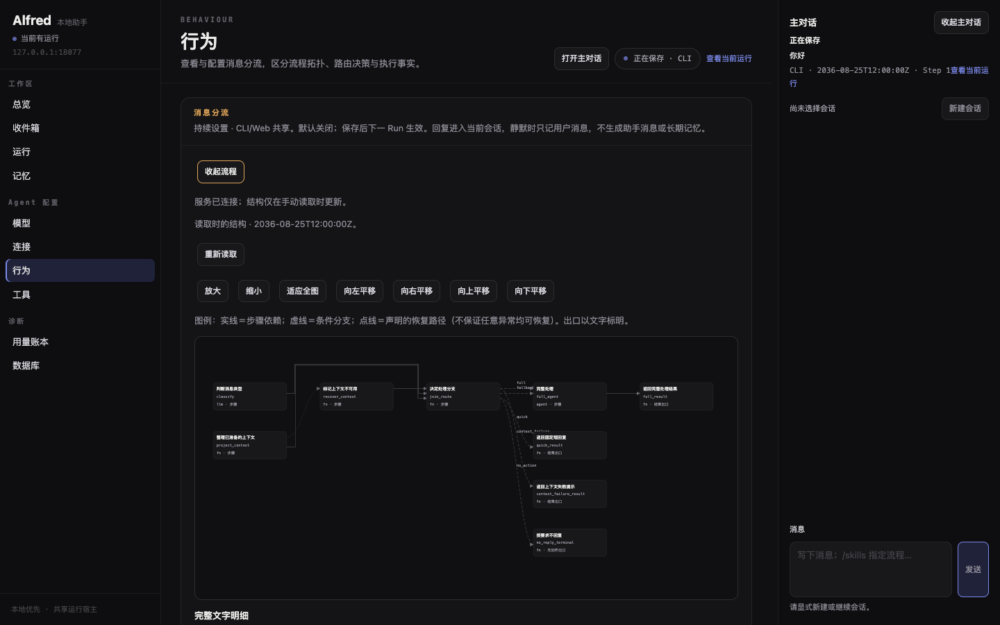 | 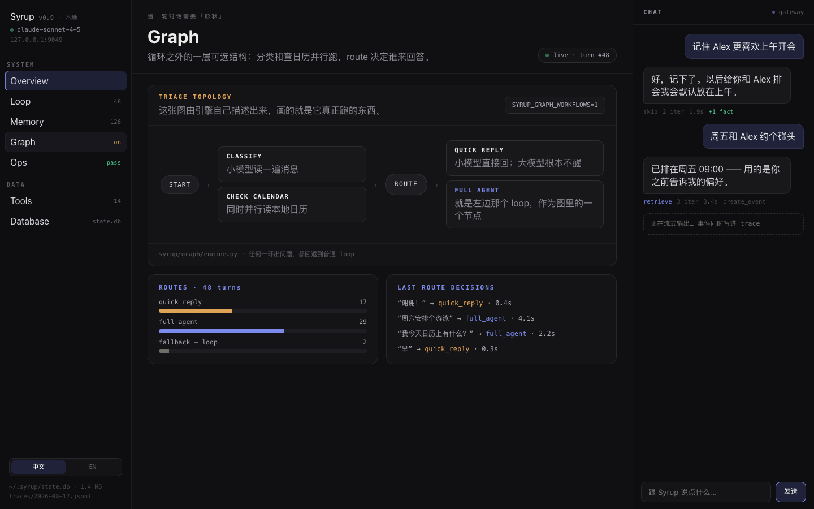 |
| 1280×800 | 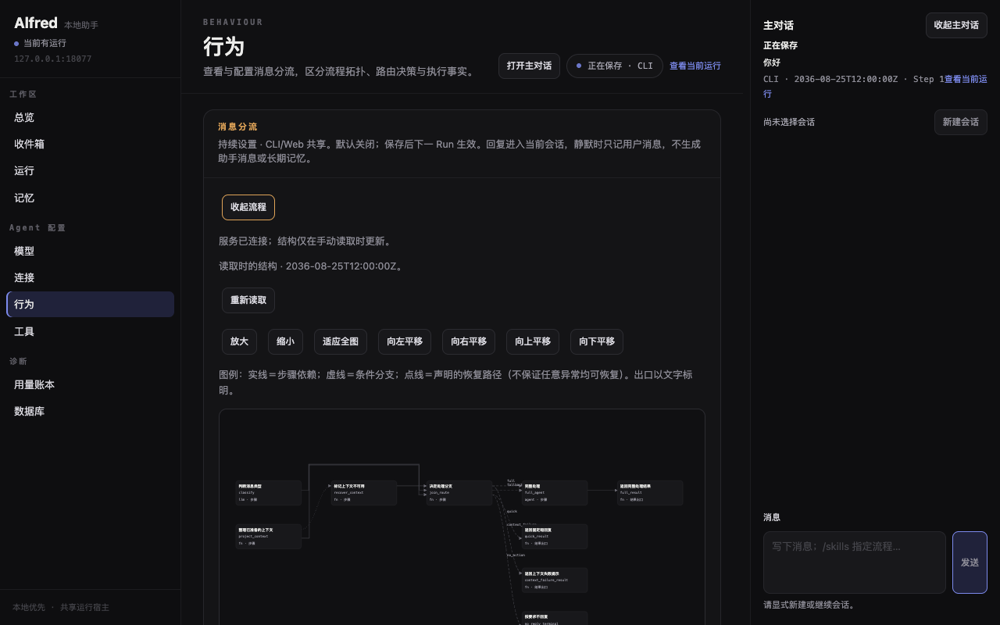 | 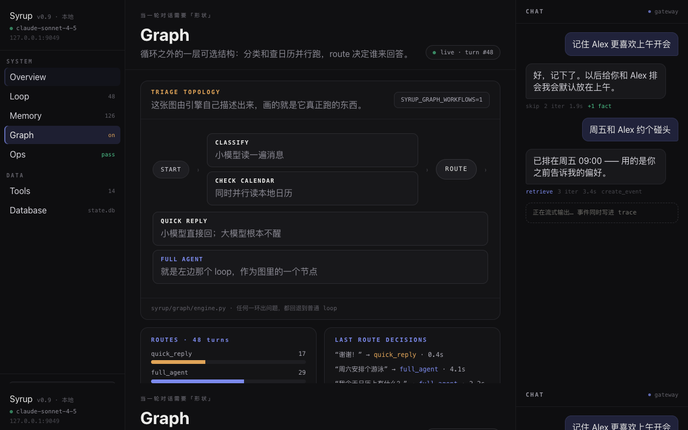 |
| 390×844 | 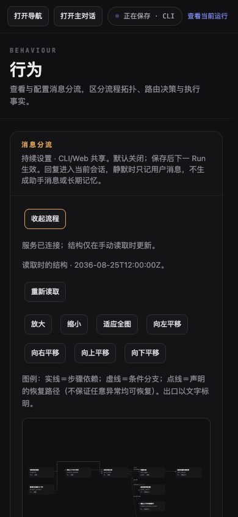 | 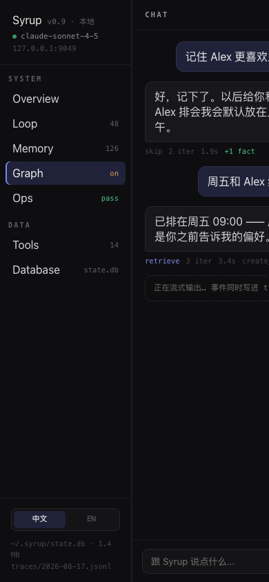 |
| 320×800 | 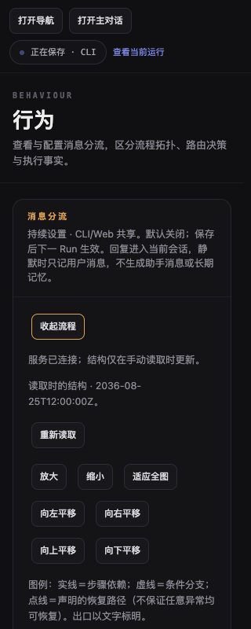 | 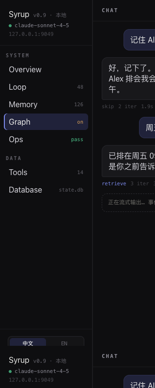 |

| 视口 | 差异与原因 |
| --- | --- |
| 1440×900 | Alfred 中央容器 823px，原稿 main 886px；壳层仍使用已合入的导航与页头配方。注意色眉标、抬升底／控件边／10px 圆角节点卡与原稿一致；真实消息分流有 9 个节点、声明恢复路径和五种决议，不能照搬原稿简化的 CLASSIFY／CHECK CALENDAR／ROUTE。图控件、连接说明、读取身份和完整文字明细增加面板高度；统计与设置在其后并列。 |
| 1280×800 | Alfred 中央容器 663px，原稿 main 726px；并列支持区继续可用。图按既有适应全图算法缩放，所有节点保留，默认图中文字会缩小，用户可使用既有放大／节点详情／完整文字明细读取。原稿胶囊流程更短，面板更矮；本票不删减真实结构或控件。 |
| 390×844 | Alfred 中央容器 349px，支持区单列，拓扑控件自然换行，图保持既有窄屏高度；完整文字和节点详情可纵向阅读。原稿 nav 191px、main 实测 0px，Graph 内容不可见；保留 Alfred 的导航／MainBar 面板切换与窄屏可操作性。 |
| 320×800 | Alfred 中央容器 279px；整页和页面横向溢出均为 0，设置、比例数值与聚合长输入继续换行，焦点实测 3px。原稿 main 仍为 0px；保留单列与完整文字入口，不裁掉关键事实来模拟原稿。 |

补充的统计与聚合四视口截图：

| 视口 | 真实路由统计 | 手动聚合与长目标 |
| --- | --- | --- |
| 1440×900 | 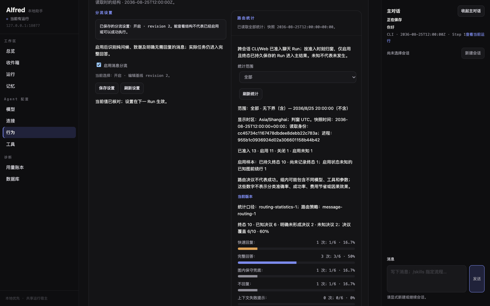 | 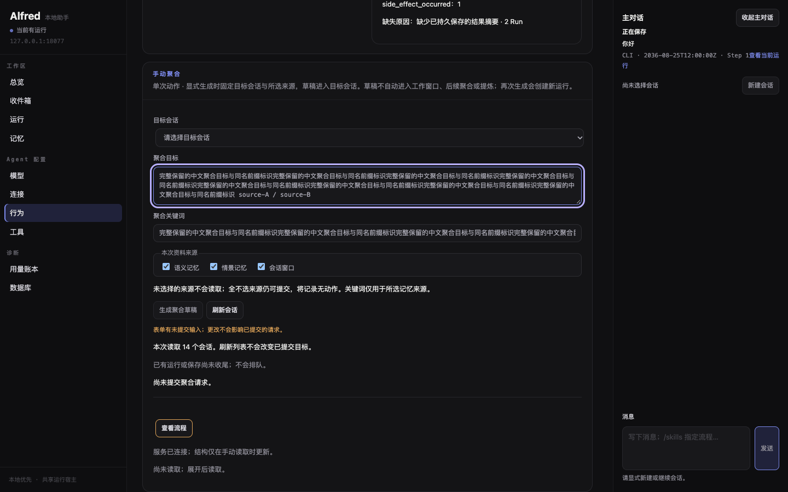 |
| 1280×800 | 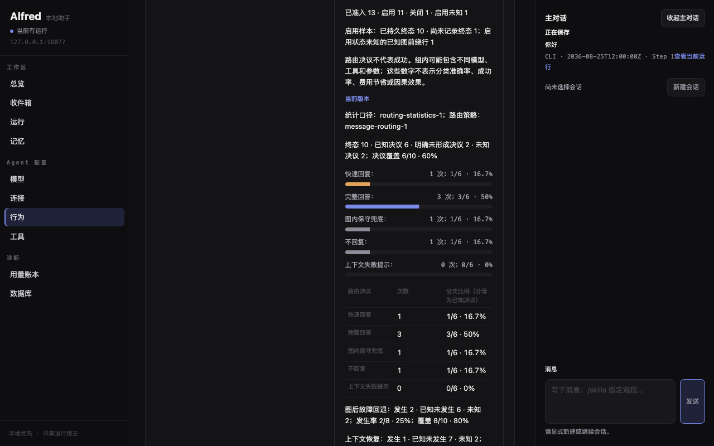 | 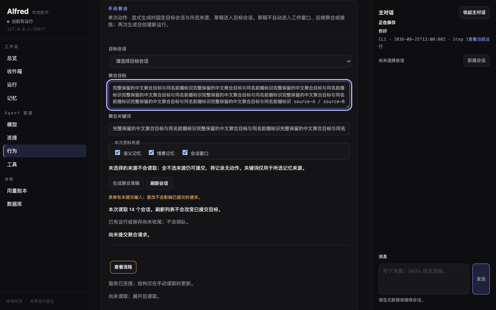 |
| 390×844 | 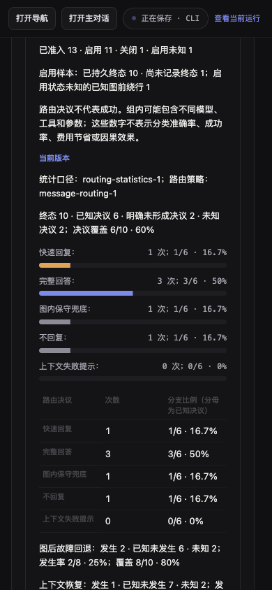 | 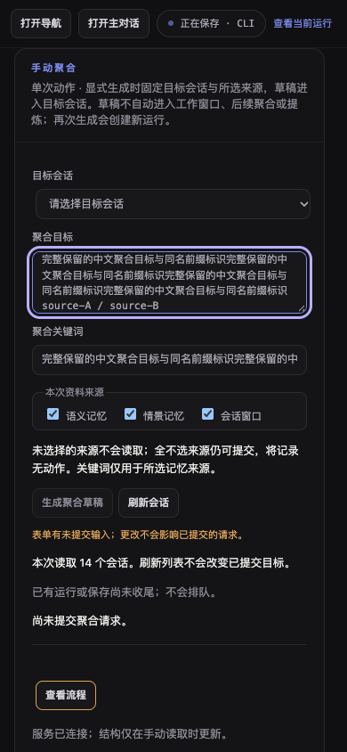 |
| 320×800 | 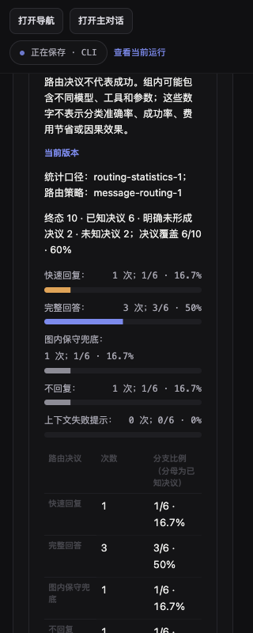 | 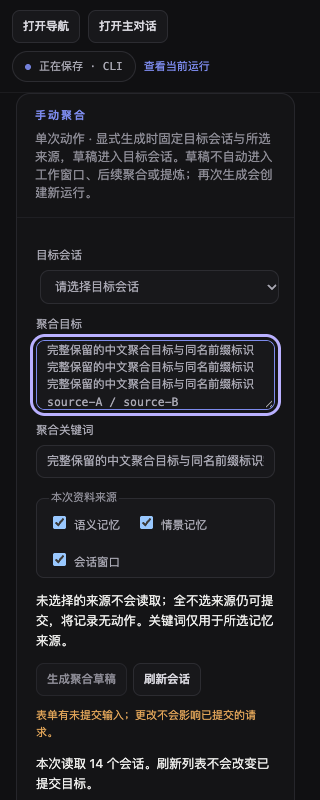 |

### 刻意偏离

1. 原稿 `LAST ROUTE DECISIONS` 的演示记录没有迁入。当前行为页与统计响应没有逐 Run 最近决策来源；本票只改视觉、不得新增读取，所以不呈现这块面板。运行的既有决策证据仍在原入口，不能把当前一次投影冒充最近决策列表。
2. 拓扑不自动展开、刷新或逐段点亮。截图经实际点击「查看流程」取得，初始页面仍需用户主动读取；结构不是执行成功的证据。
3. 保留完整文字明细与完整数表，统计和设置位于拓扑之后。原稿只有简化示意与三种演示条，本页展示五种真实路由、语义版本、样本覆盖、未知、独立回退与恢复事实。
4. 全图适应、缩放／平移、读取与失败提示、CAS 草稿和聚合表单沿用现状，导致面板更高。没有照搬 Syrup 专有环境变量、日历分支、fallback-to-loop 用词或演示数字。
5. 使用公共 `sy-panel-header`、`sy-panel-body` 间距，不按原稿拓扑体的 26×22px 单独复制配方。辅助支持区用 token 推导的 299px 轨道下限，窄于下限可收缩到 100%；不新增全局断点。
6. 新增 h3「分流设置」，移除辅助原生 progress 的角色，原因与替代文字语义见上文。按钮、既有标题级别和业务读屏信息保留。

### 建议的公共配方

可由 #135 评估复用「拓扑观察面板 + 自适应支持区」，以及「可见分子／分母／比例 + aria-hidden SVG」的条形组合。本票只组合已有公共类和页内 token，不修改公共配方。

## 门禁与首次记录

日志运行时只写 `.scratch/v07/`。八项门禁在冻结的实现、测试、依赖与配置上执行；完成后归档 JSON 中的原始 stdout/stderr、退出码、起点 SHA、受测文件 SHA 与耗时。证据归档提交不改变受测实现；最终提交再次做 diff-check，来源比对记录可核验复用范围。

<!-- gate-table:start -->
| 门禁 | 最终实现结果 | 耗时 | 原始 stdout/stderr、身份与输入 SHA |
| --- | --- | --- | --- |
| 1. Ruff | All checks passed | 1.075s | [02-ruff.json](evidence/V07/gates/02-ruff.json) |
| 2. skills | PASS；空 tree，无 SKILL.md | 0.171s | [03-skills.json](evidence/V07/gates/03-skills.json) |
| 3. .env.example | PASS | 4.138s | [04-env.json](evidence/V07/gates/04-env.json) |
| 4. 完整 pytest | 6445 passed / 0 failed | 2612.413s | [16-pytest-full.json](evidence/V07/gates/16-pytest-full.json) |
| 5. typecheck | PASS | 1.219s | [06-typecheck.json](evidence/V07/gates/06-typecheck.json) |
| 6. 完整浏览器（18070） | 545 passed / 0 failed | 797.821s | [15-browser-full.json](evidence/V07/gates/15-browser-full.json) |
| 7. diff-check | 工作区、staged 与 origin/main...HEAD 均 PASS | 0.106s | [17-diff-final-stage.json](evidence/V07/gates/17-diff-final-stage.json)；[首次实现检查](evidence/V07/gates/08-diff.json) |
| 8. build / MCP 安装 | wheel/sdist × base/mcp 四组合 PASS | 44.232s | [09-install.json](evidence/V07/gates/09-install.json) |

最终完整 pytest 为 6445 passed / 0 failed / 1 deselected / 14 warnings；deselected 与 warnings 未计入通过数。完整浏览器固定 `workers: 1`、`retries: 0`、15s case timeout 和 4s expect timeout，配置未改。完整门禁实际在实现候选 `c8b1bc5918a57af9af8429ef9f48bee6b4f98671` 上执行；归档提交只增加本票证据，受测源文件、依赖与配置 SHA 均保持不变。
推送前已 [fetch 核对](evidence/V07/pre-push-fetch.json)，`origin/main` 仍为起点 `449e77fd0ff814fb63f97a009c2435139a68686d`，无需 rebase。证据归档后还核验工作区、staged 与分支差异，见 [17-diff-final-stage.json](evidence/V07/gates/17-diff-final-stage.json)。
<!-- gate-table:end -->

七个指定相关浏览器文件的定向检查 **147 passed / 0 failed，332.607s**，见 [01-affected-browser.json](evidence/V07/gates/01-affected-browser.json)。没有重试、超时调整或非归属页面修改。

<!-- failure-records:start -->
| 记录 | 结果 | 耗时 | 原始记录 |
| --- | --- | --- | --- |
| 首次完整浏览器 | 523 passed / 22 failed | 1538.041s | [07-browser.json](evidence/V07/gates/07-browser.json)、[首次失败目录与 SHA](evidence/V07/failures/first-full-browser-failure/manifest.json) |
| 首次失败原样单独复测（--last-failed） | 22 passed / 0 failed | 86.946s | [10-browser-first-failures.json](evidence/V07/gates/10-browser-first-failures.json) |
| 第二次完整浏览器 | 522 passed / 23 failed | 1378.870s | [11-browser-full.json](evidence/V07/gates/11-browser-full.json)、[第二次失败目录与 SHA](evidence/V07/failures/second-full-browser-failure/manifest.json) |
| 第二次失败原样单独复测（--last-failed） | 22 passed / 1 failed | 50.047s | [12-browser-second-failures.json](evidence/V07/gates/12-browser-second-failures.json)、[保留的复测失败](evidence/V07/failures/second-failed-case-reproduction/manifest.json) |
| 基线原样单例诊断 | 1 passed | 6.670s | [13-baseline-restart-probe.json](evidence/V07/gates/13-baseline-restart-probe.json)、[实际基线输入](evidence/V07/baseline-probe-identity.json) |
| 首次完整 pytest | 6443 passed / 2 failed / 1 deselected / 14 warnings | 4990.056s | [05-pytest.json](evidence/V07/gates/05-pytest.json) |
| 两个 pytest 失败用例原样单独复测 | 2 passed / 0 failed | 409.748s | [14-pytest-first-failures.json](evidence/V07/gates/14-pytest-first-failures.json) |

首次浏览器失败先出现在 `mainbar-aggregation-location.spec.js` 的只读打开后删除场景；随后 Database reload 超时，留下本 worktree 的 `database_server.py` 孤儿进程占用 18074。后续 Database / Inbox 启动失败有明确的 `Address already in use` 证据；独立的 Memory R08 与 topology restart 超时也原样保留。只在核对 PID、PPID=1、脚本参数与 cwd 后清理本票孤儿进程，见 [orphan-cleanup.json](evidence/V07/orphan-cleanup.json)。未改这些页面、测试或断言。

第二次浏览器中 MCP 双标签用例超时后留下本票 MCP fixture 的父进程及其 fixture 子进程，占用 18077/18078，触发后续启动失败；Models probe 后也留下本票 settings fixture。清理前的进程与端口记录、以及先拒绝不充分 cwd 核验再核对实际父子路径的过程，见 [second-orphan-cleanup.json](evidence/V07/second-orphan-cleanup.json) 与 [second-settings-orphan-cleanup.json](evidence/V07/second-settings-orphan-cleanup.json)。没有清理其他 worktree 的进程。

`aggregation.spec.js:632` 的重启状态用例在第二轮及其复测中失败：API 已返回 `outcome=interrupted`，最终 DOM 却显示连接／服务实例变化提示，原 Run 和新输入仍保留。共享 `aggregation.js` 与本页 Host/runtime 逻辑字节未改。基线单次通过不能建立因果关系；可能的既有观察／轮询时序见 [aggregation-restart-analysis.json](evidence/V07/aggregation-restart-analysis.json)，**根因 UNKNOWN**。第三次完整浏览器原样通过 545/545；该轮在本票 pytest 结束后串行运行，没有调整配置来获得通过。

首次 pytest 两项失败分别为 `test_shutdown_cannot_succeed_while_worker_termination_failed`（第二次 close 返回 False）和 `test_v3_public_diagnostics_checkpoint_restore_and_flash_grading[full-flow]`（flow_complete 为 False）。两项都不在本票文件归属内，原样单独复测通过；没有修改 Python、业务逻辑、断言、重试或超时。首次原因仍为 **UNKNOWN**，完整复核结果见上表。

失败附件只归档失败用例自己的 `error-context.md`、失败 PNG 与 `trace.zip`。context 为避免源码摘录的尾随空格触发 diff-check，用 `error-context.md.json` 的 `utf8_source` 原样保存；manifest 给出原始字节数／SHA 和归档文件路径，逐个核验可完全还原。未提交完整 results 目录或 artifact 压缩包。全部失败均在 [gate-index.json](evidence/V07/gate-index.json) 与各轮原始日志中保留，后续通过不覆盖首次失败。
<!-- failure-records:end -->

原稿首次使用 file URL 被 Playwright CLI 的协议策略拒绝，改为本 worktree 的 HTTP 服务；没有修改归档字节。临时脚本曾因相对路径落在 CLI 工作目录导致 ENOENT，使用已存在的绝对路径后完成四视口。原始 [capture-operations.json](evidence/V07/capture-operations.json) 保留这些输出。首次产品取证在统计展开／切窗间取消旧读取，最终 3/6 条形与数表正确；补取时生成的未提交长目标触发 beforeunload 确认，未绕过该保护，重新打开独立临时服务完成取证。

### 本地评审与未执行验收

按 `code-review` 做同一固定差异的本地 Standards／Spec 两轴检查；不是独立多代理评审。标准核对范围、导出与冻结文件 SHA 核对见 source-audit。两轴结果：Standards 0 个阻塞发现，Spec 0 个阻塞发现；最近决策的数据缺口按规格「没有真实数据就不显示」明确记录为偏离。

- 原生桌面真实 200% 缩放：**NOT RUN**。
- 原生中文输入法：**NOT RUN**。
- 真实 iPhone／iOS Safari／移动软键盘：**NOT RUN**。
- 真实 provider／实际用户日用／#135 整体验收：**NOT RUN**。

四视口、长输入、键盘、焦点、溢出和 Chromium touch 模拟属于浏览器证据，不替代上述验收。远端 CI 以最终 PR head 的实际回读状态为准，随交付报告给出；本票不合并 PR、不手动关闭 issue。
