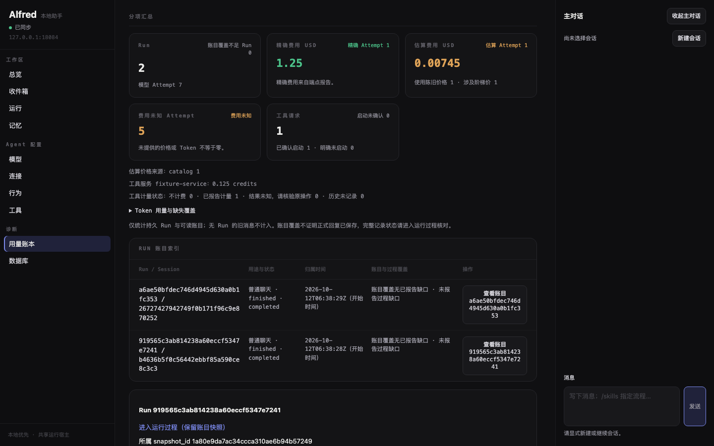
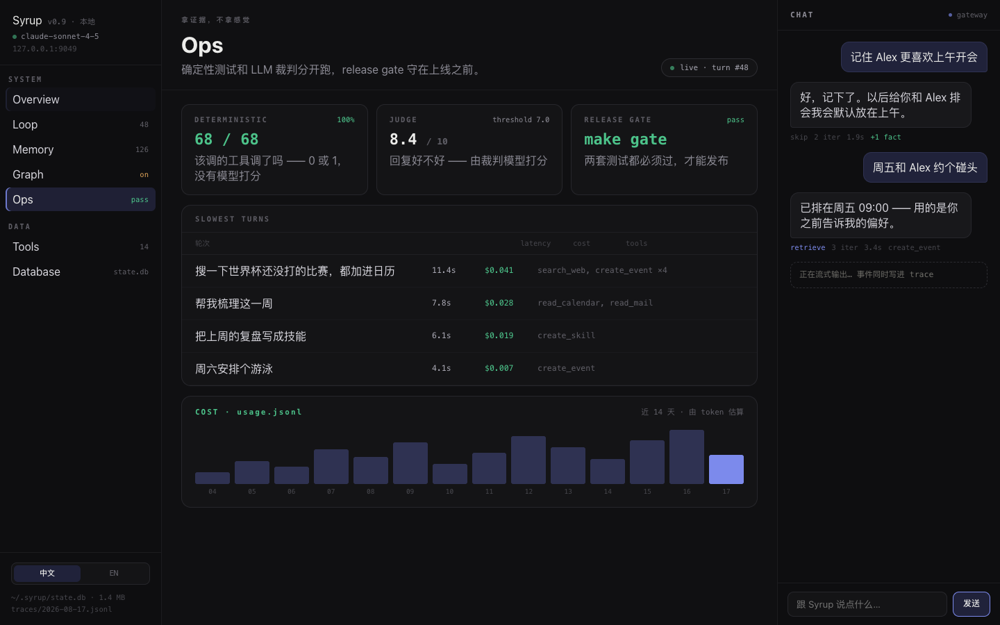
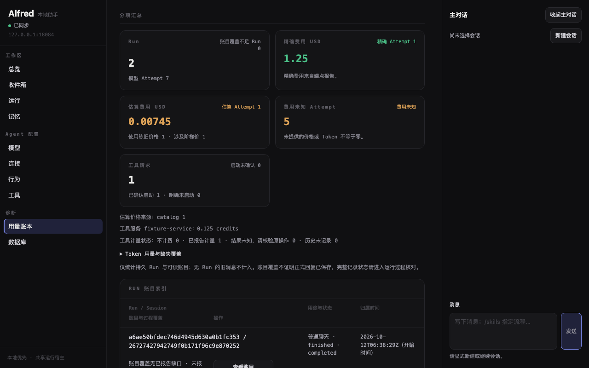
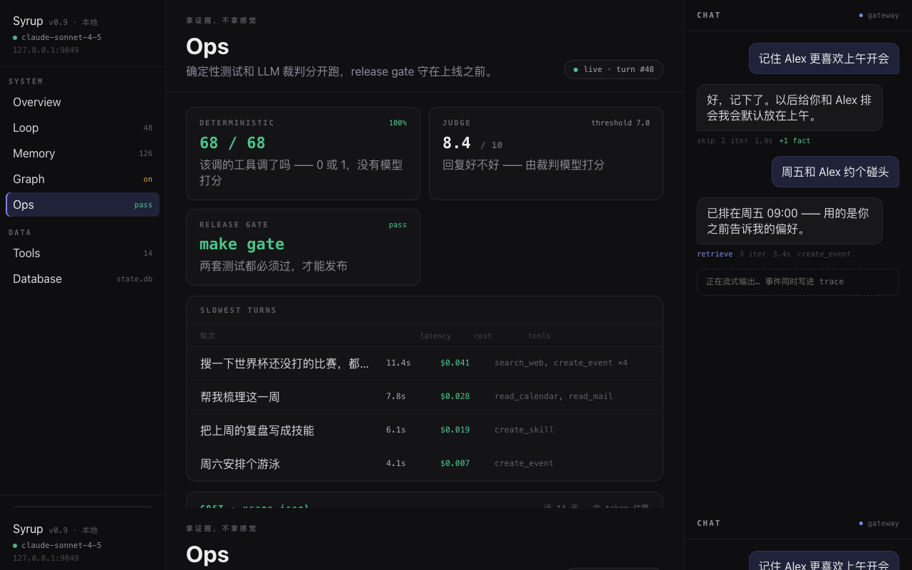
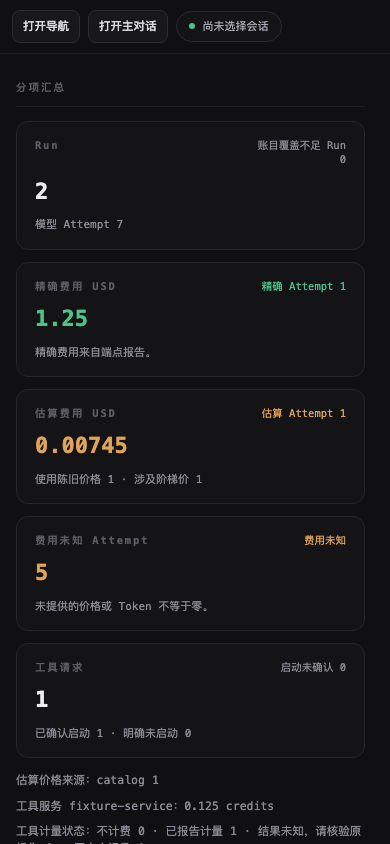
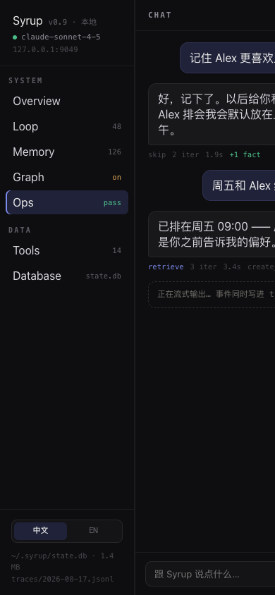
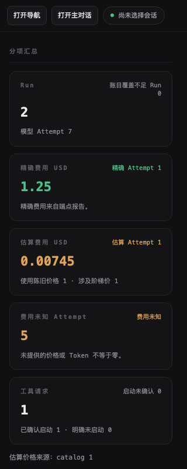
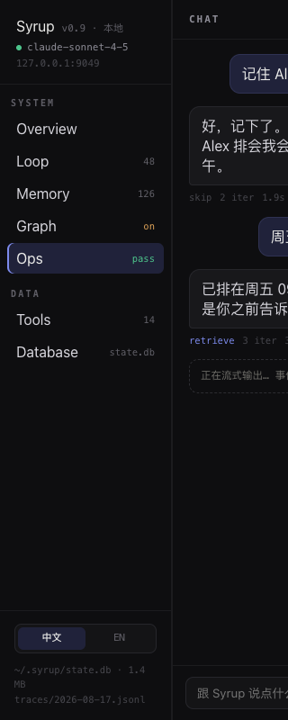

# V08 用量账本视觉与表格语义验收

对应 [#130](https://github.com/nineofoursyrup/Agent-Alfred/issues/130)，父规格为 [#122](https://github.com/nineofoursyrup/Agent-Alfred/issues/122)，公共契约为 [DASHBOARD-CLAUDE-DESIGN-RECIPES-v1](../../design/issue-122/RECIPES.md)。工作区 `/Users/nineofour/Agent-Alfred-v08`，分支 `dashboard-visual/v08-ops`，浏览器端口 `18080`。初始基线 `449e77fd0ff814fb63f97a009c2435139a68686d`，受测源码提交 `ee179c8c1dd31b6c46605609e7c78746dd8a4de8`。最终证据提交只增加本 V08 文档和静态证据；受测源码、测试、依赖、配置及环境的复用核对见 [source-audit.json](evidence/V08/source-audit.json) 和各门禁日志的 `inputs`。

本票把全局分项汇总改为 Ops 用量卡，把逐 Run 索引改为可换行的弹性行，筛选和固定快照使用公共面板。全局 summary 始终来自 `value.summary`；逐 Run 的五列仍是 Run / Session、用途与状态、归属时间、账目与过程覆盖、操作，不把汇总金额填进 Run 行。费用精确／估算／未知、各维价格来源、陈旧和阶梯价格标记、快照过期、离线财务副本及原来源待核验仍分别表达。

## 文件与契约

- 产品文件只有 `src/agent_alfred/ops/static/accounting.js`、`accounting.css`。测试只修改 `tests/browser/accounting-layout.spec.js`。
- `accountingPage(root, csrf)` 的导出名称、签名和返回方法不变；从 `tools.js` 导入的 `request` 不变，`tools.js` 未修改。HTTP/SSE、读取范围、显式刷新、分页所有权、历史投影、当前核验、路由和来源位置恢复没有改动。
- CSS 选择器全部以 `.accounting` 开头；尺寸由既有 token 推导，不写字面色值或 px 尺寸、`:root`、`url(#…)` 或产品行内样式。不添加／删除产品静态资源。
- `app.css`、公共 `sy-` 配方、壳层、其他页面、`RECIPES.md`、`.gitattributes` 无本票差异。主 checkout 和其他 worktree 的文件未操作，初始状态见 [initial-state.json](evidence/V08/initial-state.json)。
- `accounting.spec.js`、`accounting-migration.spec.js`、`integrations.spec.js`、`models-migration.spec.js`、`tools-migration.spec.js` 的行为断言原样保留，没有加重试或延长超时。
- 既有 h1/h2/h3/h4、form/region 名称、caption、按钮名称和 Tab 顺序不变。筛选 h2 与快照 h2 移入面板头，正文放入面板体；没有新增标题或 landmark。Run 表格增加显式 ARIA 角色与单元格表头关联，用于保留 CSS 弹性布局后的语义。

## 四视口与原稿并列

归档原稿为 version `1786950414092924`，两份文件 SHA-256 已先核对：HTML `54807adb38541fa2966e5b0c334b9d0e8d71c60b814245601bc4f35b8ec54b84`，support.js `8fe7df74405f3c55f49b7249c74ea1397e65d07dea2b1bd3b4a489bec2e28cbe`。原稿通过本地 `18089` HTTP 预览，React 18.3.1 和 ReactDOM 18.3.1 从 unpkg 实际取得 HTTP 200。用 `/^Ops/` 匹配的实际可访问名称为 **Ops pass**；捕获确认出现 SLOWEST TURNS，见 [reference-capture.json](evidence/V08/reference-capture.json)。归档原稿字节未改动。

Alfred 捕获使用现有 `ops_migration_server.py` 的 `mixed` 与 `long` 命令，是真实 Host、HTTP、SQLite 和隔离临时状态目录；离线模型提供可重复的费用三态、四维价格及工具 credits。主服务为 `18084`（分配端口 +4）；没有真实 provider 调用。这些 fixture 数字不进入产品源码。Chromium、DPR 1，窄屏是 viewport 模拟，减少动效开启。默认加载截图为 `ops-<width>x<height>.png`；下表使用同视口滚动到分项汇总后的截图，便于比较 Ops 卡与行列表。默认筛选、行列表和价格展开图也全部保留。

| 视口 | Alfred 分项汇总 | 原稿 Ops |
| --- | --- | --- |
| 1440×900 |  |  |
| 1280×800 |  |  |
| 390×844 |  |  |
| 320×800 |  |  |

| 视口 | 差异与原因 | 默认视图 / Run 行 / 价格证据 |
| --- | --- | --- |
| 1440×900 | Alfred 中央容器 823px，指标 3 列，Run 表 821px，正文列 207px，五列同排。原稿 main 886px、SLOWEST TURNS 面板 830px。原稿三张卡对应确定性测试／Judge／Release，Alfred 五张卡对应现有账目事实；不复制演示验收结果。已有筛选与固定快照在汇总之前，默认内容位置因此不同，比较图显式滚动到汇总。Run 行保留完整不透明身份和覆盖文字，行高大于原稿消息摘要行。 | [默认](evidence/V08/ops-1440x900.png) / [Run 行](evidence/V08/ops-rows-1440x900.png) / [四维价格](evidence/V08/ops-prices-1440x900.png) |
| 1280×800 | 中央容器 663px，指标 2 列，Run 表 661px，正文列 375px。用途和时间与正文同排，覆盖与操作换到下一排。原稿 main 726px，指标同样 2 列。Alfred 没有 Run 级 latency/cost/tools 聚合字段，因此沿用真实五列，列宽按完整状态内容选择，保持固定的 100/120/170/130px。 | [默认](evidence/V08/ops-1280x800.png) / [Run 行](evidence/V08/ops-rows-1280x800.png) / [四维价格](evidence/V08/ops-prices-1280x800.png) |
| 390×844 | 中央容器 349px，指标单列；Run 表 347px，正文列独占 309px，用途／时间、覆盖、操作依次换行。整页和 Run 索引横向溢出均为 0。原稿 nav 191px、main 实测 0px，Ops 主内容不可见。保留 Alfred 的现有面板开关、局部纵向滚动与窄屏可操作性。 | [默认](evidence/V08/ops-390x844.png) / [Run 行](evidence/V08/ops-rows-390x844.png) / [四维价格](evidence/V08/ops-prices-390x844.png) |
| 320×800 | 中央容器 279px，指标单列；Run 表 277px，正文列 239px，度量列宽不变并换行，没有正文列归零或整页横向溢出。完整 Run/Session、覆盖说明与按钮名称都换行显示。原稿 main 仍为 0px，主对话部分被裁切；此差异来自原稿没有窄屏适配。 | [默认](evidence/V08/ops-320x800.png) / [Run 行](evidence/V08/ops-rows-320x800.png) / [四维价格](evidence/V08/ops-prices-320x800.png) |

[capture.json](evidence/V08/capture.json) 保存每个视口的 DOM、ARIA snapshot、Chromium 完整 AX tree 中的表格节点、列宽、卡片字号与真实汇总文字。每张卡的大数字均为 22px；请求同源，page error 为 0。四视口截图阶段 requestfailed 为 0；其后立即从 Run 返回来源时有一条旧 Run 页的读取被正常退休中止（ERR_ABORTED），在 capture 中单独记录。[inline-style-audit.json](evidence/V08/inline-style-audit.json) 的独立 Chromium 检查中截图前 `[style]` 为 0，执行 Playwright 截图后六个 INPUT 出现空 `style=""` 属性；前后声明数均为 0。这是截图工具留下的空属性，不是产品行内样式。图片尺寸和哈希见 [screenshot-manifest.json](evidence/V08/screenshot-manifest.json)。

## 表格语义与精确边界

保留 `table > caption + thead/tbody > tr > th/td`。Run 索引显式设置 `aria-label="Run 账目索引"`，避免公共眉标的 CSS 大写转换改变 Chromium AX tree 中的表格名称，并显式声明 `table`、`rowgroup`、`row`、`columnheader`、`cell` 角色；每个列头继续 `scope="col"`，并有 `ops-run-column-0`～`4` 的唯一 id，每个对应单元格用 `headers` 关联。四视口快照都保留一行五个列头和每 Run 五个 cell，数据顺序不变。样式没有把 table 或行变成普通 list；折行后的 cell 仍属于其原列。[capture.json](evidence/V08/capture.json) 同时提供 ARIA 结构和 DOM 关联证明，实际 VoiceOver 操作为 NOT RUN。

行几何：正文下限 200px，四个固定列 100、120、170、130px，四个 14px 间隙，左右各 19px 内边距，外层两条 1px 边框，所以完整五列所需中央宽度为 **816px**。现有布局测试现在精确检查 **815px 换行 / 816px 同排**，正文宽度分别为 343/200px，固定列逐项等于上述宽度。四参考视口与 1099/1100 壳层边界仍检查筛选节点身份、Tab 顺序、面板返回、价格控件、字体、减少动效及无整页溢出；Run 索引检查加强为横向溢出严格等于 0，见 [layout-metrics.json](evidence/V08/layout-metrics.json)。Attempt、四维价格和 Token 明细继续保留有名称、可聚焦的局部横向滚动区。

[ops-source-pending-390x844.png](evidence/V08/ops-source-pending-390x844.png) 通过真实 Run 来源返回和暂缓原快照读取捕获“原账目来源待核验”面板；释放相同 GET 后恢复当前快照，没有创建替代账目。首次捕获的全局摘要包含两个 Run，但选中明细仅属于混合计费 Run；同一 capture 保存两者，证明没有把全局金额伪装成逐 Run 金额。费用冻结、失效、断连及新进程响应退休由原样行为测试验证。

### 刻意偏离

1. 只借用原稿 Ops 卡和 SLOWEST TURNS 的视觉语言；确定性测试、Judge、Release gate、演示费用、延迟、Syrup 用词及 14 天柱图均不进入产品。
2. 五张汇总卡拆分真实的 Run、精确费用、估算费用、费用未知 Attempt 与工具请求；工具服务／单位和价格来源另行保留。大数字与眉标在 DOM 中相邻，保持原有“精确费用 USD 1.25”等读取文本；右侧状态在视觉上位于同一眉标行。
3. 卡片采用原稿的 16×18px 内边距和 12px 圆角，大数字使用公共 `sy-metric-usage` 的 22px，说明使用公共等宽 11px 配方；原稿无效的 `font:… inherit` 回退造成的说明字号不照搬。数字行高 1.2，以保留可能换行的完整金额。公共配方定义不修改。
4. 不截断完整身份、状态、覆盖文字或按钮名。原稿的 62/62/170px 度量列不适用于 Alfred 的五列事实，采用上述固定宽度；正文下限和 flex-wrap 配方一致。窄屏提供可读内容，原稿窄屏主区仍照实截图。
5. 保留筛选、快照、汇总、索引、明细的原有阅读顺序与所有既有标题／region 名称。比较图显式滚动，默认截图另行保留，不隐藏筛选以制造外观相同。

### 建议的公共配方

可供 #135 整理“保留 table/thead/tbody/tr/th/td 及 scope/headers 的弹性行索引”组合，以及“眉标／右侧状态／22px 数值／说明”的语义 Ops 卡。卡片 DOM 保持标签与数值相邻，CSS grid 负责视觉排布。当前只在 `.accounting` 内实现，未扩展公共 token 或公共 `sy-` 定义。

## 门禁与首次失败

八项门禁在冻结源码后执行；运行中日志只写 `.scratch/v08/`，全部完成后归档。原始 stdout/stderr 以 JSON 字符串保存，附开始时间、退出码、秒数、HEAD 和输入文件 SHA；日志原文可逐字节还原，不修改 `.gitattributes`。门禁外的截图、辅助脚本、候选审计也先写入忽略目录，pytest 期间没有修改候选树。

| 门禁 | 最终结果 | 原始日志 |
| --- | --- | --- |
| ruff check | PASS，0 FAIL；0.177s | [31-ruff.json](evidence/V08/gates/31-ruff.json) |
| check_skills | PASS，0 FAIL；0.220s | [32-skills.json](evidence/V08/gates/32-skills.json) |
| check_env_example | PASS，0 FAIL；8.973s | [33-env.json](evidence/V08/gates/33-env.json) |
| Python 全量 | 6445 passed, 1 deselected, 14 warnings in 3629.14s (1:00:29)；3631.677s | [34-pytest.json](evidence/V08/gates/34-pytest.json) |
| typecheck | PASS，0 FAIL；1.937s | [35-typecheck.json](evidence/V08/gates/35-typecheck.json) |
| 完整浏览器 | 545 passed (13.5m)；808.610s | [36-browser.json](evidence/V08/gates/36-browser.json) |
| diff-check | PASS，0 FAIL；源候选 0.174s，最终暂存／完整基线 0.117s | [37-diff-check.json](evidence/V08/gates/37-diff-check.json)、[40-final-diff-check.json](evidence/V08/gates/40-final-diff-check.json) |
| build + MCP 安装核验 | wheel/sdist × base/MCP：4 PASS，0 FAIL；63.390s | [38-build-install.json](evidence/V08/gates/38-build-install.json) |

首次定向批次：[00-targeted-browser.json](evidence/V08/gates/00-targeted-browser.json)，**63 passed / 1 failed，173.761s**。唯一失败是本票新增的布局断言误用 `viewport < 1100` 推断行换行：在 1099px 时侧栏收起，中央区变宽，实际无需折行。改为中央容器 `< 816px` 的精确判断，随后原用例单独复测 **1 passed，4.797s**，见 [00-layout-retest.json](evidence/V08/gates/00-layout-retest.json)。未修改任何既有行为断言、重试或超时。原始 [error-context.md.json](evidence/V08/first-targeted-failure/error-context.md.json)、[失败 PNG](evidence/V08/first-targeted-failure/test-failed-1.png)、[trace.zip](evidence/V08/first-targeted-failure/trace.zip) 及 [manifest](evidence/V08/first-targeted-failure/manifest.json) 保留；JSON 中 UTF-8 原文与原 SHA 可还原带尾随空白的 error-context.md，只归档失败用例自己的三份原始证据。

第一次 Python 全量因补正实际表格可访问名称而主动 SIGINT：**824 passed / 1 deselected，退出 2，719.949s**，没有测试失败，但全量未完成，标 **NOT COMPLETED**，不作为门禁 PASS。原始记录见 [04-pytest.json](evidence/V08/gates/04-pytest.json)。

第一次完整浏览器启动同样在名字修复前主动停止：**60 passed / 2 failed / 1 interrupted / 482 did not run，退出 130，296.977s**，见 [06-browser.json](evidence/V08/gates/06-browser.json)，标 **NOT COMPLETED**。停止前两项实际失败是未归属的 Aggregation CE-14 整体 15s 超时和 Behaviour 320px 的 30s 整体超时；没有修改这些页面或用例。两项原样单独复测为 **2 passed，16.082s**，见 [00-unrelated-failure-retest.json](evidence/V08/gates/00-unrelated-failure-retest.json)。这支持时序波动假设，具体根因仍为 **UNKNOWN**；单独复测不替代全量门禁。Database cancel after-B 在停止时被中断，不记为产品失败，后续完整套件重新覆盖。只归档这三个用例各自已有的 error-context.md、失败 PNG 和 trace.zip；成员和 SHA 见 [first-full-browser-failure/manifest.json](evidence/V08/first-full-browser-failure/manifest.json)。

表格名称修复后的布局复测为 **1 passed，13.085s**，见 [00-final-layout-retest.json](evidence/V08/gates/00-final-layout-retest.json)。辅助截图校验曾把截图后新增的空 style 属性误判为产品行内样式；独立截图前后对照证实六个属性均为空，声明数为 0。随后按实际声明检查完成全部四视口语义与截图取证，没有修改产品来规避工具行为。

第二次全量启动因最后补正 Run caption 的公共眉标色而主动停止，两个运行都标 **NOT COMPLETED**。Python 为 **1 failed / 823 passed / 1 deselected，退出 2，741.218s**，原始 [14-pytest.json](evidence/V08/gates/14-pytest.json) 保留；真实失败是未修改的 `test_live_trace_thread_keeps_false_close_owned_until_real_thread_exit[normal_exit-ordinary-reopened]` 在 `reached.is_set()` 的断言。原用例单独复测 **1 passed，1.967s**，见 [19-host-lifecycle-retest.json](evidence/V08/gates/19-host-lifecycle-retest.json)，根因仍为 UNKNOWN。

该次浏览器为 **1 failed / 247 passed / 1 interrupted / 296 did not run，退出 130，766.777s**，见 [16-browser.json](evidence/V08/gates/16-browser.json)。真实失败是 A04 A05 A06 A08 在 Tools 页第二个 Tab 的“保存授权”处整体 15000ms 超时，尚未进入 Ops；原样单独复测 **1 passed，7.286s**，见 [20-authorization-retest.json](evidence/V08/gates/20-authorization-retest.json)，根因 UNKNOWN。Memory G2 v5 是主动停止时的中断，未冒充产品失败。对应已有上下文、PNG 和 trace.zip 见 [second-full-browser-failure/manifest.json](evidence/V08/second-full-browser-failure/manifest.json)。第一次该授权用例的临时复测命令使用锚定 grep 而未匹配到完整标题，退出 1、0 用例；该命令记录 [19-authorization-retest.json](evidence/V08/gates/19-authorization-retest.json) 不作为 PASS，修正 grep 后才取得上述原样复测结果。

最终核对 caption 颜色时发现既有 `.accounting caption` 覆盖了公共列表头色，已在本页索引 caption 显式使用 `--metadata`，补正前截图见 [caption-before-tone-fix-1440x900.png](evidence/V08/caption-before-tone-fix-1440x900.png)。几何和实际可访问名称保持不变，四视口重新捕获。既有 Aggregation 与 Routing Statistics 测试还会向 `tmp/agent-work/issue-27/` 和 `issue-76/` 写成功路径截图；这些由本 worktree 测试生成的文件先移入 `.scratch/v08/` 保存，最终 Python 与完整浏览器按顺序执行，避免候选捕获期间重写未忽略文件。没有修改该测试或仓库忽略配置。

最终候选 `ee179c8c1dd31b6c46605609e7c78746dd8a4de8` 上的完整 Python 为 **6445 passed / 1 deselected / 14 warnings，3631.677s**；其后完整浏览器为 **545 passed / 0 failed，808.610s**。两项均完整结束、exit 0，未增加重试或超时；原始日志为 [34-pytest.json](evidence/V08/gates/34-pytest.json) 和 [36-browser.json](evidence/V08/gates/36-browser.json)。后者重新覆盖了全部首次失败与中断用例，Python 的旧线程断言也随完整重跑通过。14 个现有 fork DeprecationWarning 保留在原始日志，不计为测试失败。

原稿首次通过 `file:` 打开时被 Playwright CLI 的协议策略阻止，随后改为同一归档目录的本地 HTTP 预览；原稿和 support.js 未修改，实际捕获成功。这是辅助取证入口限制，不是产品失败。

本地 `code-review` 对最终产品／测试差异做规范和规格两轴检查，最终均 **0 findings**；补查实际 Chromium AX tree 发现的表格名大小写问题已通过显式原名称修复，四视口重新捕获，初次观测见 [table-name-first-observation.json](evidence/V08/table-name-first-observation.json)，不是独立代理评审。核对范围与源码身份见 source-audit。初始化三个指定命令全部执行成功。

收尾前在本 worktree 再次执行 `git fetch origin`，远端 main 仍为 `449e77fd0ff814fb63f97a009c2435139a68686d`，与初始基线相同，无需 rebase；[remote-main-fetch.json](evidence/V08/remote-main-fetch.json) 与 [39-fetch-origin.json](evidence/V08/gates/39-fetch-origin.json) 保存回读结果。后续只提交 V08 文档和静态证据，受测实现、测试、依赖、配置及环境不变，八项通过结果按源文件 SHA 复用。最终暂存、完整基线与分支差异全部通过，见 [40-final-diff-check.json](evidence/V08/gates/40-final-diff-check.json)。

## 未执行的验收

- 原生桌面真实 200% 缩放：**NOT RUN**。
- 中文输入法与真实移动软键盘：**NOT RUN**。
- iPhone / iOS Safari：**NOT RUN**，既有范围外。
- 真实 VoiceOver 导航朗读：**NOT RUN**；本票提供 Chromium ARIA/AX 与 DOM 列关联证据。
- 真实 provider 调用与生产账单核对：**NOT RUN**；本票验证现有离线模型的真实 Dashboard 链路。
- #135 十页统一视觉验收：**NOT RUN**，由该票负责；本 PR 不合并、不手动关闭 #130。
