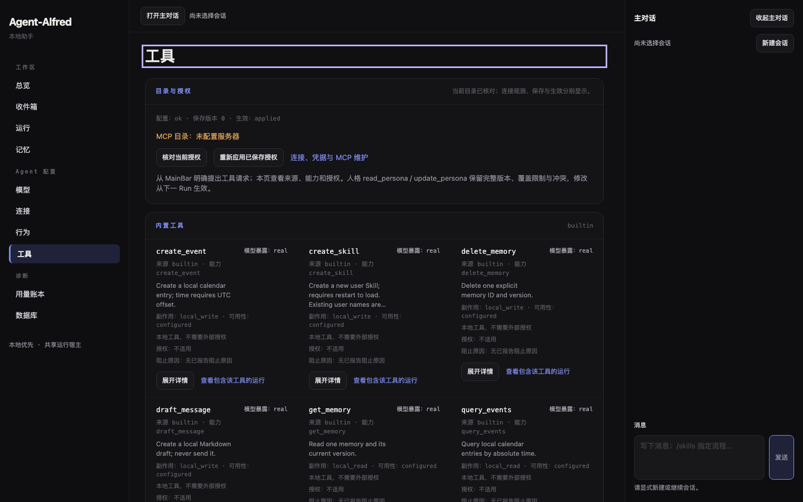
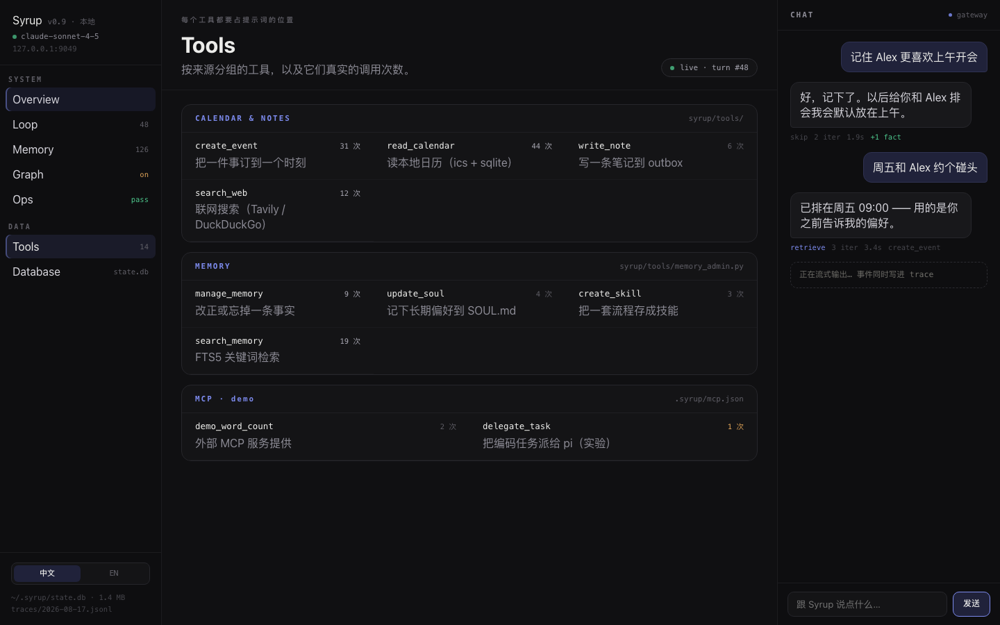
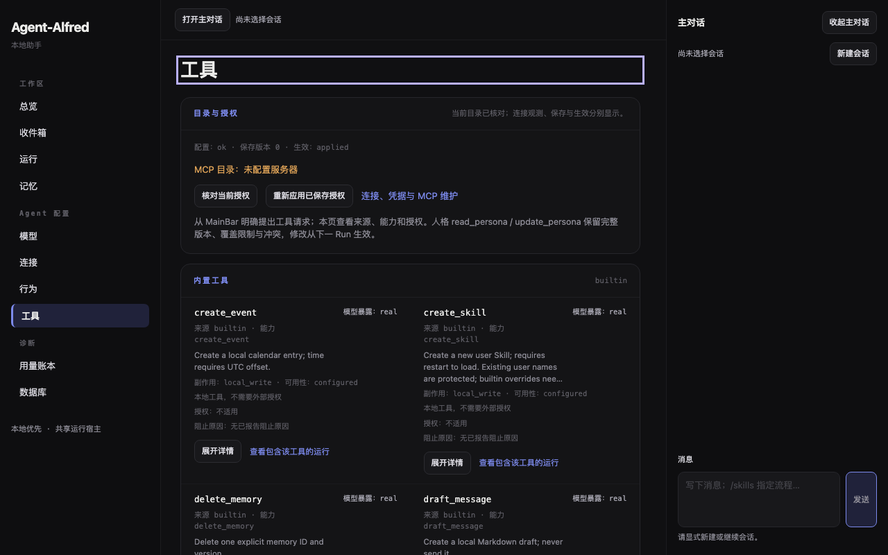
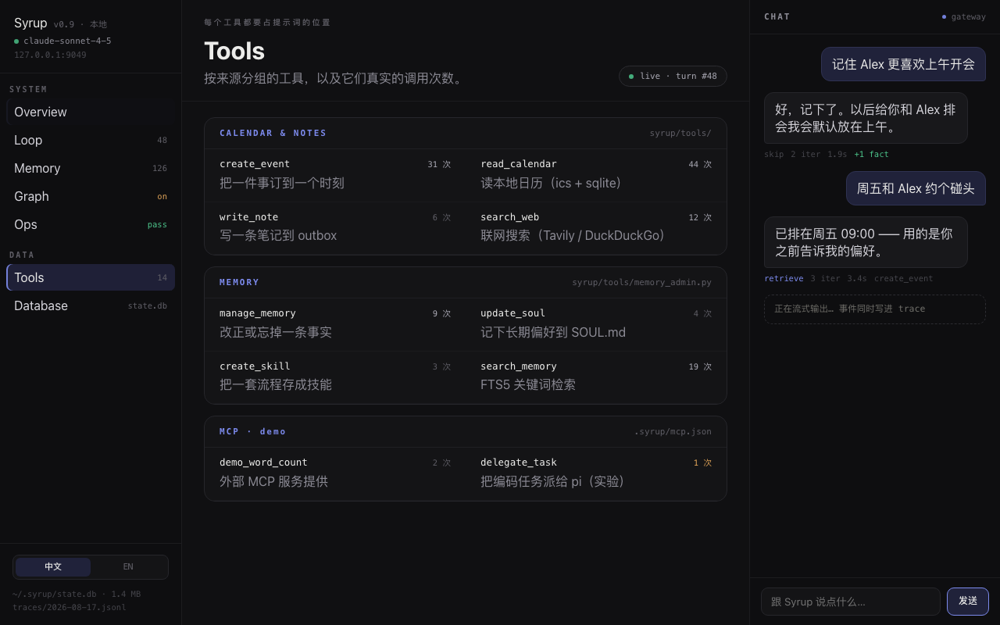
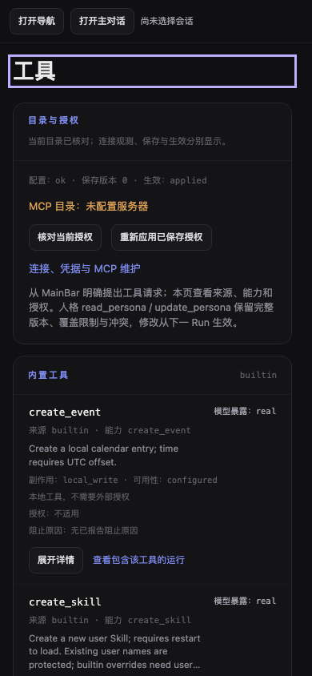
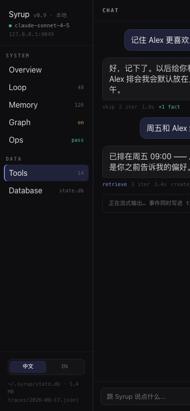
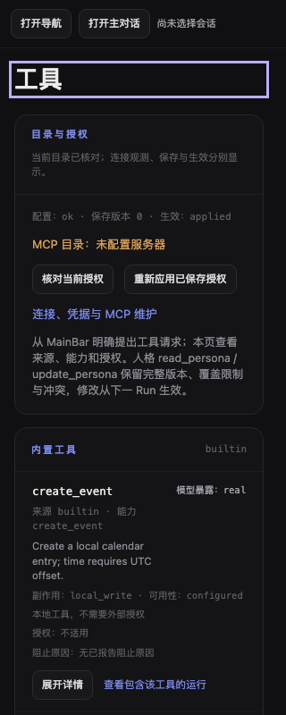
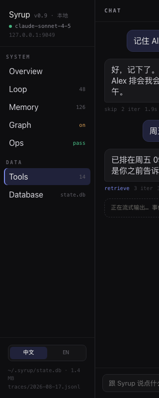

# V09 工具页视觉与来源语义验收

对应 [#131](https://github.com/nineofoursyrup/Agent-Alfred/issues/131)，父规格为 [#122](https://github.com/nineofoursyrup/Agent-Alfred/issues/122)，复用 [RECIPES.md](../../design/issue-122/RECIPES.md)。工作区 `/Users/nineofour/Agent-Alfred-v09`，分支 `dashboard-visual/v09-tools`；初始基线 `645c4549bb5bea9f79ddb4625f17c5a8a6af58c8`，实现候选 `a4f3b99f5cc8ea0be9adc7c1d771e0df6bf406b6`。最终交付身份及复用核对见 [source-audit.json](evidence/V09/source-audit.json) 与门禁汇总。

本票把当前来源、退休来源、工具详情及授权草稿套入公共面板，工具目录改为原稿 Tools 的自适应栅格。完整来源身份仍决定分组；同名来源与同名能力不合并，历史能力没有授权控件。名称、完整身份、连接观测、已保存授权、实际应用、模型暴露、阻止原因与未保存草稿分别保留；MCP 可用工具数继续明确注明“不是已授权数”。不改 HTTP/SSE、授权 CAS、保存／回读、退休政策、路由或离页合同。

## 文件与契约

- 产品只有 `src/agent_alfred/ops/static/tools.js`、`tools.css`。
- 测试只有 `tests/browser/tools-visual.spec.js` 的中央容器边界 hunk：679/680 改为 521/522，并改量来源栅格列数。2×260px 加公共面板左右边框，实测 521px 为单列、522px 为双列。壳层、焦点、字号、溢出及 V01 公共配方测试不改。
- `tools.spec.js`、`tools-migration.spec.js`、`mcp.spec.js`、`integrations.spec.js` 的既有定位器适用，没有改动这些文件或放宽断言；未增加重试或超时。
- `request`、`toolsPage` 导出名称与签名不变，`request` 实现逐字节相同；`accounting.js` 和 `app.js` 未改。所有页面 CSS 选择器都以 `.tools-page` 开头；没有字面色值／尺寸、`:root`、行内样式、远程产品资源或公共 `sy-` 类定义。
- `app.css`、`RECIPES.md`、`.gitattributes` 及其他页面无本票差异。主工作区与其他 `Agent-Alfred-vNN` 的文件未操作。

## 四视口与原稿并列

原稿为归档 version `1786950414092924`、SHA-256 `54807adb38541fa2966e5b0c334b9d0e8d71c60b814245601bc4f35b8ec54b84` 的 `Syrup Dashboard.dc.html`，`support.js` SHA 为 `8fe7df74405f3c55f49b7249c74ea1397e65d07dea2b1bd3b4a489bec2e28cbe`。两份原稿没有改动。浏览器实际从 unpkg 取得 React 18.3.1 与 ReactDOM 18.3.1，两个响应均 HTTP 200；原稿截图已实际选择 Tools，见 [reference-capture.json](evidence/V09/reference-capture.json)。

本页使用真实 Host、HTTP、SQLite、临时状态目录、现有离线 `tools_server.py`；补充历史目录使用现有回环 MCP fixture。端口固定 `ALFRED_BROWSER_TEST_PORT=17960`，实际辅助服务在预留的 17960～17968 内。Chromium、DPR 1，窄屏仅为 viewport/touch 模拟。所有默认截图中产品页面请求都是同源，行内样式为 0，page error/requestfailed 为 0；[capture.json](evidence/V09/capture.json) 记录环境、源码 SHA、完整来源、列数和焦点。四视口图片尺寸及 SHA 见截图 manifest。

截图时 #124 尚未并入本候选，页头、导航、`<title>` 和 MainBar 仍为旧结构，这是既定分工；页头 3px 外轮廓来自实际导航焦点。#131 没有实现英文眉标／副标题或壳层重排。

| 视口 | Alfred 工具页 | 原稿 Tools |
| --- | --- | --- |
| 1440×900 |  |  |
| 1280×800 |  |  |
| 390×844 |  |  |
| 320×800 |  |  |

| 视口 | 逐项差异与原因 |
| --- | --- |
| 1440×900 | 本页中央容器 823px，首个来源栅格 3 列；原稿同组 3 列，轨道 276px。原稿把分组面板直接放在页头下；本页先呈现真实的目录核对、保存版本、生效、MCP 目录与操作面板，因此来源区下移。面板、强调眉标、完整来源右侧等宽说明和条目名称／描述／右侧状态均使用配方；本页每项还保留多个独立状态和操作，行更高、目录更长。 |
| 1280×800 | 本页中央容器 663px，2 列；原稿也是 2 列，轨道 334px。本页仍完整呈现状态文字和授权入口，描述保留已有三行摘要及可展开全文，状态不截断。公共壳层边框盒模型及内容 gutter 带来轨道的少量差异，本票不改壳层。 |
| 390×844 | 本页中央容器 349px，1 列，页内竖向滚动，导航／MainBar 仍用既有面板开关；完整来源、状态、按钮和授权草稿可换行。原稿保持桌面三栏，nav 191px、main 实测 0px，Tools 内容不可见；这是原稿没有提供窄屏适配造成的截图差异，本页保留既有可操作性。 |
| 320×800 | 本页中央容器 279px，来源栅格可用 277px，1 列，整页横向溢出为 0。历史目录的嵌套来源面板更窄时，条目最小宽度压到 100%，完整身份与状态换行；原稿 main 同样为 0px，仅能看到导航及被裁切的主对话。保留单列和嵌套区完整内容是有意适配，不修改原稿。 |

### 刻意偏离

1. 原稿的演示调用次数、路径、来源分组和业务数据不进入产品。右侧状态取现有“模型暴露”事实，连接、可用性、保存、生效及草稿另行保留；没有新增计量 API、装饰数字或状态推断。
2. 来源头采用公共 `sy-panel-header` 的 15×18px，原稿 Tools 为 14×19px；面板间距为公共 14px。行内 13×19px、260px 栅格下限均由现有 token 表达，不修改冻结的公共配方。
3. 260px 下限用页面变量从既有 13px body token 推导，窄于下限时允许收缩至容器宽度。中央边界测量仍精确断言 521/522px，不沿用旧的状态摘要断点。
4. 工具描述采用配方要求的 11.5px 系统字；原稿预览实测描述为 16px，因其 `font:400 11.5px/1.45 inherit` 无效并回退。名称与面板眉标实测仍分别为 12.5/11px。本页使用有效 CSS 和已批准字级，未改公共 token；测量见 [reference-measurements.json](evidence/V09/reference-measurements.json)。原稿标题实测 32px，本页现有标题为公共 27px，页头归 #124。
5. 状态文字完整保留，只有既有描述摘要三行截断。详情全文、完整身份、授权 CAS 基线、操作回执和历史不可调用说明都可展开／阅读，焦点轮廓保持 3px。不增加状态动画。
6. 配置面板新增 h2“目录与授权”（`tools.js:41`）。原页面这一区块没有标题，为套用 `sy-panel` 面板头的强调色眉标与右侧等宽 `readState` 而新增；它与来源组的 h2 同级，没有修改任何已有标题、region 名称或按钮名称，现有测试不依赖它。
7. `aria-label="工具状态摘要"` 的容器现在还包含工具名 h3、来源／能力身份和描述摘要（`tools.js:81-83`），使“名称／描述 + 右侧模型暴露”处于同一栅格；现有测试仍用这个标签配合 `toContainText` 定位，断言字符串没有改变。

### 建议的公共配方

可考虑复用“完整来源头 + 260px 自适应目录栅格 + 名称／描述／右侧等宽状态”的组合，包含窄于最小轨道时收缩至 100% 的规则，供模型／连接设置组按需采用。本票仅在 `.tools-page` 内实现布局，未新增或重定义 `sy-` 类，也未改 `RECIPES.md`。

## 详情、授权和历史证据

四个视口都补拍授权面板与退休目录，文件为 `tools-authorization-<width>x<height>.png`、`tools-history-<width>x<height>.png`。授权截图通过真实选择产生 `allowed` 草稿，保存值仍为 `unset`，不声称已保存／已授权；焦点实测 3px。历史截图通过真实 MCP 同名替换产生，当前／原来源完整身份不同，旧草稿失效清除，历史无 combobox、模型暴露 hidden、实际应用不可调用，调用记录入口仍绑定旧身份，业务 `tools/call` 为 0。四视口快照和 capture JSON 保留这些事实。

S07 的四视口长描述、完整同名前缀、草稿折叠、面板切换、键盘和焦点断言随完整套件通过。原稿与产品的默认截图不是实际 provider、原生桌面 200% 缩放、中文 IME 或 iOS 验收；这些为 NOT RUN，本票不代替后续 #135 的整体视觉验收。

## 门禁与首次失败

所有运行命令、候选源码 SHA、开始时间、退出码、耗时、原始 stdout/stderr 及其 SHA 用 JSON 保存；JSON 字符串可还原原始日志字节，不改写行末空白、不新增 `.gitattributes`。运行中输出先写 `.scratch/v09/`，门禁结束后才归档，以免改变候选身份。

| 门禁 | 最终实现下的执行结果；证据提交阶段的处理 | 原始日志 |
| --- | --- | --- |
| `uv run ruff check` | 重跑 PASS；后续证据提交复用，Python 源码和配置未变 | [03-ruff.json](evidence/V09/gates/03-ruff.json) |
| `uv run python scripts/check_skills.py` | 重跑 PASS；后续复用，校验脚本与技能树未变 | [03-skills.json](evidence/V09/gates/03-skills.json) |
| `uv run python scripts/check_env_example.py` | 重跑 PASS；后续复用，脚本、配置与 `.env.example` 未变 | [03-env.json](evidence/V09/gates/03-env.json) |
| `uv run --extra mcp pytest` | 完整重跑 PASS：6445 passed / 1 deselected / 14 warnings；后续仅静态证据归档，受测 Python 实现、依赖、配置及环境未变 | [03-pytest.json](evidence/V09/gates/03-pytest.json) |
| `npm run typecheck` | 最终源码 PASS；复用 03 的确定性检查，JS／测试／锁文件／配置 SHA 未变 | [03-typecheck.json](evidence/V09/gates/03-typecheck.json) |
| `ALFRED_BROWSER_TEST_PORT=17960 npm run test:browser` | 第四次完整重跑 PASS：543 passed（11.9m）；未增加重试或超时 | [09-browser.json](evidence/V09/gates/09-browser.json) |
| `git diff --check` | 最终重新执行 PASS；暂存与完整基线差异也通过 | [11-diff-check.json](evidence/V09/gates/11-diff-check.json)、[cached](evidence/V09/gates/11-cached-diff-check.json)、[branch](evidence/V09/gates/11-branch-diff-check.json) |

初始化执行了用户指定的 `uv sync --extra dev --extra mcp --locked`、`npm ci --ignore-scripts` 和 `npx playwright install chromium`。首次工具／MCP／集成定向批次为 **43 passed（1.2m）**，其中 S07 四视口及 V01 公共配方通过。之后只收紧目录状态面板空段落及垂直间距，完整门禁按最终 CSS 重新检查。

首次 Python 全量记录完整保留在 [01-pytest.json](evidence/V09/gates/01-pytest.json)：**8 failed / 816 passed / 1 deselected**，主动 SIGINT 停止，exit 2，未完成全量。原因是协调者没有冻结被候选捕获的仓库输入：持续日志写入未被排除的 `evidence/V09/gates/01-pytest.raw`，同期取证和间距编辑也发生在仓库内；验收测试在同次 capture/verify 间得到 `candidate_changed`。单独诊断时产品编辑已经结束，持续日志仍足以改变捕获身份。单独诊断期间也触发同一失败；首次 3 个 seal 用例复测通过不代表已经复测实际失败项。改用 `.scratch/` 输出并冻结输入后，**8 个实际失败项全部通过**，见 `02-python-failures.json`；之后重跑四项 Python 门禁。没有改候选检查、Python 代码或测试来规避失败。

首次完整浏览器 **540 passed / 3 failed（14.6m）**，exit 1，见 [03-browser.json](evidence/V09/gates/03-browser.json)。失败为未修改的 Database SSE 恢复等待、Connections 旧探测回执离线提示等待和 Memory A52 的 15000ms 整体超时；本票工具、S07 四视口、V01 公共配方均通过。只保存这三个失败用例各自的上下文、失败 PNG 和 trace.zip，没有保存整个结果 artifact 压缩包。两份 error-context.md 含原始尾随空白，用 `.md.json` 保存 UTF-8 原文与原始字节 SHA，解码后逐字节一致，不新增 `.gitattributes`。来源与成员校验见 [first-full-browser-failure-manifest.json](evidence/V09/first-full-browser-failure-manifest.json)。

三个实际失败项在相同实现／断言／阈值下单独执行为 **3 passed（12.4s）**，见 [04-browser-failures.json](evidence/V09/gates/04-browser-failures.json)。这支持时序波动的假设，但不足以证明首失败的具体根因，仍标 UNKNOWN；后续完整门禁不能覆盖此记录。最终完整复测结果见上表。

第二次完整浏览器为 **539 passed / 4 failed（12.1m）**，见 [05-browser.json](evidence/V09/gates/05-browser.json)。四项停在 Models STD01、Overview 两项及 Session read-retirement 的 4000ms 离线提示断言；原始 native SSE trace、失败截图和上下文分别保存在 `second-full-browser-failure/`，与首次记录分开。相同源码／配置下这些四项和同组 replay-gap 用例独立复测为 **5 passed（7.5s）**，见 [06-second-browser-failures.json](evidence/V09/gates/06-second-browser-failures.json)。完整套件与独立复测结果不同，尚未证明根因，仍为 UNKNOWN；没有把独立复测当成完整门禁 PASS，没有改动公共连接层或其他页面。

第三次完整浏览器为 **542 passed / 1 failed（12.0m）**，见 [07-browser.json](evidence/V09/gates/07-browser.json)。Run-path CE-08 在初始 `routingRun` 内“发送”按钮 4000ms 就绪断言失败，尚未进入反序响应／重新打开／Run 导航主体；未触发的 POST 等待又产生清理期错误。只保留这一个用例的上下文、PNG、trace.zip，位于 `third-full-browser-failure/`，同样有原始成员 SHA manifest。该用例原样复测为 **1 passed（3.3s）**，见 [08-third-browser-failure.json](evidence/V09/gates/08-third-browser-failure.json)。前两次失败项在此次完整检查中均通过；新失败的具体根因仍为 UNKNOWN，未修改非归属页面。

原稿第一次捕获用可访问名称 `Tools` 定位，实际原稿链接为 `Tools 14`，因此 5s 内未匹配；原稿已成功联网加载且无 page error。原始 [reference-first-failure.json](evidence/V09/reference-first-failure.json) 和 PNG 保留，改用实际名称后四视口捕获通过。补充字体测量曾用全页 `create_event` 精确文本遇到 main／aside 两个匹配，随后限定到 main；这仅是临时取证定位器，未改生产名称或测试断言。一次本地辅助命令误用不存在的 `python`，未执行该段文件修改，随后改用 `uv run python`；记录见取证调用失败 JSON。

最终暂存差异检查首次发现本 V09 文档尾部多余空行，`10-cached-diff-check.json` 的 exit 2 原始记录保留；删去该空行后重新检查，未改源码或测试。

提交前在本 worktree 执行 `git fetch origin`，远端 main 仍为 `645c4549bb5bea9f79ddb4625f17c5a8a6af58c8`，无需 rebase；见 [remote-main-fetch.json](evidence/V09/remote-main-fetch.json)。实现提交之后的改动只增加 V09 文档与静态证据，受测代码、锁文件、配置、校验脚本和环境未变；最终 source SHA 与各通过日志的 inputs 逐项核对一致。四项 Python 与 typecheck 在证据提交阶段复用上述记录，完整浏览器则在所有失败复测后重新执行。远端 CI 将在 PR 创建后独立运行，实际 PR head 和回读 CI 状态随交付报告给出。本次追加提交只修改 `V09.md`，被测源码、测试、依赖和配置均未变化，`source-audit.json` 和 `gates/final-results.json` 里的 SHA 仍然适用，继续沿用已有门禁记录。
