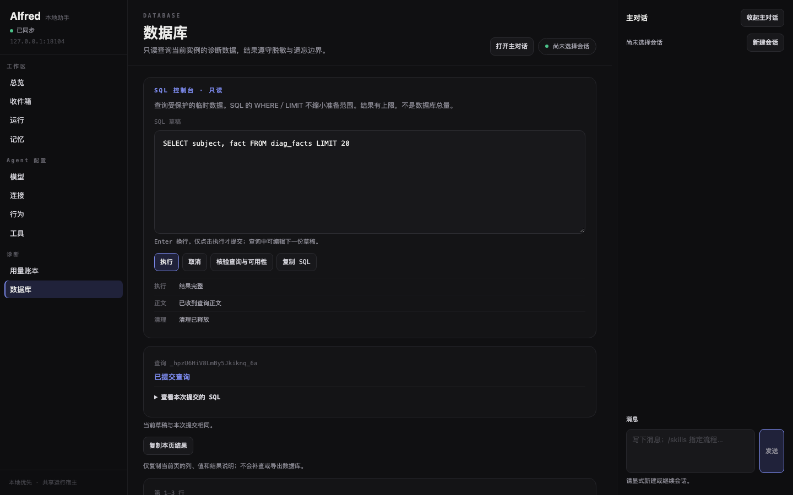
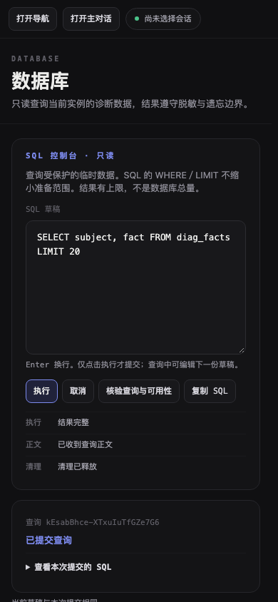
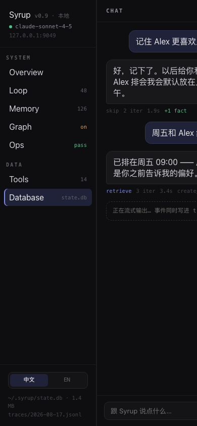
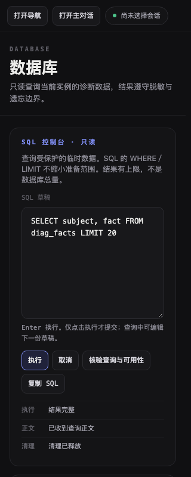
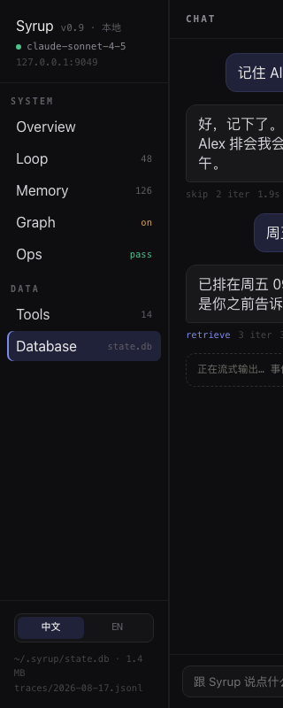
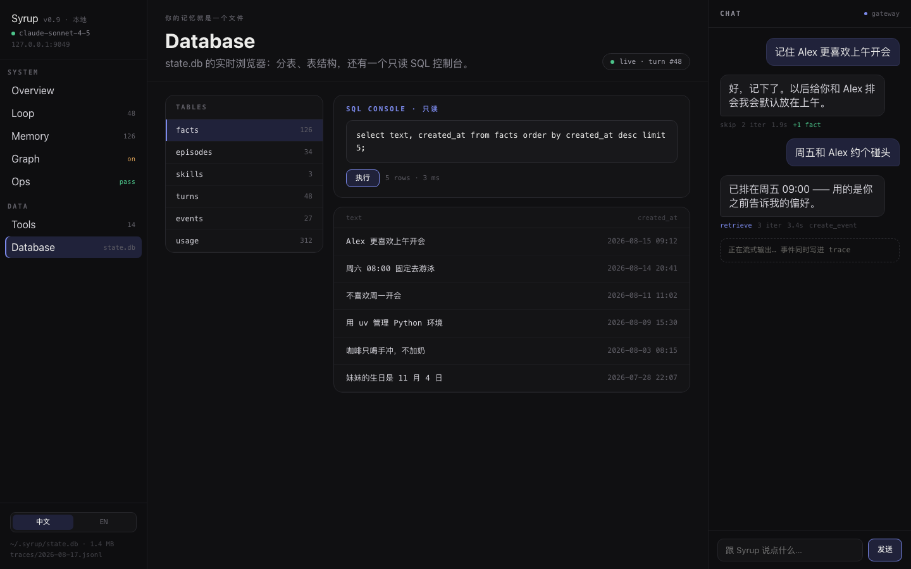
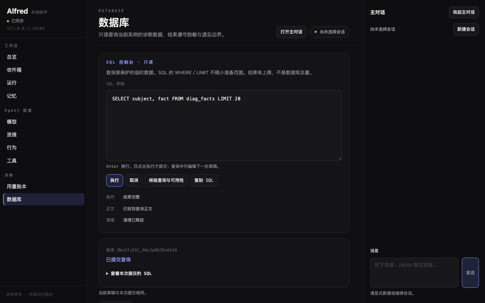
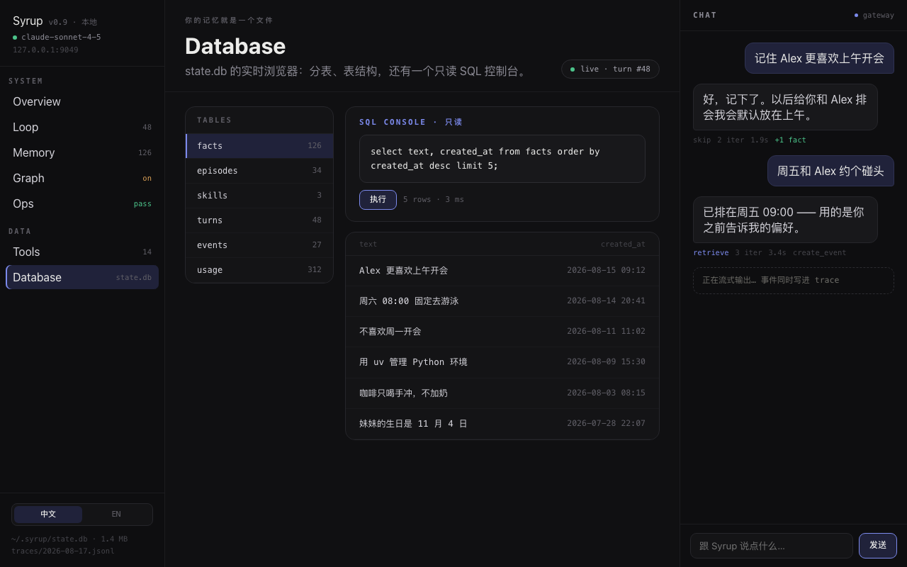

# V10 · Database 控制台

> 当前候选的合并前复验见 [2026-10-23 记录](#rebase-20261023)。此前各节保留初次实施的历史门禁、截图与失败事实。

Issue [#132](https://github.com/nineofoursyrup/Agent-Alfred/issues/132)，父规格 [#122](https://github.com/nineofoursyrup/Agent-Alfred/issues/122)，契约 **DASHBOARD-CLAUDE-DESIGN-RECIPES-v1**。从 `origin/main` 基线 `449e77fd0ff814fb63f97a009c2435139a68686d` 创建 `/Users/nineofour/Agent-Alfred-v10`、分支 `dashboard-visual/v10-database`。初始化工作树无既存修改；主 checkout 的 `docs/dashboard.md`、`README.md` 与 `tmp/` 未改。初始状态与归属见 [workspace-initial-state.json](evidence/V10/workspace-initial-state.json)。

SQL 控制台采用强调眉标「SQL 控制台 · 只读」、抬升底色与 10px 圆角的等宽编辑区、强调边框及选中底的执行按钮；执行／正文／清理以三条独立等宽状态行呈现。诊断结果继续使用真实 `table`、最弱色等宽表头和行分隔，放入原有具名 `.table-scroll` 区域。现有诊断目录、已提交查询、草稿关系、复制回执和完整保护／覆盖说明全部保留。

## 文件与契约

- 产品改动仅 `src/agent_alfred/ops/static/database.js`、`database.css`；测试仅 `tests/browser/database_migration.spec.js`。
- `databasePage(root, ctx)` 导出名称、签名与返回接口不变。从 `let generation = 0` 起的全部执行、取消、清理、HTTP/SSE、离页及草稿逻辑与基线逐字节相同；校验见 [source-audit.json](evidence/V10/source-audit.json)。点示例、查询提交归属、保护失效、NULL／空文本表达、取消／回执丢失等既有行为断言未改变。
- 新增 h2「SQL 控制台 · 只读」以承载规格指定眉标，使既有 h3 执行／正文／清理处于 h2 后。原有 h1、h2、h3 名称及层级、label、按钮和 region 名称不变；新增外层 section 未添加 region 名称。
- 旧状态三列栅格改为各视口一致的三条状态行，因此中央 679/680px 用例仍精确测量两个宽度，但栅格断言均改为单列。四视口 computed-style 仅补足状态行 11px 断言。原壳层 1099/1100px、导航 232px、MainBar 320px、键盘焦点、长值与整页溢出断言保留；没有放宽断言、增加 retries 或延长 timeout。其余 Database 四份测试及 aggregation／mainbar-empty-identity／mainbar-location／shell 未改。
- 所有页面 CSS 选择器以 `.db-console` 开头；颜色、尺寸与字级只引用公共 token 或 token 推导。未改冻结公共层、其他页面、导出、静态资源清单或 `.gitattributes`，无新增／删除生产静态资源、远程产品资源、`:root`、CSS `url(#…)` 或行内样式。

## 四视口与原稿并列

归档原稿 version `1786950414092924`；HTML SHA-256 `54807adb38541fa2966e5b0c334b9d0e8d71c60b814245601bc4f35b8ec54b84`，support.js SHA-256 `8fe7df74405f3c55f49b7249c74ea1397e65d07dea2b1bd3b4a489bec2e28cbe`，实现前均按 README 核对一致，原稿未修改。真实 Playwright 加载归档 HTML，从 unpkg 取得 React / ReactDOM 18.3.1，均 HTTP 200；选择 `database` 视图，实际链接可访问名称为 `Database state.db`，用前缀定位。几何与环境见 [reference-capture.json](evidence/V10/reference-capture.json)。

Alfred 取证使用既有 `memory_server.py`、真实 Host／HTTP／SQLite、临时状态目录和离线模型。通过真实 API 预置三条本地视觉测试事实，再显式执行 `SELECT subject, fact FROM diag_facts LIMIT 20`，未引入原稿演示数据或产品默认占位数字。端口固定 18100～18109，产品辅助服务为 18104、原稿临时服务为 18109。Chromium / DPR 1；窄屏为 viewport/touch 模拟。有效行内 CSS 声明、active request failure、page error、外部产品请求均为 0；Playwright 操作留下的空 style 属性在 JSON 单列，未被当成有效 CSS。环境、源码 SHA、正常／长值几何和 3px 焦点见 [capture.json](evidence/V10/capture.json)。

| 视口 | Alfred Database | 原稿 Database |
| --- | --- | --- |
| 1440×900 |  |  |
| 1280×800 |  |  |
| 390×844 |  |  |
| 320×800 |  |  |

| 视口 | 逐项差异与原因 |
| --- | --- |
| 1440×900 | Alfred 中央区 823px，控制台占满中央区；原稿控制台 564px，左侧 TABLES 占据额外一栏。本票按规格省略该栏，保留真实诊断对象目录并移至结果之后。Alfred 编辑区 188px 高，保留现有八行可编辑 textarea；结果前还保留提交身份、正文归属、读取时刻、保护版本及覆盖说明，所以结果表更靠下。 |
| 1280×800 | Alfred 中央区 663px，控制台占满中央区；原稿控制台 444px，左侧 TABLES 占据额外一栏。本票按规格省略该栏，保留真实诊断对象目录并移至结果之后。Alfred 编辑区 188px 高，保留现有八行可编辑 textarea；结果前还保留提交身份、正文归属、读取时刻、保护版本及覆盖说明，所以结果表更靠下。 |
| 390×844 | Alfred 中央区 349px，单列控制台，操作按钮自然换行；三项状态仍逐行完整显示，长值在具名表格／单元格区域内滚动，整页横向溢出 0。原稿 main 实测 0px，保持桌面导航与 CHAT，Database 主区不可见。本票沿用 Alfred 既有窄屏壳层和可操作性。 |
| 320×800 | Alfred 中央区 279px，单列控制台，操作按钮自然换行；三项状态仍逐行完整显示，长值在具名表格／单元格区域内滚动，整页横向溢出 0。原稿 main 实测 0px，保持桌面导航与 CHAT，Database 主区不可见。本票沿用 Alfred 既有窄屏壳层和可操作性。 |

正常结果与长值结果分别补拍 `database-result-<width>x<height>.png`、`database-long-result-<width>x<height>.png`。长值场景由真实查询返回 SQL NULL、空文本、字符串 "NULL"、integer、real、BLOB 和长中文文本。SQL NULL 保留 `NULL` 文字与斜体，空文本／字面 NULL 则带引号；完整单元格值可以键盘聚焦，表格可局部横向滚动，四视口整页与中央区横向溢出均为 0。截图文件字节 SHA 与尺寸见 [artifact-manifest.json](evidence/V10/artifact-manifest.json)。

### 刻意偏离

1. 不呈现原稿 TABLES 左栏、演示行数／耗时、Syrup 状态库路径或演示记忆。现有 Alfred「诊断对象目录」是只读诊断合同的一部分，作为下方完整面板保留，示例仍只替换草稿。
2. 控制台使用公共 `sy-panel-body` 的 17×19px，原稿为 16×19px。执行按钮沿用公共控件的 8×10px padding／hover 配方，原稿为 7×14px；正常状态仍为强调边加选中底。编辑区 padding 13×15px、字体 12.5px、raised 底色与 10px 圆角与原稿相同，保留八行可编辑 textarea，而非缩成原稿两行静态展示。
3. 查询提交身份、当前草稿关系、清理事实、复制回执、读取时刻与保护／覆盖信息让本页比原稿更长；结果先保留这些真实说明，不复制原稿 `5 rows · 3 ms`。三项状态始终逐行显示，避免重新混成一项成功状态。
4. 结果使用 table 语义和 13px 公共表格正文，原稿是 flex 行、正文 12.5px；表头仍为 10.5px 等宽最弱色，行分隔与公共配方一致。单元格旧有 100/400px 宽度、360px 内容宽度、180px 局部高度及 pre 240px 上限由 token 推导；编辑区 max 400px、表区 max 480px 也用 token，超过时局部滚动。窄屏继续可操作，原稿主区为 0px 的截图原样保留。

### 建议的公共配方

#135 可考虑复用「内嵌 SQL 编辑区 + 原生 label + 强调执行按钮 + 执行／正文／清理独立等宽状态行」组合；空 named region 保留在可访问树，只有非空内容获得面板边框和 padding。本票只在 `.db-console` 中实现，没有修改 RECIPES.md 或公共 sy- 类。

## 门禁与首次失败

门禁持续日志先写已排除的 `.scratch/v10/`，运行期间冻结源码。八项全部完成后才归档静态证据，未改变被测实现、测试、依赖或配置；每份原始 JSON 保存命令、开始时间、耗时、退出码、原始 stdout/stderr、字节 SHA 与受测输入 SHA。[final-results.json](evidence/V10/gates/final-results.json) 与 source-audit 逐项绑定最终源码。原始日志放入 JSON 以保留行末空白和 ANSI 字节；Markdown error-context 用 UTF-8 text 与 raw_sha256 包装，解码后逐字节一致，不修改公共 git attributes。

| 门禁 | 结果 | 原始日志 |
| --- | --- | --- |
| `uv run ruff check` | PASS / 0 failed · 0.715s | [03-ruff.json](evidence/V10/gates/03-ruff.json) |
| `uv run python scripts/check_skills.py` | PASS / 0 failed · 0.181s | [03-skills.json](evidence/V10/gates/03-skills.json) |
| `uv run python scripts/check_env_example.py` | PASS / 0 failed · 2.470s | [03-env.json](evidence/V10/gates/03-env.json) |
| `uv run --extra mcp pytest` | 6445 passed / 1 deselected / 14 warnings · 2759.471s | [10-pytest.json](evidence/V10/gates/10-pytest.json) |
| `npm run typecheck` | PASS / 0 failed · 0.691s | [03-typecheck.json](evidence/V10/gates/03-typecheck.json) |
| `ALFRED_BROWSER_TEST_PORT=18100 npm run test:browser` | 545 passed / 0 failed · 701.361s | [12-browser.json](evidence/V10/gates/12-browser.json) |
| `git diff --check + git diff --check origin/main...HEAD` | PASS / 0 failed · 0.083s | [11-diff.json](evidence/V10/gates/11-diff.json) |
| `uv build && uv run python scripts/check_mcp_installations.py --output .scratch/v10/mcp-artifacts.json` | PASS / wheel + sdist × base + MCP = 4 modes · 26.557s | [13-build-install.json](evidence/V10/gates/13-build-install.json) |

首轮定向 **90 passed / 12 failed（225.262s）**；修复空提交区域隐藏的 CSS 回归后，十二个真实失败项原样独立复测 **12 passed（28.080s）**。原始日志见 [01-target.json](evidence/V10/gates/01-target.json)、[02-target-failures.json](evidence/V10/gates/02-target-failures.json)，成员 SHA 见 [首次失败 manifest](evidence/V10/first-target-failure/manifest.json)。

确认的页面回归、真实 worker 清理首错／teardown 超时／端口占用链及临时取证辅助器失败逐项保留在 [diagnosis.md](evidence/V10/diagnosis.md)，清理断言的原始 trace 提取见 [cleanup-timeout-timeline.json](evidence/V10/cleanup-timeout-timeline.json)。清理恢复首错和第三次辅助取证的上游原因仍为 UNKNOWN，独立复测与最终完整通过不覆盖首次记录。没有改非归属页面、共享连接层、测试重试或超时。

首轮完整 Python [03-pytest.json](evidence/V10/gates/03-pytest.json) 为 **6440 passed / 5 failed / 1 deselected**；真实五个失败项原样独立复测 [09-python-failures.json](evidence/V10/gates/09-python-failures.json) 为 **5 passed**。首轮完整浏览器 [03-browser.json](evidence/V10/gates/03-browser.json) 为 **542 passed / 3 failed**，原样复测 [04-browser-failures.json](evidence/V10/gates/04-browser-failures.json) 为 **3 passed**；第二轮 [07-browser.json](evidence/V10/gates/07-browser.json) 为 **543 passed / 2 failed**，原样复测 [08-browser-failures.json](evidence/V10/gates/08-browser-failures.json) 为 **2 passed**。这些独立通过未替代完整门禁，最终完整结果只取上表的实际通过日志。每轮首次记录独立保留，没有用后续通过覆盖它们。

实现提交 `93f7a384796e0b274fc521c5dba75f0994d2ee81` 后执行 `git fetch origin`，`origin/main` 仍为创建时的 `449e77fd0ff814fb63f97a009c2435139a68686d`，无需 rebase；读回见 [remote-main-fetch.json](evidence/V10/remote-main-fetch.json)。所有通过记录的最终源码 SHA 与 source-audit 一致；早期静态检查与提交后的源码字节相同，按未改变受测输入的原则复用。后续提交仅增加 V10 文档与静态证据，真实模型／用户／原生验收不由这些记录代替。

## 未执行的验收

| 验收 | 状态与条件 |
| --- | --- |
| 原生桌面真实 200% 缩放 | NOT RUN；Chromium viewport／DPR 模拟不代替真实应用缩放。 |
| macOS 中文输入法／真实剪贴板权限 | NOT RUN；现有浏览器键盘／受控 clipboard 用例不代替原生 IME 或系统许可。 |
| iPhone／iOS Safari／真实移动软键盘 | NOT RUN；本票仅 Chromium 窄 viewport/touch。 |
| 真实模型 provider 与用户生产数据 | NOT RUN；仅离线模型和临时数据验证。 |
| #135 整体视觉接受、PR 合并与 issue 关闭 | NOT RUN；由后续独立验收与用户授权决定。本票仅推送并开 PR。 |

## 2026-10-23 · rebase 与合并前复验

本轮从远端 PR head `db5b42da100a8983f500250cc13ea87d60c17b0e` 无冲突 rebase 到 `origin/main` 的 `e982bfa83e72938b3e5cbaeb4f469290cc3538ad`（已包含 V11 / PR #146）；rebase 后、修复前 HEAD 为 `1fd8f8f14fd21ddf76bfacac463b11265c38b463`。本轮门禁记录同时保存该 HEAD、工作树输入 manifest 和源文件 SHA，不能只用 HEAD 代表尚未提交的修复。最终提交中的生产源码与通过门禁的源码按 SHA 对齐。

用户明确允许 `tests/browser/database_migration.spec.js` 已有的 **4 增 2 删**作为唯一归属例外；本轮没有追加测试差异。其余差异限于 `database.js`、`database.css`、本文及 `evidence/V10/`。冻结公共层、原稿与生产静态资源清单未改。

### 当前改动与取证端口

- `capture-reference.mjs` 将原稿临时 HTTP 服务改为 `18108`。本轮 Playwright 基端口固定 `18100`，套件使用 `18100–18108`；产品取证使用既有 Memory fixture 的 `18104`，原稿使用 `18108`，两者与套件串行执行。
- `database.js` 为标题和说明增加 `db-query-title`／`db-query-notice` 私有布局类；`database.css` 使用这些类设置间距，删除对公共 `sy-*` 类的覆盖。执行按钮核验中／禁用时继承公共禁用文字色，启用时保留强调边、选中底和正文色。
- 执行、取消、清理、草稿归属、HTTP/SSE 与离页逻辑仍与最新 main 从 `let generation = 0` 起逐字节相同。永久行为断言、重试、超时均未改。

`capture-product.mjs` / `capture-reference.mjs` 仅用于手工复现视觉证据：构建脚本、测试代码与 CI 不引用它们；Playwright 只发现 `tests/browser`，TypeScript 只检查生产静态 JS，wheel 只打包 `src/agent_alfred`。sdist 可以包含这些文档文件，但不执行它们，也不把它们加入生产静态资源清单。

此前章节所引用的取证结果和旧门禁为 2026-10-12 历史记录，包括旧取证服务端口和早期失败，保留原始值；根目录复现脚本采用本轮修正后的版本，当前有效取证以本节的新目录为准，不把历史日志改写成当前结果。原稿画面自身的示例地址只是设计稿内容，并非本轮监听端口。

### 独立 review 与修复证据

首轮 Standards 提出 **S1 / P2**：页面 CSS 重定义公共 `sy-*` 类，其中执行按钮颜色覆盖胜过 `button:disabled`。Spec 未发现产品遗漏或越界。通过真实 `/database` 页面暂缓初始 `/api/database` 响应，使按钮停留于真实“核验中”状态，同一探针先得到 **RED**：期望 `rgb(141, 140, 150)`，实际 `rgb(236, 236, 234)`；修复后得到 **GREEN**，启用色仍为 `rgb(236, 236, 234)`。未通过直接修改 DOM 的 disabled 属性伪造状态。

修复后及最终证据归档后的独立 Standards／Spec 复核均为 **PASS，剩余问题 0**；审核报告、原始 RED/GREEN、截图和输入身份在 [review-r1.json](evidence/V10/rebase-20261023/review-r1.json)。[原始探针源码](evidence/V10/rebase-20261023/probe-disabled.mjs.txt)、[RED](evidence/V10/rebase-20261023/08-disabled-red.json) 与 [GREEN](evidence/V10/rebase-20261023/09-disabled-green.json) 一并保留；复制源码到记录中的 `.scratch/v10/rebase-20261023/probe-disabled.mjs` 路径后，从仓库根运行相同命令即可复现，输出目录须为空。

首轮完整 Python 在 S1 确认后主动发送 SIGINT 停止，退出 2，已有 811 passed / 1 deselected；该记录仅为 **NOT_RUN（完整门禁中断）**，不算完整通过、不归类为 flaky。修复后重新执行完整门禁，采用下面的实际终态。

### 本轮四视口对照

| 视口 | Alfred Database | 原稿 Database |
| --- | --- | --- |
| 1440×900 |  |  |
| 1280×800 |  |  |
| 390×844 |  |  |
| 320×800 |  |  |

四个视口的中央区宽度仍为 823／663／349／279px，页面与文档横向溢出均为 0。NULL 文字与斜体、长值完整区域、表区键盘滚动及 3px 焦点保留。修复前后布局与 computed style 记录一致；按方向键后的滚动偏移随采样时刻有少量差异，前后均大于 0，原始数值分别保留。原稿窄屏主区仍为 0px，既有“刻意偏离”说明继续适用。

### 本轮完整门禁

| 门禁 | 结果 | 原始记录 |
| --- | --- | --- |
| `.venv/bin/ruff check --no-cache .` | PASS · 0.198s | [11-ruff.json](evidence/V10/rebase-20261023/11-ruff.json) |
| `.venv/bin/python -B scripts/check_skills.py` | PASS · 0.103s | [12-skills.json](evidence/V10/rebase-20261023/12-skills.json) |
| `.venv/bin/python -B scripts/check_env_example.py` | PASS · 2.735s | [13-env.json](evidence/V10/rebase-20261023/13-env.json) |
| `npm run typecheck` | PASS · 0.767s | [14-typecheck.json](evidence/V10/rebase-20261023/14-typecheck.json) |
| `.venv/bin/python -B -m pytest -q` | 6445 passed / 1 deselected / 14 warnings · 2658.144s | [15-pytest.json](evidence/V10/rebase-20261023/15-pytest.json) |
| `ALFRED_BROWSER_TEST_PORT=18100 npm run test:browser` | 545 passed / 0 failed · 742.216s | [16-browser.json](evidence/V10/rebase-20261023/16-browser.json) |
| `git diff --check` | PASS · 0.063s | [17-diff-worktree.json](evidence/V10/rebase-20261023/17-diff-worktree.json) |
| `git diff --check origin/main...HEAD` | PASS · 0.205s | [18-diff-branch.json](evidence/V10/rebase-20261023/18-diff-branch.json) |
| `uv build` | PASS · 8.694s | [19-build.json](evidence/V10/rebase-20261023/19-build.json) |
| `uv run python scripts/check_mcp_installations.py --output <临时目录>/mcp-artifacts.json` | wheel／sdist × base／MCP 四模式 PASS · 11.355s | [20-mcp-install.json](evidence/V10/rebase-20261023/20-mcp-install.json) |

全部本地门禁均绑定修复后的输入 manifest `96d38fe8bbf9614a6d4d38c2a7b093baf570817ba5193d508a489f4f0a0e0fee`，各命令运行前后 tracked 输入均无变化。本轮 Python 与浏览器完整套件首个完成的运行均为绿色，**没有新增 flaky 用例**。原始执行结果见 [final-results.json](evidence/V10/rebase-20261023/final-results.json)；安装后真实 Dashboard／Database 查询和源码污染检查四模式均通过，详情见 [mcp-artifacts.json](evidence/V10/rebase-20261023/mcp-artifacts.json)。

后续仅整理本票文档与静态证据，不修改受测实现、测试、依赖或配置；上述确定性检查保持适用。CI 必须以推送后的 PR #149 最终 head 为准，本节不以旧 head 的成功代替新 CI。没有执行合并或关票。原生 200% 缩放、中文 IME、真实移动软键盘、真实 provider 和 #135 整体视觉接受仍保留前节的 NOT RUN，未由自动门禁或截图代替。
