# V11 收件箱行列表与只读预览

对应 [#133](https://github.com/nineofoursyrup/Agent-Alfred/issues/133)，父规格 [#122](https://github.com/nineofoursyrup/Agent-Alfred/issues/122) 的「页面映射 › 收件箱」，公共契约为 [RECIPES.md](../../design/issue-122/RECIPES.md) 的 `DASHBOARD-CLAUDE-DESIGN-RECIPES-v1`。专属 worktree `/Users/nineofour/Agent-Alfred-v11`，分支 `dashboard-visual/v11-inbox`，初始基线 `449e77fd0ff814fb63f97a009c2435139a68686d`；初始化时 worktree 干净，主 checkout 既有改动未操作，见 [initial-state.json](evidence/V11/initial-state.json)。端口只使用 18110～18119。

原稿没有收件箱视图。本票把按 Session 的卡片改成连续行列表，消息预览使用正文，Session ID、角色、来源、时间和 Run 字段使用等宽元数据；来源标题使用列表头眉标，操作沿用公共按钮。只读预览仍不改变本标签页选中的 Session，继续会话仍需显式点击，来源读取、游标和分页没有变化。

## 文件与契约

| 文件 | 本票改动与保留合同 |
| --- | --- |
| `src/agent_alfred/ops/static/inbox.js` | 新增根类 `inbox-page`，接入 `sy-panel`、`sy-list-header`、`sy-row-list`、`sy-row`、`sy-row-content`、`sy-row-meta` 和公共按钮；保留全部 region、标题层级、可访问名称、按钮名称、路由、HTTP/SSE 与动作回调。 |
| `src/agent_alfred/ops/static/inbox-runs.css` | 只追加 `.inbox-page` 开头的规则；原有内容和 `.runs-page` 段逐字节保留。只引用 token，无字面色值／尺寸、`:root`、`url()` 或行内样式。 |
| `tests/browser/inbox-run-sources.spec.js` | 在原有来源恢复测试中补充核验行 `data-selected=true` 的断言，原有断言、读取次数、超时和重试保持不变。其他四份指定测试无需定位器或字号调整。 |
| `tests/browser/shell.spec.js` | DOM 从卡片改为连续行后，将返回滚动测试的就绪定位器从 `#page .card` 改为 `#page .inbox-rows article`；可见性、滚动距离、异步响应和标题焦点断言全部保留，不改壳层生产文件。 |
| `docs/implementation/dashboard-claude-design/V11.md`、`evidence/V11/` | 当前候选的截图、原始日志、源码身份、范围审计和临时取证脚本。没有新增或删除生产静态资源。 |

`inbox(root, dashboard)` 的导出名、签名与业务合同不变。`run-fields.js` 没有差异，`runRow` 和 `runFields` 名称、签名、内容及行为不变；输入预览字段只在收件箱的返回 DOM 中移到预览区，其余字段保持全部可读。冻结层和其他页面没有本票差异。范围与源码 SHA 见 [source-audit.json](evidence/V11/source-audit.json)，CSS 原始前缀证明见 [append-only-audit.json](evidence/V11/append-only-audit.json)。

列表选中底与强调条仅由公共配方已有的 `data-selected` 激活：Session 行读取 MainBar 已选 Session 事实，来源返回行读取既有 `highlightSource` 的核验结果；不会仅凭路由参数把未核验行标为来源定位成功。原 `data-source-highlighted` 仍保留供行为定位器使用。分区链接沿用原本的 `aria-current=page`，没有新增 ARIA 属性或选择动作。Session 动作状态更新仅同步外观，不产生读取、切换或写入。

## 四视口并排对照

归档原稿 version `1786950414092924`，HTML SHA-256 `54807adb38541fa2966e5b0c334b9d0e8d71c60b814245601bc4f35b8ec54b84`，`support.js` SHA-256 `8fe7df74405f3c55f49b7249c74ea1397e65d07dea2b1bd3b4a489bec2e28cbe`；实现前按 [reference/README.md](../../design/issue-122/reference/README.md) 核对一致。Playwright 实际打开归档副本并从 unpkg 取得 React / ReactDOM 18.3.1，均 HTTP 200。用前缀匹配选择 Loop，实际可访问名称为 `Loop 48`，见 [reference-capture.json](evidence/V11/reference-capture.json)。原稿首次打开的 favicon 请求为 404，不影响原稿运行，page error 为 0。

Alfred 使用现有 `tests/browser/server.py`、离线模型、真实 Host/HTTP/SQLite 和独立临时状态目录；页面数据由 [seed.py](evidence/V11/scripts/seed.py) 构造，属于测试输入，不是生产演示数据。Chromium，DPR 1，固定浏览器时钟 `2026-10-12T01:15:00Z`。通过实际「继续此会话」选择 `v11-session-1`，随后只读预览 `v11-session-2`；12 份收件箱快照中的当前 Session 均仍为 `v11-session-1`。全部视口无整页横向溢出、行内样式为 0；DOM、字级、选中伪元素和读取路径见 [capture.json](evidence/V11/capture.json)，图片尺寸与 SHA 见 [image-manifest.json](evidence/V11/image-manifest.json)。

| 视口 | Alfred 收件箱 | 已合入 V05 `/runs` | 原稿 Loop / TURNS |
| --- | --- | --- | --- |
| 1440×900 | 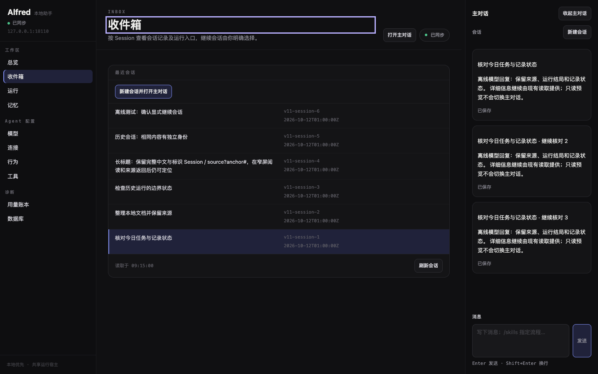 | 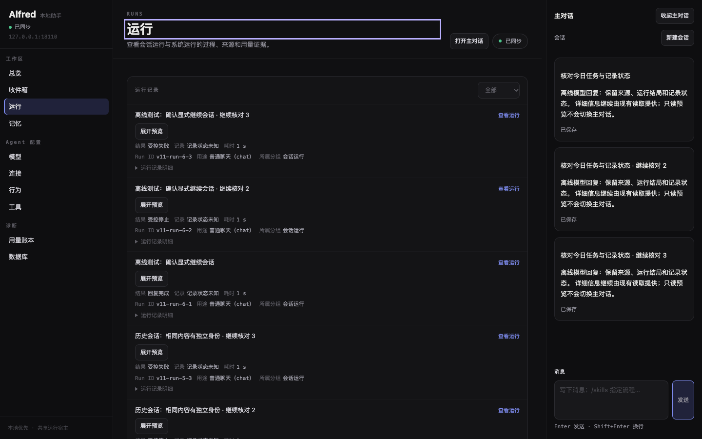 | 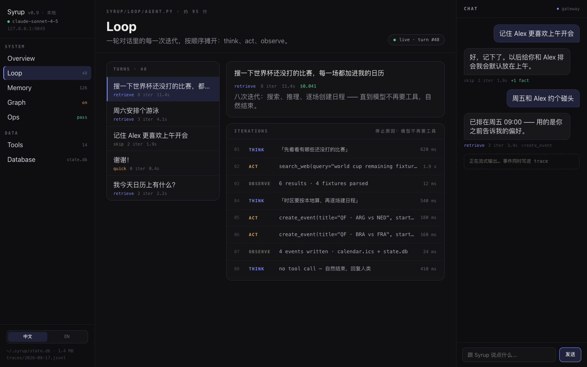 |
| 1280×800 | 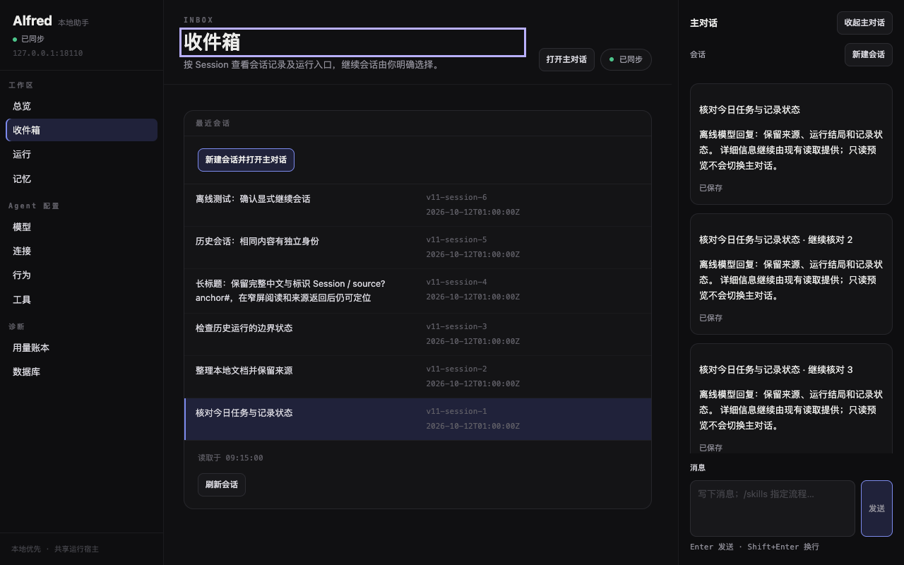 | 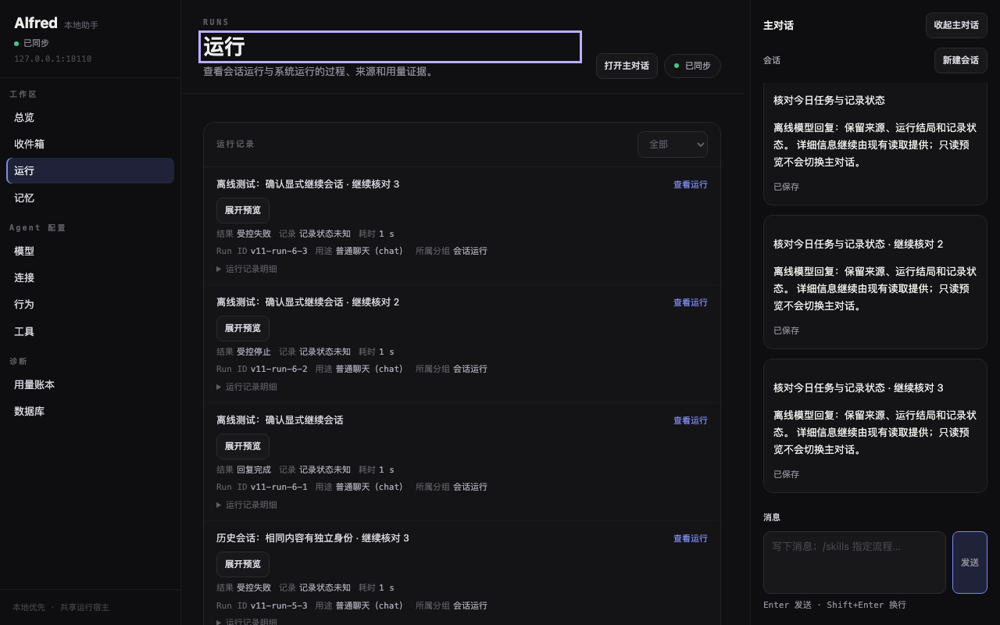 | 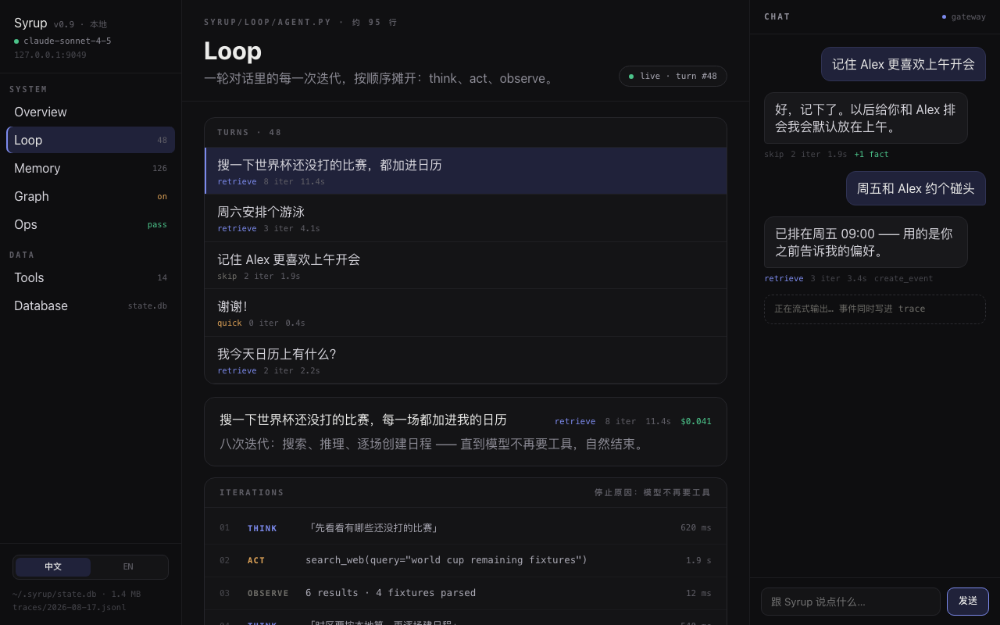 |
| 390×844 | 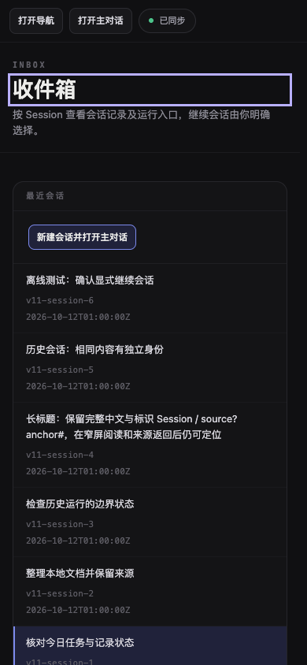 | 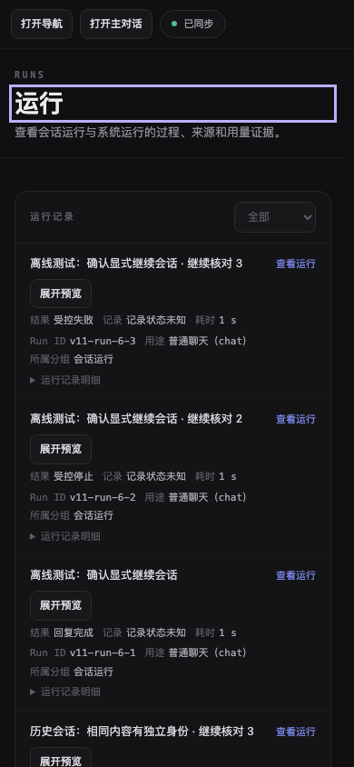 | 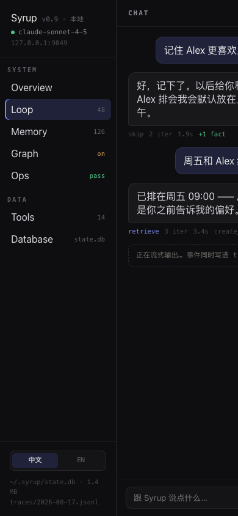 |
| 320×800 | 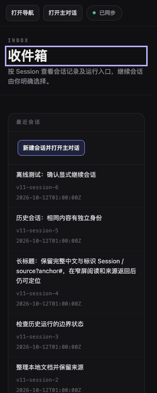 | 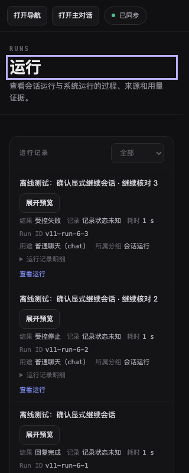 | 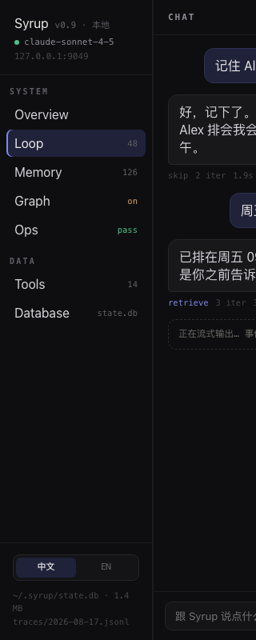 |

| 视口 | 逐项风格一致性、差异与原因 |
| --- | --- |
| 1440×900 | 收件箱与 V05 中央容器均 823px，面板底／边／14px 圆角、列表头 10.5px 等宽眉标、行正文 12.5px、元数据 11px 等宽、11×16px 行内边距及行分隔使用相同配方。CI 修复将收件箱操作区、读取控制区从 17×19px 收紧为 11×16px，与行和列表头对齐；V05 自己的面板控制区仍为原配方。Session 标题在左、身份和创建时间在右；V05 保留运行操作、状态和明细，行更高。原稿 Loop main 为 886px，另有运行详情栏；收件箱没有对应原稿详情视图，也没有新增并列数据读取。 |
| 1280×800 | 收件箱与 V05 中央容器均 663px，相同 gutter、头部和连续行层级。收件箱两个控制区各减少 12px 高度，行配方和选中样式不变。长 Session 标题可换行，身份和时间完整显示；选中底与 2px 左侧内嵌强调条一致。原稿 main 为 726px，仍是桌面三栏与 TURNS／详情分栏；Alfred 的业务信息与中文名称保留。 |
| 390×844 | 两页中央容器均 349px；收件箱正文与元数据转为纵向，按钮换行、局部竖向滚动、导航与 MainBar 保留既有开关。控制区采用 11×16px 内边距，按钮配方与窄屏换行保留；消息／来源／时间不省略。V05 也在窄屏换行，状态不截断；相同面板与行分隔继续适用。原稿 main 实测 0px，没有窄屏适配，不能据它删去 Alfred 的窄屏操作。 |
| 320×800 | 两页中央容器均 279px，收件箱长中文／标识在单列内换行，整页溢出为 0，元数据与真实状态可读。控制区收紧后按钮仍使用原按钮尺寸并正常换行，TURNS 行配方保持原样。V05 保留自己的运行明细折叠与操作。原稿 main 同样 0px，只显示导航和被裁切的主对话；这是原稿几何与 Alfred 既有窄屏合同的差异。 |

同一服务、同一固定时钟下，通过请求替换仅载入基线 `inbox-runs.css`，对 `/runs` 拍改动前后四组截图；DOM 可访问快照一致，四组 PNG 的原始字节和 SHA-256 完全一致，见 [runs-proof.json](evidence/V11/runs-proof.json)。此项取证双方都使用 `prefers-reduced-motion: reduce`，排除已同步壳层状态点的帧相位；没有修改生产 CSS 或壳层状态。`run-fields.js` 本次未改，此证明额外覆盖共享 CSS 的追加边界。

## 只读预览与会话运行

| 视口 | 消息预览与核验来源行 | 会话运行分区 |
| --- | --- | --- |
| 1440×900 | 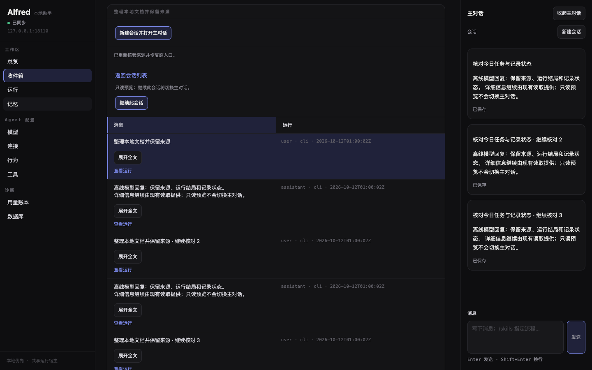 | 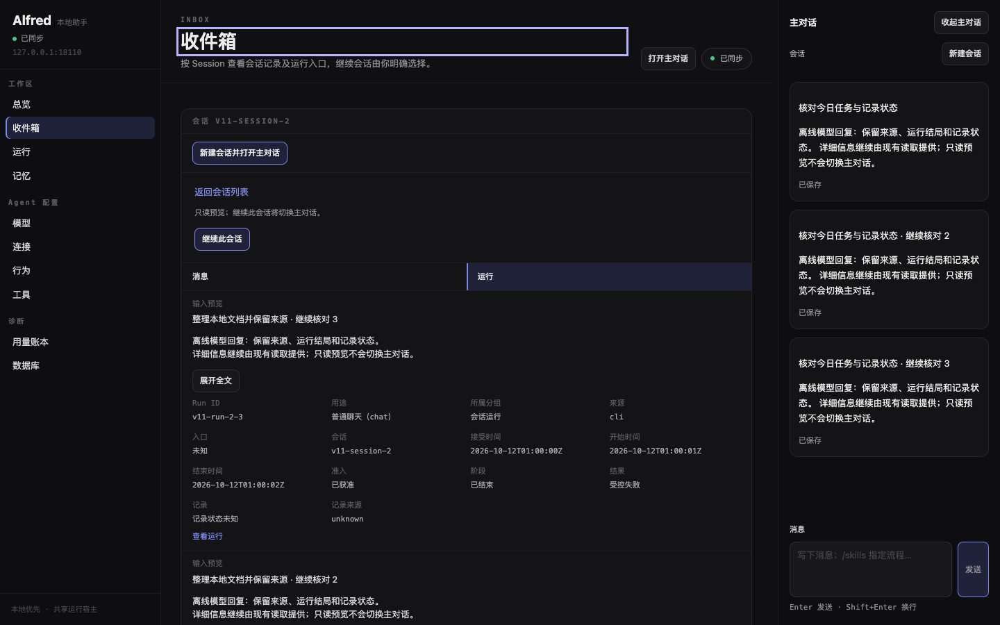 |
| 1280×800 | 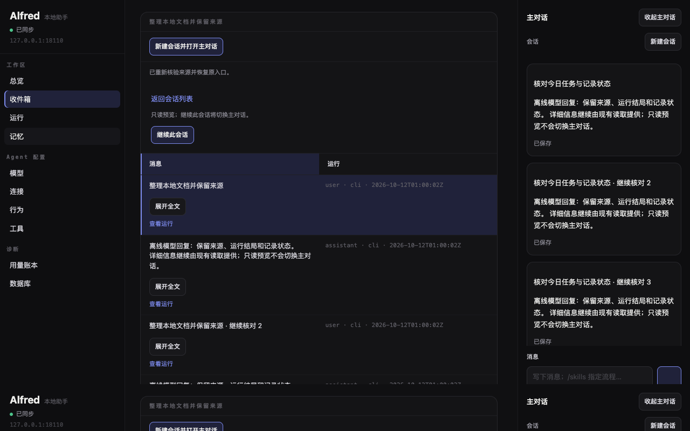 | 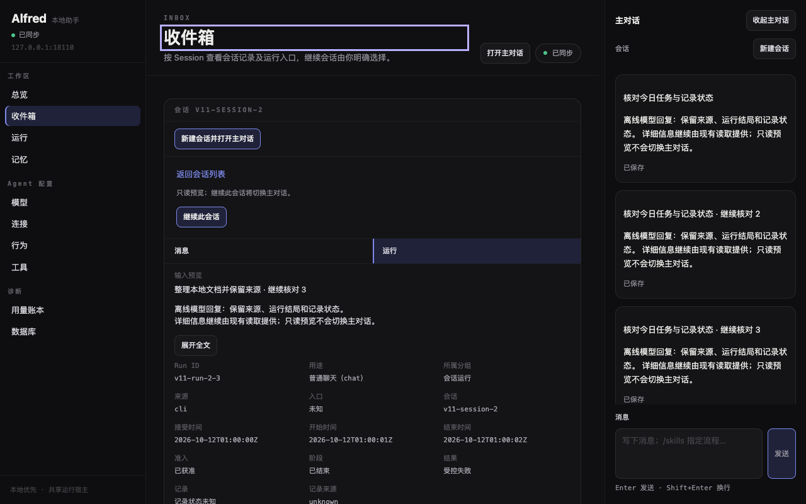 |
| 390×844 | 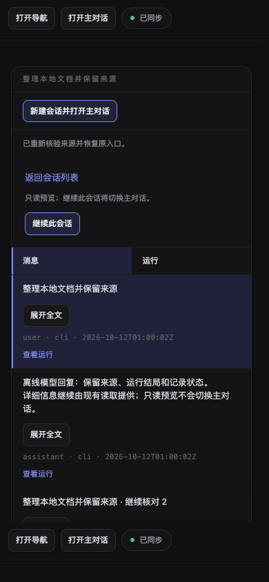 | 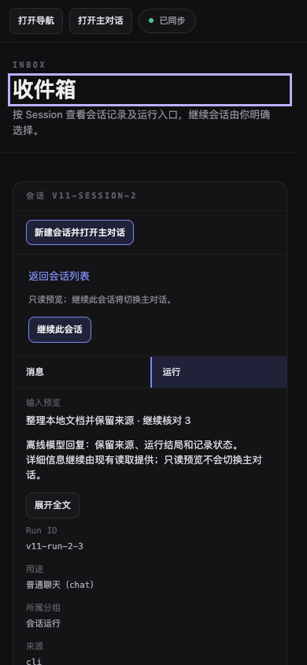 |
| 320×800 | 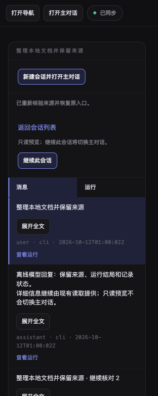 | 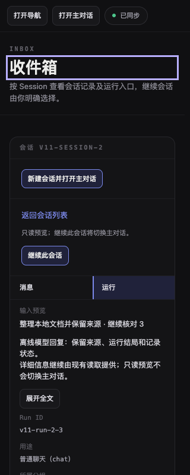 |

### 刻意偏离

1. 原稿没有收件箱，以 TURNS 的连续行层级套用 Session、消息与会话 Run。行高按真实字段与换行决定，不复制原稿演示数据、轮次、迭代数或费用。
2. Session 标题保留完整换行；消息保留已有截断／展开全文。角色、来源、时间和无 Run 关联文字保留。Run 分区的所有既有字段仍默认可读，字段较多时采用等宽自适应网格，因此比 V05 的简洁运行列表更高；没有折叠或删去关键状态。
3. 消息 DOM 阅读顺序改为正文预览、角色／来源／时间、运行入口；Run 输入预览移到正文区，其他字段留在原有 `dl` 中。这是正文加元数据的行配方所需重排，标题、region、按钮和链接可访问名称均不变。
4. 只读预览保留返回列表、明确继续、分区导航及来源恢复说明，位于列表前。新增会话与继续会话采用既有 `sy-button-accent`，读取与分页按钮采用基础按钮配方。
5. 已核验来源行的旧整行外轮廓由公共选中底与强调条替换；实际键盘焦点仍由公共 3px 轮廓表达，旧 `data-source-highlighted` 定位合同不变。截图中页头的外轮廓是实际导航焦点，属于已合入壳层行为。
6. 读取状态和刷新／分页按钮采用 V05 的同行布局，窄屏按现有 flex 规则自动换行。CI 首失败证明仅采用同行布局仍增加了 12px 页高；本次进一步把收件箱操作区和读取区内边距收紧为 11×16px，与行／列表头对齐，以降低短桌面窗口的滚动需求。回执、壳层和按钮规则不变。
7. 原稿归档文件在实际浏览器中行字号为 16px、标题为 32px；原稿 font 简写含 inherit，未形成预期行字级。Alfred 依批准的公共配方使用行正文 12.5px、标题 27px、元数据 11px，和 V05 一致；保留原稿实际截图并记录此差异，见 [reference-measurements.json](evidence/V11/reference-measurements.json)。
8. 保留原有窄屏面板与局部滚动，不复制原稿窄屏主区宽度为 0 的几何。不新增状态脉冲；只使用壳层已合入的真实已同步指示。

### 建议的公共配方

可由 #135 评估「正文预览 + 完整身份／来源／时间元数据 + 显式动作」的行组合，以及 `aria-current=page` 驱动的来源分区导航。当前仅在收件箱内组合现有配方，没有新增或重定义公共 `sy-` 类，没有修改 `RECIPES.md`。

## PR #146 的 CI 首失败与修复

[CI run 38223059161](https://github.com/nineofoursyrup/Agent-Alfred/actions/runs/38223059161) 对应 `421ee2a11039c0216410385445e882465a5e7d96`。Offline Dashboard browser tests 为 **544 passed / 1 failed**；唯一失败是 `session-create-race.spec.js:165` 的 1440×360 回执场景，第 196 行「打开已创建会话」在获得键盘焦点后可见比例为 `0.9881404042243958`。trace 在断言约 4 秒期间的 12 次观测均得到相同比例，SSE 在该期间连接，几何稳定；这是页高增加后整数滚动留下的亚像素裁切，不是偶发断连。失败截图中的断连提示发生在用例清理之后，不用它解释断言失败。原 `b80ad60` 的 macOS 本地通过不足以证明跨平台可见性。

通过 `gh run download 38223059161 -n browser-failure-evidence` 取回证据，仅归档 [失败用例目录](evidence/V11/ci-first-failure/session-create-race-a-dela-9c126-trols-reachable-at-1440x360/) 的原始 context、`test-failed-1.png`、`trace.zip`，以及 [完整 job 日志](evidence/V11/ci-first-failure/job-114723755305.log.json)。没有提交整个 artifact、其他用例目录或 artifact 压缩包。context 的代码空行和 job 日志分别含尾随空格；沿用既有无损 JSON 表示，保留完整原文与 SHA，可逐字节恢复，未删改失败内容或 whitespace 检查规则。成员及字节身份见 [manifest.json](evidence/V11/ci-first-failure/manifest.json)，12 次稳定观测见 [ci-trace-summary.json](evidence/V11/ci-repair/ci-trace-summary.json)。

本次生产差异只有 `inbox-runs.css` 两条 `.inbox-page` 声明：`.inbox-actions` 和 `.inbox-read-controls` 的 `padding` 都为 `calc(var(--gap-small) - var(--inbox-line)) var(--gap-large)`，实测 11×16px，替代继承的 17×19px。列表头、TURNS 行正文／元数据／选中底／强调条、按钮配方及 `inbox.js` 均不改。正式测试与所有断言、超时、重试保持原样；共享 CSS 的 8978 字节 main 前缀完全一致，见 [修复范围审计](evidence/V11/ci-repair/source-audit.json)。

测量使用同一个 [脚本](evidence/V11/ci-repair/scripts/layout.spec.js)、`overview_server.py` 离线服务、固定浏览器时钟 `2026-10-12T01:15:00Z` 和 1440×360 视口，只在诊断副本中记录几何，不改正式 spec。main／修复前通过路由替换两份收件箱资源，其他资源、服务与步骤一致；资源原文及 SHA 见 [diagnostic-resources.json](evidence/V11/ci-repair/diagnostic-resources.json)。

| 布局 | `#page.scrollHeight` | `#page.scrollTop` | 查看链接顶边 / 比例 | 打开按钮顶边 / 比例 |
| --- | --- | --- | --- | --- |
| `origin/main`，`449e77f` | 471px | 111px | 30.609375px / 1 | 20.609375px / 1 |
| 修复前，`421ee2a` | 483px | 123px | 18.609375px / 1 | 8.609375px / 1 |
| 本次修复 | 459px | 99px | 42.609375px / 1 | 32.609375px / 1 |

修复后总高度减少 24px，比 main 小 12px。两个焦点阶段分别保留 main／before／after 的六份 [原始测量 JSON 与汇总](evidence/V11/ci-repair/receipt-layout-comparison.json)。本地修复前也显示比例 1，因此本地是否通过不是这次修复的唯一依据；页高下界与远端实际 CI 共同验收。

四视口的收件箱、消息预览、运行分区已补拍并更新上方截图及差异表，修复前 12 张图片保留在 [screenshots-before](evidence/V11/ci-repair/screenshots-before/)；无整页横向溢出、行内样式为 0，只读预览仍保留 `v11-session-1`。同一服务与固定时钟下，V05 `/runs` 四对 PNG 仍逐字节一致，见 [修复后截图审计](evidence/V11/ci-repair/capture.json) 与 [Runs 一致性](evidence/V11/ci-repair/runs-proof.json)。原稿归档及 SHA 不变，其四视口截图沿用。

先运行未修改的 `session-create-race.spec.js` 全部场景（含四个回执视口）和五份收件箱相关 spec：**50 passed / 0 failed，52.05s**，见 [定向回归日志](evidence/V11/ci-repair/gates/ci-repair-targeted.json)。三组同脚本几何诊断各 1 passed；正式全量浏览器再次覆盖回执四个视口，没有修改正式测试。

八项门禁在冻结实现候选 `3c14a17af1647824c5f36c32526ec6d49971dcde` 上执行，全部日志先写 `.scratch/v11/`，结束后归档。随后仅追加结果与证据，不改实现、测试、依赖或配置；全部门禁输入 SHA 均与归档后源码一致，见 [修复门禁身份与结果](evidence/V11/ci-repair/final-results.json)。本轮八项门禁和定向回归均无失败。

| 门禁 | 修复结果 | 原始日志 |
| --- | --- | --- |
| `uv run ruff check` | PASS，退出码 0；0.10s | [01-ruff](evidence/V11/ci-repair/gates/ci-repair-01-ruff.json) |
| `uv run python scripts/check_skills.py` | PASS，退出码 0；0.06s | [02-skills](evidence/V11/ci-repair/gates/ci-repair-02-skills.json) |
| `uv run python scripts/check_env_example.py` | PASS，退出码 0；1.95s | [03-env](evidence/V11/ci-repair/gates/ci-repair-03-env.json) |
| `uv run --extra mcp pytest` | 6445 passed，0 failed，1 deselected，14 warnings；2564.64s | [04-pytest](evidence/V11/ci-repair/gates/ci-repair-04-pytest.json) |
| `npm run typecheck` | PASS，退出码 0；0.53s | [05-typecheck](evidence/V11/ci-repair/gates/ci-repair-05-typecheck.json) |
| `ALFRED_BROWSER_TEST_PORT=18110 npm run test:browser` | 545 passed，0 failed；737.53s | [06-browser](evidence/V11/ci-repair/gates/ci-repair-06-browser.json) |
| `git diff --check`、`git diff --check origin/main...HEAD` | PASS，退出码 0；0.28s（归档后含 staged 复核） | [07-diff-closeout](evidence/V11/ci-repair/gates/ci-repair-07-diff-closeout.json)，[实现候选 0.26s](evidence/V11/ci-repair/gates/ci-repair-07-diff.json) |
| `uv build && uv run python scripts/check_mcp_installations.py --output .scratch/v11/ci-repair/mcp-artifacts.json` | PASS，退出码 0；25.61s | [08-install](evidence/V11/ci-repair/gates/ci-repair-08-install.json)，[安装报告](evidence/V11/ci-repair/mcp-artifacts.json) |

辅助 CSS 作用域自查首次把原有注释包含在 selector 中而报 AssertionError；修正诊断解析器后同一源码通过，没有修改产品以绕过自查，见 [辅助命令原始记录](evidence/V11/ci-repair/source-scope-probe-first-error.json)。本次开始、完整门禁前及推送前均 fetch，`origin/main` 一直为 `449e77fd0ff814fb63f97a009c2435139a68686d`，无需 rebase。远端结论以修复后 PR 当前 HEAD 的 Offline Dashboard browser tests 为准。

## 修复前的本地门禁与首次失败（历史记录）

最终实现源文件与测试身份由 `source-audit.json` 绑定。门禁日志先写 `.scratch/v11/`，全部运行完成后再归档 JSON；`output` 保存原始 stdout/stderr，SHA 校验其字节，不在 pytest 期间修改候选文件。

| 门禁 | 当前候选结果 | 原始日志 |
| --- | --- | --- |
| `uv run ruff check` | PASS，退出码 0；0.19s | [01-ruff-r2.json](evidence/V11/gates/01-ruff-r2.json) |
| `uv run python scripts/check_skills.py` | PASS，退出码 0；0.15s | [02-skills-r2.json](evidence/V11/gates/02-skills-r2.json) |
| `uv run python scripts/check_env_example.py` | PASS，退出码 0；3.86s | [03-env-r2.json](evidence/V11/gates/03-env-r2.json) |
| `uv run --extra mcp pytest` | 6445 passed，0 failed，1 deselected；2924.75s | [04-pytest-r2.json](evidence/V11/gates/04-pytest-r2.json) |
| `npm run typecheck` | PASS，退出码 0；1.12s | [05-typecheck-r2.json](evidence/V11/gates/05-typecheck-r2.json) |
| `ALFRED_BROWSER_TEST_PORT=18110 npm run test:browser` | 545 passed，0 failed；882.95s | [06-browser-r2.json](evidence/V11/gates/06-browser-r2.json) |
| `git diff --check`、`git diff --check origin/main...HEAD` | PASS，退出码 0；0.26s（归档后复核） | [07-diff-closeout.json](evidence/V11/gates/07-diff-closeout.json)，[实现候选](evidence/V11/gates/07-diff-r2.json) |
| `uv build && uv run python scripts/check_mcp_installations.py --output .scratch/v11/mcp-artifacts.json` | PASS，退出码 0；29.79s | [08-install-r2.json](evidence/V11/gates/08-install-r2.json) |

最终门禁在实现候选 `b80ad60abd566b19cb667f42b2b0fd6e00e6e382` 执行；归档门禁后只更新证据文件，不修改实现、测试、依赖或配置。全部输入 SHA 与归档后的相同，见 [final-results.json](evidence/V11/final-results.json)。最终定向回归为 **65 passed（93.99s）**，覆盖五份指定 spec、会话竞争与壳层，见 [06-browser-repair-validation.json](evidence/V11/gates/06-browser-repair-validation.json)。21 份浏览器 spec 涉及 `/inbox`，全量仍运行全部 545 项。

首次完整浏览器轮为 **540 passed / 5 failed，1470.69s**，见 [06-browser-parallel.json](evidence/V11/gates/06-browser-parallel.json)。按原样隔离首失败用例，**2 passed / 3 failed，51.9s**，见 [06-browser-first-failures.json](evidence/V11/gates/06-browser-first-failures.json)。首次失败目录只保留各失败用例自己的原始 `error-context.md`（以 JSON 无损封存）、实际生成的失败 PNG 和 `trace.zip`，见 [首轮失败目录](evidence/V11/failures/06-browser-parallel/) 与 [原样复测失败目录](evidence/V11/failures/06-browser-first-failures/)；部分整体超时没有生成 PNG，不补造截图。

| 首失败 | 原样复测与处理 |
| --- | --- |
| Database worker row/column/byte boundary | 原样隔离复测通过；未改 Database 页面、Python 或断言。首次超时原因 UNKNOWN，最终全套再次覆盖。 |
| Memory exact legacy receipt scope | 原样隔离复测通过；未改 Memory 页面或断言。首次超时原因 UNKNOWN，最终全套再次覆盖。 |
| 会话回执 1440×360 | 当前布局稳定裁切链接上缘约 0.4px；同服务基线资源下通过。几何记录见 [当前](evidence/V11/receipt-layout-current.json)／[基线](evidence/V11/receipt-layout-baseline.json)／[修复](evidence/V11/receipt-layout-proposed.json)。读取区改为 V05 的状态与操作同行布局，四回执视口及真实 65 项回归均通过；未改壳层、回执或断言。 |
| Back 恢复收件箱滚动 | 老 `.card` 定位器不匹配本票行 DOM；仅改为 `.inbox-rows article`，原可见性、滚动阈值、延迟响应与焦点断言全部保留。 |
| Topology 1280px 完整文本 | 首次隔离仍超时，随后原样当前页面测试通过；未改 Behaviour、Topology 或断言。首次超时原因 UNKNOWN，最终全套再次覆盖。 |

基线诊断仅把两份收件箱资源换回 `449e77f`，三用例通过，见 [06-browser-baseline-diagnosis-r2.json](evidence/V11/gates/06-browser-baseline-diagnosis-r2.json)；它是定位辅助，不能代替最终门禁。辅助基线配置第一次因 WebServer cwd 错误退出 127，未运行测试，修正诊断配置的 cwd 后重跑；其原始命令输出保留，未把上轮结果目录误关联到该次运行。诊断脚本中的额外几何记录不改正式测试的断言或超时；路由诊断使用的基线／修复资源原文与 SHA 在 [diagnostic-resources.json](evidence/V11/diagnostic-resources.json) 中保留，不新增生产静态资源。

旧 Python 全套在已证明需要新 CSS 候选后主动中止，原始结果为 **1 failed / 2460 passed / 1 deselected，4094.76s，退出码 2**；中断前数据库取消清理用例曾得到 `cleanup=failed` 而非 `released`。该用例原样单独复测 **1 passed（8.17s）**，未改 Python 实现或断言，首次原因 UNKNOWN。旧轮不记为 PASS，最终候选重新执行完整 pytest；`requires_key` 用例按仓库配置默认排除，保持 1 deselected，不作为已运行验收。见 [04-pytest.json](evidence/V11/gates/04-pytest.json)、[04-pytest-first-failure.json](evidence/V11/gates/04-pytest-first-failure.json) 与 [python-interruption.json](evidence/V11/python-interruption.json)。

归档原始 context 后的首次 diff-check 因 Playwright 代码摘录中 `101 | ` 一类空行的尾随空格失败，见 [07-diff-archive-first-failure.json](evidence/V11/gates/07-diff-archive-first-failure.json)。不裁剪原始失败数据、不改 `.gitattributes` 或 whitespace 检查规则；`error-context.md.json` 保留完整 UTF-8 原文、字节数及 SHA-256，读取 `text` 后编码可逐字节恢复原 `error-context.md`。原始文件仍保存在 `.scratch/v11/failures/`，PNG 和 trace 原始字节不变。修正归档表示后最终工作区和分支 diff-check 均通过，见 [07-diff-closeout.json](evidence/V11/gates/07-diff-closeout.json)。

首次五份定向测试为 **33 passed（53.2s）**，见 [affected-browser.json](evidence/V11/affected-browser.json)；typecheck 与工作区 diff-check 同时通过。既有行为断言全部保留，未增加重试、未延长超时、未放宽断言。

取证补拍第一次桌面 `/runs` 对比在 1440／1280 各有一个像素差异，分别位于 `(1001,80)`／`(841,80)`，是壳层已同步状态点所在位置；可访问快照一致，两个窄屏 PNG 一致。原始两对 PNG 和差异坐标保存在 [capture-comparison-first-failure/record.json](evidence/V11/capture-comparison-first-failure/record.json)。两侧使用减少动效后，四组原始 PNG 完全一致，未修改任何壳层或运行页面规则。

减少动效的临时脚本首轮等待窄屏隐藏 MainBar 的可见「已保存」文字，30s 后超时；改为等待原有隐藏 region 的节点已挂载，不改变产品、正式测试断言或超时。原始输出见 [runs-proof-first-timeout.json](evidence/V11/runs-proof-first-timeout.json)。一次辅助 `gh issue view` 误把 `--comments` 与 `--json` 同时传入，命令未读取或写入 issue；随后改用 `--json labels,comments`，两票均无补充评论。

本地 Standards 与 Spec 自查均为 **0 项阻断发现**，是本地核对，不声称独立多代理评审，见 [review.json](evidence/V11/review.json) 与 [修复后复核](evidence/V11/spec-review-notes.json)。推送前已 `git fetch origin`，`origin/main` 仍为初始基线 `449e77fd0ff814fb63f97a009c2435139a68686d`，没有前进，无需 rebase；见 [pre-push-fetch.json](evidence/V11/pre-push-fetch.json)。

## 未执行的验收项

- 原生桌面真实 200% 缩放：NOT RUN。
- 中文输入法与真实软键盘：NOT RUN。
- iOS / Safari / 真机：NOT RUN。
- 真实 provider 与原生人工试用：NOT RUN；浏览器套件为离线模型与真实本地服务。
- #135 的整组最终视觉验收：NOT RUN，本票证据不代替该验收。
